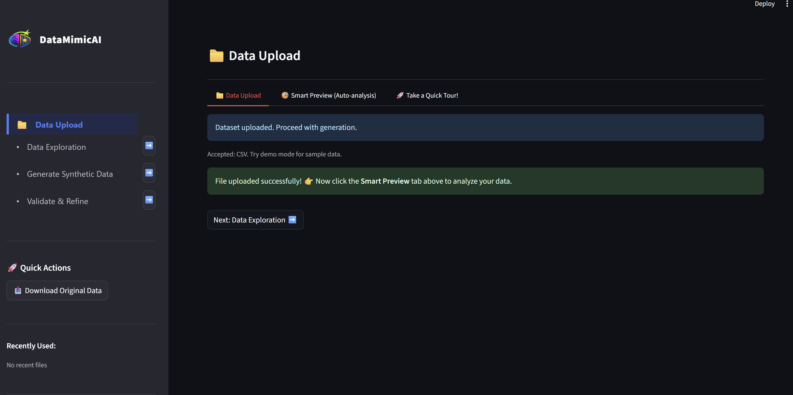
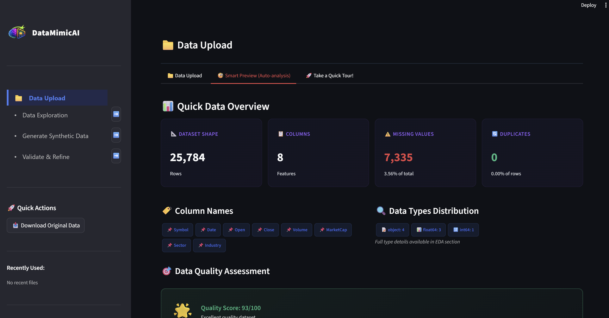
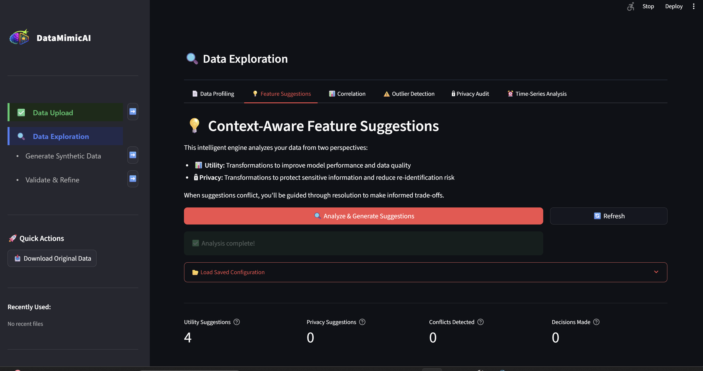
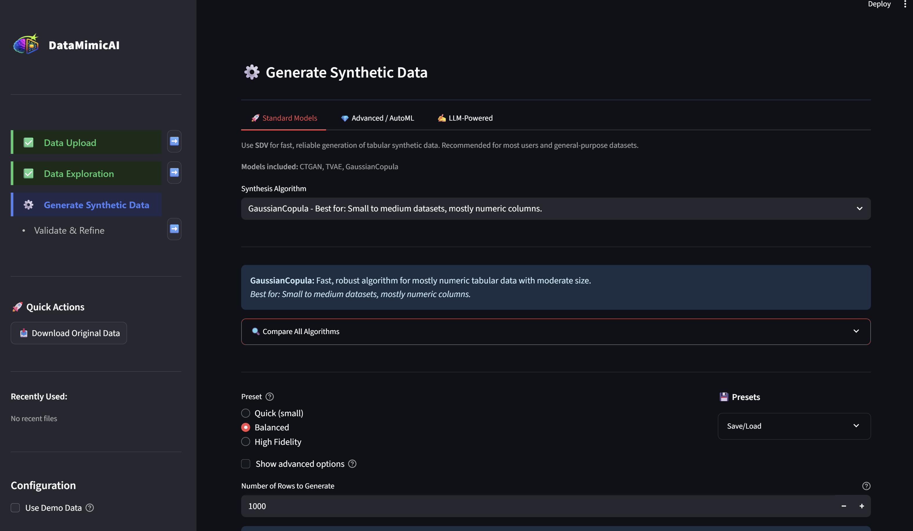
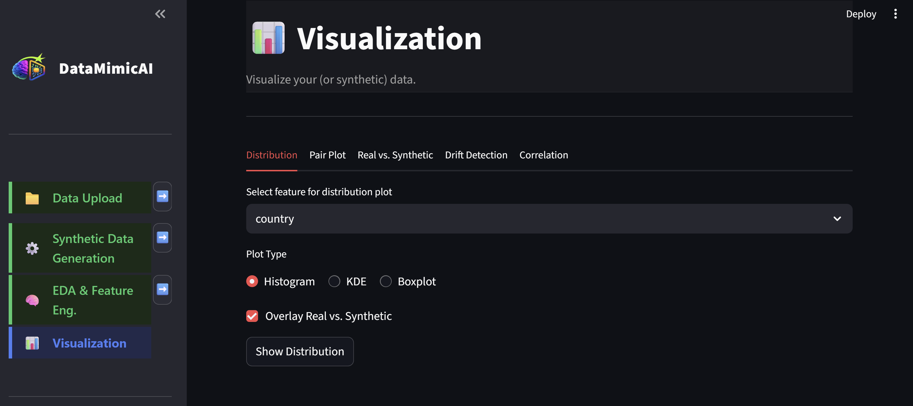

# DataMimicAI 🚀

**A Synthetic Data Platform for AI, Analytics, and Data Science**

> _Explore, generate, explain, and validate synthetic tabular and time-series data with SDV and SynthCity models, built-in privacy audits, and an AI assistant whose plans always need human approval. A guided four-step workflow takes you from upload to validation._


---

## 🌟 Overview

**DataMimicAI** is a no-code platform for **synthetic data generation** from **tabular and time-series CSV files**.

It's built for **data scientists, ML engineers, and analytics teams**, and lets them:

- Upload a CSV (or pick a demo dataset) and generate a synthetic version in a few clicks
- Profile, clean, and transform the data before generation, and export the transformations as Python code
- Audit the data for **PII, quasi-identifiers, and k-anonymity**
- Get **LLM explanations** of data diagnostics, plus transformation plans that a human must approve
- Compare 11 generators (SDV and SynthCity, including differentially private models)
- Check the synthetic data against the original with statistical tests, privacy checks, and side-by-side charts, then refine and regenerate

---

## 🧪 Why Synthetic Data?

| Benefit | What it enables |
| --- | --- |
| 🔐 **Privacy** | Work with realistic data that is generated, not copied, from the real records |
| 🧠 **More training data** | Add rows for small datasets or rare cases |
| 📊 **Safe testing** | Fill dev, QA, and demo environments without using production data |
| ⚡ **Faster iteration** | Prototype and share data without waiting for data-access approvals |

---

## 🖼️ Dashboard Preview

> Screenshots below are from the Streamlit UI.











---

## 🏗️ Architecture

```
┌──────────────────────────┐      ┌──────────────────────────┐
│  Next.js frontend (main) │      │  Streamlit frontend      │
│  frontend-next/  :3000   │      │  (legacy) frontend/ :8501│
└────────────┬─────────────┘      └────────────┬─────────────┘
             │          REST (JSON / CSV)       │
             └───────────────┬──────────────────┘
                             ▼
              ┌──────────────────────────────┐
              │  FastAPI backend  :8000      │
              │  backend/src/api             │
              ├──────────────────────────────┤
              │  core/eda        profiling, correlation, outliers, drift, PII, privacy, time-series
              │  core/feature_engineering   utility & privacy suggestions, conflict resolution
              │  core/synth      SDV + SynthCity generators, AutoML model comparison
              │  core/ai_assistance         diagnostics, LLM explanations, planner, approval gate
              │  core/execution  deterministic transformation engine
              │  core/validation before/after validation & decision reports
              └──────────────┬───────────────┘
                             ▼
              local uploads/ folder · Groq LLM API
```

**Two frontends, one backend.** The **Next.js 14 + TypeScript** app is the main UI and covers the full workflow, including AI Assistance (Agent Mode). The earlier **Streamlit** UI is still included and talks to the same FastAPI backend; it is what the Docker and Render setups run.

---

## 🧭 Key Features

### ✅ Guided Four-Step Workflow

**Upload → Explore → Generate → Validate**

- Steps unlock as you go: Explore and Generate need a loaded dataset, and Validate needs a generated one
- Wizard step indicator, sidebar navigation, **Ctrl+1–4** keyboard shortcuts, and a guard that warns before you leave a page mid-task
- Workspace state is saved in the browser, so a page refresh keeps your progress
- Onboarding tour for first-time users, and light/dark themes

### 📁 Step 1: Upload & Smart Preview

- Drag-and-drop CSV upload (header row required; 10 MB default limit in the browser), or **Demo Mode** with built-in SDV sample datasets
- Auto-detected column types, missing values, and basic statistics
- A data-health overview (missing values, duplicate rows, constant columns), a KPI banner, and a sortable data table

### 🔍 Step 2: Explore & Configure (EDA & Feature Engineering)

| Module | What it does |
| --- | --- |
| 📄 **Data Profiling** | Column types, missing values, unique counts, constant, duplicate and mostly-missing columns, and distribution fitting (best-fit distribution, skewness, kurtosis). One-click fixes: fill missing values, group rare categories, drop outlier rows, drop columns |
| 📊 **Correlation** | Pearson correlation heatmap, top correlated pairs, mutual-information matrix, and functional-dependency detection |
| ⚠️ **Outliers** | IQR, Z-score, MAD, Isolation Forest, and LOF detection; Cook's distance; remediation by capping, winsorizing, removing rows, binning, or log transform |
| 🔒 **Privacy Audit** | Fast and deep PII scans (Microsoft Presidio), quasi-identifier suggestions, and k-anonymity scoring |
| 💡 **Feature Suggestions** | Utility suggestions (log, square root, power, scaling) and privacy suggestions (redact, hash, mask, generalize, bin, suppress), with conflict resolution when both apply to the same column. Preview the impact, save and load configurations, export the code, and apply the accepted transforms at generation time |
| ⏰ **Time Series** | Auto-detection of date and value columns, ACF/PACF, seasonal decomposition, and time-series outliers |
| 🗂️ **Current Dataset** | The working data with recently changed columns highlighted, and **Reset to original** to undo all changes |

### 🤖 AI Assistance (LLM Explain + Agent Mode)

Available in both the Next.js and Streamlit UIs. **AI proposes, a human approves, and a deterministic engine executes.**

- **🔍 AI Diagnostics:** Builds structured diagnostics from EDA signals and explains them in plain language with **Groq-hosted LLaMA 3.3 70B**. You choose the focus (for example, a dataset overview or selected columns) and the tone. Explanations are grounded with rules from a YAML knowledge base (EDA, transformation, generator, and privacy rules)
- **Guardrails:** a baseline guard, signal selection, and an output validator that compares the numbers in the LLM's answer with the computed facts
- **🤖 Action Planner:** A rule-based planner maps the detected issue patterns to transformation plans, each with its rationale, assumptions, and risks
- **✅ Approval Gate:** Every plan is explicitly approved or rejected by a human; nothing runs automatically
- **⚙️ Deterministic Execution:** Approved plans run through a non-AI engine on a copy of the data, with status tracking and a before/after validation. The dataset used for generation is not modified
- **📄 Decision Report:** An auditable record of what was proposed, approved, executed, and why

> More detail: [backend/src/core/ai_assistance/docs/AI_Assistance_Module_README.md](backend/src/core/ai_assistance/docs/AI_Assistance_Module_README.md)

### ⚙️ Step 3: Synthetic Data Generation

- **Standard (SDV):** CTGAN, TVAE, GaussianCopula, PAR (sequential/time-series)
- **Advanced (SynthCity):** TabDDPM (diffusion), CTGAN, TVAE, PrivBayes, DP-GAN, PATE-GAN, ARF
- **AutoML comparison:** trains several SynthCity models on your data and compares them on four statistical distances (KS, Jensen–Shannon, Wasserstein, MMD)
- **Presets:** Quick (200 rows / 100 epochs), Balanced (1,000 / 300), High Fidelity (10,000 / 500), plus your own saved presets
- Parameters for rows and epochs, and sequence count and length for PAR
- An algorithm comparison table with guidance on when to use each model
- A memory check before SynthCity training, so a large job fails with a clear message instead of crashing the server
- Download the result as **CSV, JSON, or Parquet**

### ✅ Step 4: Validate & Refine

- **Quality Report:** fidelity, privacy, and utility gauges computed from per-column statistical tests (KS for numeric columns, chi-square for categorical columns) and two SDMetrics privacy checks (distance to the closest real record compared with a random baseline, and the share of synthetic rows that are not copies of real rows). The scores measure distribution similarity, not downstream model performance
- Real vs. synthetic summary metrics, per-column results, and a list of flagged issues
- **Recommendations** that regenerate in one click: train longer or less, switch generator, or generate more rows
- Download the quality report (Markdown) and the per-column metrics (CSV)
- **Visualizations:** distributions, pair plots, real vs. synthetic overlays, drift, and correlation charts
- **Iterative refinement:** regenerate with a new row count from the Validate page
- **Generation history:** every generation is saved as a version that you can compare, restore, or download. Export or import the whole session as a JSON file

---

## 🧰 Tech Stack

| Layer | Technologies |
| --- | --- |
| **Backend** | FastAPI, Uvicorn, Pandas, NumPy, SciPy, scikit-learn, statsmodels, distfit, ennemi, Plotly |
| **Synthesis** | SDV 1.17, SynthCity 0.2.12, Opacus (differential privacy), SDMetrics |
| **Privacy** | Microsoft Presidio, k-anonymity, quasi-identifier detection |
| **AI / LLM** | LangChain + Groq (LLaMA 3.3 70B), YAML rule knowledge base |
| **Storage** | Local `uploads/` folder (CSV files and versioned synthetic outputs) |
| **Frontend (main)** | Next.js 14, React 18, TypeScript, Tailwind CSS, shadcn/ui, TanStack Query & Table, Zustand, React Hook Form + Zod, Recharts |
| **Frontend (legacy)** | Streamlit, Plotly |
| **DevOps** | Docker, docker-compose, Render (`render.yaml`) |

---

## 🏁 Quickstart

### Prerequisites

- **Python 3.11** (the version used by the Docker image)
- **Node.js 18+** and npm (for the Next.js frontend)
- A **Groq API key**, required only for the AI Assistance features ([get one here](https://console.groq.com/))

### 1. Clone and configure

```bash
git clone https://github.com/MukeshKumawat0903/DataMimicAI-AI_Powered_Synthetic_Data_Generation_Platform.git
cd DataMimicAI-AI_Powered_Synthetic_Data_Generation_Platform
cp .env.example .env        # Windows PowerShell: Copy-Item .env.example .env
```

Add your LLM key to `.env`:

```env
GROQ_API_KEY=your_groq_api_key
```

### 2. Start the backend

```bash
cd backend
python -m venv .venv
# macOS/Linux: source .venv/bin/activate   |   Windows: .venv\Scripts\activate
pip install -r requirements.txt
uvicorn src.api.main:app --reload --host 0.0.0.0 --port 8000
```

API docs are then available at **http://localhost:8000/docs**.

### 3a. Start the Next.js frontend (recommended)

```bash
cd frontend-next
npm install
npm run dev
```

Open **http://localhost:3000**. The frontend uses `NEXT_PUBLIC_API_URL` (default `http://localhost:8000`) to reach the backend.

> 🪟 **Windows one-click:** `run_frontend_next.bat` starts the backend and the Next.js frontend in separate windows. It finds `backend\.venv` automatically and runs `npm install` on first launch.

### 3b. Or start the Streamlit frontend (legacy)

```bash
cd frontend
pip install -r requirements.txt
streamlit run app.py
```

Open **http://localhost:8501**. On macOS/Linux, `bash ./start.sh` launches the backend and Streamlit together.

### 4. Use it

Upload a CSV (or pick a demo dataset), then follow the steps: **Explore → Generate → Validate**.

---

## 🐳 Docker

The compose setup runs the **backend + Streamlit frontend**:

```bash
cp .env.example .env
docker-compose up --build          # dev: hot reload via docker-compose.override.yml
docker-compose up -d               # detached
docker-compose down
```

| Service | URL |
| --- | --- |
| Backend | http://localhost:8000 (health check: `/health`) |
| Streamlit | http://localhost:8501 |

See [README_DOCKER.md](README_DOCKER.md) for the full guide.

---

## ⚙️ Environment Variables

| Variable | Used by | Purpose |
| --- | --- | --- |
| `GROQ_API_KEY` | Backend | Enables LLM explanations in AI Assistance |
| `UPLOAD_DIR` | Backend | Where uploaded and generated files are stored |
| `LOG_LEVEL` | Backend | Logging verbosity (default `INFO`) |
| `BACKEND_LOG_FILE` | Backend | Optional path for a rotating log file |
| `CORS_ORIGINS` | Backend | Extra browser origins allowed to call the API, comma-separated (any `localhost` port is always allowed) |
| `SYNTHCITY_MIN_FREE_MEMORY_GB` | Backend | Free memory required before SynthCity training starts (default `2`) |
| `BACKEND_PORT` / `UVICORN_WORKERS` | Docker | Backend port and worker count |
| `NEXT_PUBLIC_API_URL` | Next.js | Backend base URL (default `http://localhost:8000`) |
| `NEXT_PUBLIC_MAX_UPLOAD_SIZE` | Next.js | Upload size limit in bytes, checked in the browser (default 10 MB) |
| `BACKEND_URL` / `API_URL` | Streamlit | Backend base URL |
| `STREAMLIT_SERVER_PORT` | Streamlit | Streamlit port (default `8501`) |

---

## 🔌 API Overview

The full interactive reference is at `/docs` (Swagger UI). Main route groups:

| Prefix | Purpose |
| --- | --- |
| `/upload`, `/load-demo`, `/generate`, `/evaluate_models`, `/visualize`, `/metrics`, `/health` | Core data, generation, model comparison, and validation |
| `/eda/*` | Profiling, correlation, outliers, drift, feature suggestions, transforms, PII, k-anonymity, time-series, downloads |
| `/feedback-generation/*` | Generation with accepted transforms, download, and version restore |
| `/llm/*` | LLM explanations and explanation scopes |
| `/api/diagnostics/*` | Build and interpret diagnostics |
| `/api/planner/*` | Transformation planning |
| `/api/approval/*` | Human review gate for plans |
| `/api/execution/*` | Deterministic plan execution and status |
| `/api/validation/*` | Decision reports and plan history |

---

## 🛠️ Project Structure

```
.
├── backend/                     # FastAPI service
│   ├── src/api/                 # Routers: main, eda_feature, llm, diagnostics, planner,
│   │                            #          approval, execution, validation, feedback
│   └── src/core/
│       ├── eda/                 # Profiling, correlation, outliers, drift, PII, privacy, time-series
│       ├── feature_engineering/ # Utility/privacy suggesters, conflict resolver
│       ├── synth/               # SDV & SynthCity generators, AutoML model comparison
│       ├── ai_assistance/       # Diagnostics, LLM explainability engine, YAML knowledge base,
│       │                        # planner agent, approval gate
│       ├── execution/           # Deterministic execution engine
│       └── validation/          # Before/after validation & decision reports
├── frontend-next/               # Next.js 14 + TypeScript frontend (main)
│   └── src/
│       ├── app/                 # Routes: /upload, /explore, /generate, /validate
│       ├── components/          # data, eda, ai, generation, validation, charts, wizard, layout, ui (shadcn)
│       ├── hooks/               # TanStack Query API hooks, shortcuts, navigation guard
│       └── lib/                 # API client, types, constants, Zustand workspace store
├── frontend/                    # Streamlit frontend (legacy)
│   ├── app.py
│   ├── helpers/                 # Upload, EDA, generation, validation, visualization modules
│   └── ui/                      # Action Planner & Decision Report UIs
├── docker-compose.yml           # Backend + Streamlit services
├── render.yaml                  # Render deployment config
├── run_frontend_next.bat        # Windows launcher: backend + Next.js
└── start.sh                     # Bash launcher: backend + Streamlit
```

---

## 🔐 License

**Copyright Notice:**
All code and documentation in this repository is Copyright (c) 2025 [Mukesh Kumawat]. All rights are reserved.

This project is published publicly for showcasing and educational purposes only. No legal license for reuse, copying, modification, or distribution is granted. Unauthorized use is prohibited.
