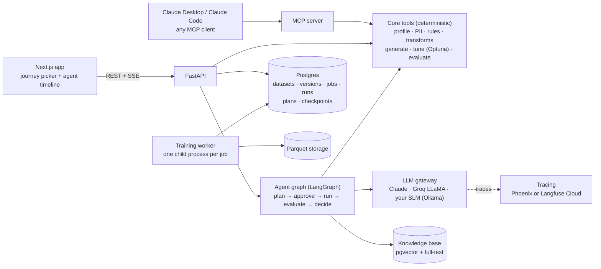
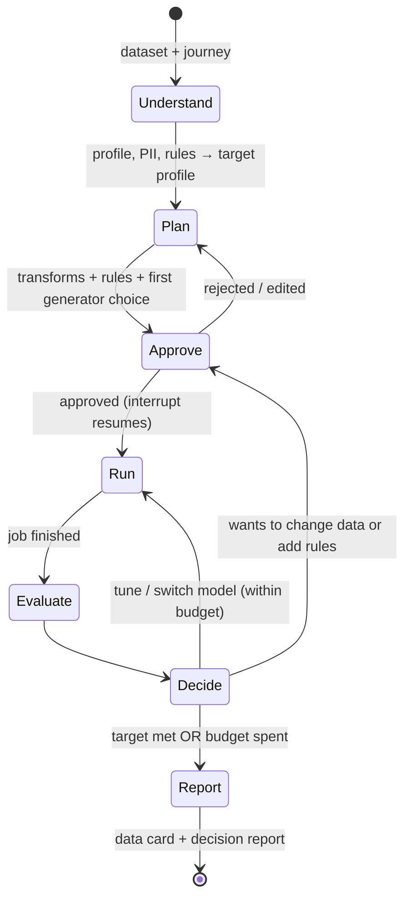

# DataMimicAI: Improvement Plan

> **Version:** 1.2 (2026-10-22; adds WS8, your own small language model; see §11 for all changes)
> **Branch at time of writing:** `feature/frontend-migration-nextjs`
> **Goal:** Make DataMimicAI (1) a project that holds up under an AI Engineer interview and (2) a tool people can actually use.
> **How to use this doc:** Read §1–§4 once. Work from §6 (roadmap) and §10 (checklist). §8 is your interview kit.
> **Reference style:** `§3` means a section of this doc; `WS3.2` means workstream 3, item 2 in §5.

---

## 1. The short version

**Verdict:** The data side is strong: broad EDA, 11 generators, a privacy audit, a guided UI, a working model-selection step and a good human-in-the-loop design. The **AI core is thin**, and that's exactly where an AI Engineer interviewer will dig:

1. The "AI agents" are deterministic rule tables. No LLM, no tool calls, no loop.
2. The "RAG" is an exact-match dictionary lookup over ~290 lines of YAML.
3. The one real LLM feature (explanations) has a fact check with holes. An offline probe showed it **lets invented statistics through** and can **show a provider error message to the user as if it were the explanation** (§3.2).
4. Nothing is **measured**: there are no evals, no benchmark, one test file and no CI.

**Recommendation:** Reposition the project as:

> **"An evaluated, human-in-the-loop AI agent that turns sensitive datasets into privacy-safe synthetic data and proves its quality with numbers."**

Do these six things, in this order:

| # | Do this | Why it matters |
|---|---|---|
| 1 | **Build the evaluation backbone first:** a synthetic-data scorecard (fidelity, utility, privacy) and an LLM/agent eval set | Without numbers, nothing else can be shown to work. Evals are the #1 skill interviewers probe in 2026 |
| 2 | **Fix the LLM layer:** structured JSON outputs where every claim cites a fact ID, typed errors, a provider abstraction, tracing | Closes the holes found in §3.2 and gives you a hallucination-rate metric |
| 3 | **Turn the rule-based "agents" into a real tool-calling agent**, keeping the rules as the fallback and baseline | A genuine agent, measured against your rules, your existing model selection and a hyperparameter-search baseline |
| 4 | **Add two LLM-native features:** business-rule discovery and enforcement, and natural-language-to-dataset | Things GANs can't do, useful in practice, each with a clear metric |
| 5 | **Train your own small language model (SLM):** fine-tune a 1–4B open model for rule proposal and cited explanations, and serve it locally | Private, fast, cheap inference for the strict-privacy mode, and a measured answer to "have you fine-tuned a model?" |
| 6 | **Productionize:** Postgres, a job queue, auth, CI, a live demo, an MCP server | Answers "how would this run for real users?" |

**Stop doing:** adding EDA widgets, adding generators, maintaining two frontends, and describing components as more than they are (§3.3).

**"Interview-ready" means all of these are true:**

- The public repo has green CI, visible docs, and a README with three tables: benchmark scorecard, eval results, model comparison.
- There's a live demo link and a 2-minute video.
- Every claim in the README and your interview notes matches the code.
- You can answer the §8.2 questions with your own numbers.

**Start here (first 2 days):**

1. Commit the 93 uncommitted changes in logical commits and merge the migration branch (WS6.9).
2. Do the honesty pass on the README and your interview notes (§3.3).
3. Fix the four leftover bugs (§3.2), and add the validator probe cases from §3.2 as your first tests.

---

## 2. Key decisions at a glance

| Area | Today | Change to | Why |
|---|---|---|---|
| **LLM provider** | Groq LLaMA 3.3 70B only, via LangChain | A thin `LLMClient` interface with three adapters: **Claude (`claude-opus-5-5`) via the official `anthropic` SDK** as the main model; **Groq LLaMA** as the low-cost baseline; a **local model** (your fine-tuned SLM from WS8, served by Ollama) for strict-privacy mode. Benchmark them, plus `claude-sonnet-5-5` / `claude-haiku-5-5` if cost matters, on your eval set and pick per task by the numbers | Strong tool use and structured outputs for the agent. Groq is still an outside service, so only a local model keeps data on the machine (your RTX 4050 can run a small one, §3.4) |
| **Own model** | None (API models only) | A **fine-tuned 1–4B open SLM** (QLoRA), served locally with Ollama or llama.cpp, for rule proposal and cited explanations, with Claude as the fallback (WS8). Optionally, an SLM-based tabular generator in the benchmark | Private and cheap for high-volume structured tasks; fine-tuning, quantization and local serving are core AI-engineer skills |
| **Orchestration** | None (one LLM call) | **LangGraph** state graph: approval via `interrupt()`, Postgres checkpointer. Nodes call your own `LLMClient`, not LangChain chat models. LangGraph 1.2.6 is already installed locally | Your approval gate maps directly onto `interrupt()`; checkpoints survive restarts |
| **Generator tuning** | Fixed parameters, plus model comparison (`select_best_model`) | An **Optuna** tool the agent calls. The LLM decides *what* to optimize and *when to stop or ask*; Optuna searches the numbers | The right tool for numeric search, and it heads off "why not just grid search?" |
| **LLM output** | Free text plus a heuristic number check | **JSON structured outputs** (Pydantic schema). Each claim cites `fact_id`s and is validated claim by claim. Provider failures raise typed errors | Exact grounding, a measurable "claim support rate", and errors can't reach users as text |
| **Retrieval** | Exact-match YAML lookup called "RAG" | Rename it to "rule grounding" now. Then build **real hybrid retrieval** (pgvector + Postgres full-text + reranker) over a corpus where retrieval matters, **with a retrieval eval** | Calling a dictionary lookup "RAG" is a credibility risk |
| **Evaluation** | Per-column KS/chi² + 2 sdmetrics privacy metrics | A **3-axis scorecard** (SDMetrics fidelity, utility tests matched to the user's goal, attack-based privacy) + benchmark + LLM evals with a dev/test split, in CI | "How do you know it works?" is the question that decides interviews |
| **State and storage** | CSV files named by UUID, `approvals.json`, in-memory dicts | **Postgres** (metadata, jobs, runs, plans, agent checkpoints, vectors) + **Parquet** files | One database for everything, multi-user safe, keeps lineage |
| **Long jobs** | Training runs inside the HTTP request | **Job table + worker + SSE progress**, with **each training job in a fresh child process** | Training takes minutes, and a child process releases all its memory when it ends (the B1/B2 crashes) |
| **Dependencies** | Loose `>=` pins; `runtime.txt` says Python 3.9.13 while Docker, Render and your machine use 3.11; local torch 2.3.0 breaks SynthCity's `torch<2.3` | A **lock file** (uv or pip-tools), **Python 3.11 everywhere**, a CUDA torch 2.2.x build for local GPU work | Reproducible installs. The `anthropic` 1.x SDK needs Python ≥ 3.10 |
| **Frontend** | Next.js + Streamlit | **Next.js only** (72/80 parity is already done) | Half the maintenance, one story |
| **Observability** | Log lines | **Arize Phoenix** locally (one process, OpenTelemetry) or **Langfuse Cloud's free tier**. Not self-hosted Langfuse v3, which needs ClickHouse, Redis and blob storage | Tokens, cost, latency and prompt version per call, without overloading a 16 GB laptop |
| **Integration** | REST only | REST + an **MCP server** | Lets Claude Desktop, Claude Code or any MCP client use DataMimicAI as a tool |

---

## 3. Honest assessment of today

### 3.1 What's genuinely strong (keep it and talk about it)

- **The human-in-the-loop design.** *AI proposes → human approves → a deterministic engine executes.* It's the right instinct for data tools and your best design story. The plan builds it out properly.
- **Fact-grounding intent.** The 6-step explain pipeline (signals → diagnostics → prompt → LLM → validator) shows you know LLMs must not invent numbers. The implementation has holes (§3.2), but the idea is right.
- **A real model-selection step.** [`select_best_model`](../../backend/src/core/synth/model_selection.py#L267) trains several SynthCity models and picks the best by an aggregate metric score. Calling it "AutoML-style model selection" is fair, and it becomes a baseline in WS3.3.
- **Broad deterministic analytics:** profiling, MI/dependencies, IQR/IF/LOF/Cook's, drift, Presidio PII, k-anonymity, ACF/PACF.
- **Real engineering war stories** from the parity audit (§8.3). These are worth more in an interview than any feature.
- **Next.js migration done properly:** typed API client, TanStack Query, Zustand, E2E-verified in a real browser.

### 3.2 What an interviewer will find weak

| What the README claims | What the code does | Evidence | The question you'll get |
|---|---|---|---|
| "AI Agents" (interpreter + planner) | Fixed pattern → transformation tables. No LLM call anywhere in `agents/` | [transformation_planner_agent.py:48](../../backend/src/core/ai_assistance/agents/transformation_planner_agent.py#L48) | "Where's the agent loop? How does it decide what to do next?" |
| "RAG knowledge base" | Exact string match on `issue_type`. The docstring says *"NO embeddings, NO vector DB, NO LLM"* | [retriever.py:5](../../backend/src/core/ai_assistance/explainability/rag/retriever.py#L5) | "Which embedding model? How do you chunk? How do you measure retrieval quality?" |
| "LLM explanations, validated against facts" | The number check **skips every number below 20 and every decimal below 100**, which is almost every statistic (skewness, correlations, p-values, most percentages). It flags the rest only if more than 50% don't match the facts within 5%. The scope check only looks for one keyword. If either check fails, the whole answer is thrown away and a statistics-only summary is shown | [output_validator.py:178-186](../../backend/src/core/ai_assistance/explainability/llm_explainability_engine/output_validator.py#L178-L186), [:223](../../backend/src/core/ai_assistance/explainability/llm_explainability_engine/output_validator.py#L223), [:226](../../backend/src/core/ai_assistance/explainability/llm_explainability_engine/output_validator.py#L226), [llm_api.py:315-337](../../backend/src/api/llm_api.py#L315-L337) | "What's your hallucination rate? How did you test the guardrail?" |
| LLM error handling | Provider errors come back as strings (`"Error: ..."`) and go through the validator like an answer. Some get through and would be shown to the user labelled `explanation_source: "llm"` (probe below) | [llama_inference.py:168-172](../../backend/src/core/ai_assistance/explainability/llm_explainability_engine/llama_inference.py#L168-L172), [llm_api.py:353](../../backend/src/api/llm_api.py#L353) | "What happens when the provider is down or rate-limits you?" |
| Synthetic data quality | KS/chi² per column + DCR/NewRowSynthesis. No ML utility test, no attack-based privacy, no holdout set, no benchmark across datasets | [main.py `/metrics`](../../backend/src/api/main.py#L612) | "How do you know the synthetic data is *useful* and *private*?" |
| Production-readiness | 1 test file, empty `.github/workflows/`, no auth (a `file_id` is the only thing protecting a dataset), plans held in memory, a 2,405-line router with 49 routes | [shared_state.py:27](../../backend/src/api/shared_state.py#L27), [eda_feature_api.py](../../backend/src/api/eda_feature_api.py) | "How would this run for 100 users? How do you deploy safely?" |

**Validator probe (run offline on 2026-10-22).** The probe loaded `output_validator.py` on its own, with sample facts of 1,000 rows, 8 columns, skewness 2.1 and 12.3% missing:

| Input text | Scope | Should be | Actually |
|---|---|---|---|
| "…skewness **9.87**, **45.6%** of values missing, a **0.99** correlation…" (all invented) | `diagnostics_overview` | Rejected | **Passed**: none of these numbers are checked |
| "Error during Groq inference: Connection error." | `diagnostics_overview` | Never shown | **Passed** and would be shown as the explanation |
| Missing-API-key error message | `column_analysis` | Never shown | **Passed**, because "environment *variables*" contains the scope keyword "variable" |
| "The dataset has **34,936** rows…" (facts say 1,000) | `dataset_overview` | Rejected | Rejected ✓ |
| "The dataset has **1,000** rows and 8 columns…" | `dataset_overview` | Passed | Passed ✓ |

An error message is rejected only when it happens to contain numbers (e.g. "Error code: 429"). The parity audit (B6) saw the real LLM answer rejected on its test data, but which check rejected it wasn't recorded. **Step one is to log the reason** (`get_validation_report()` is already computed in `llm_api.py` and then discarded). Turn these five rows into regression tests now (Phase 0); WS2 replaces the design.

**Leftover bugs** still in the code (listed in the March plan, not fixed yet):

- `/load-demo` raises `HTTPException("Data processing failed: ", 500, ...)` with its arguments in the wrong order ([main.py:274](../../backend/src/api/main.py#L274)).
- `target_column` defaults to the Titanic column `"Survived"` ([main.py:285](../../backend/src/api/main.py#L285), [main.py:411](../../backend/src/api/main.py#L411), [model_selection.py:94](../../backend/src/core/synth/model_selection.py#L94)).
- `DATA_CACHE` is written and never read ([main.py:174](../../backend/src/api/main.py#L174)).
- `/upload` has no size or type limit.
- Dependencies: `backend/runtime.txt` says `python-3.9.13`, but Docker, Render and your machine run 3.11. Locally, torch is `2.3.0+cpu` while SynthCity 0.2.12 requires `torch<2.3` (the Docker image correctly pins 2.2.2). `langgraph` and `sentence-transformers` are installed but not listed in `requirements.txt`.

**Repo hygiene problems:**

- `.gitignore` line 12 (`*docs`) matches the whole `docs/` folder: **0 files from `docs/` are on GitHub.** Some of the ignores look deliberate (your interview prep), and that's fine: interviewers shouldn't read your cheat sheet. But the architecture docs, benchmarks and design decisions should be public. See WS6.9 for the split.
- 93 uncommitted changes (69 modified, 24 new files) sit on the migration branch.
- 4 runtime metadata files are still tracked (parity audit B11).
- License is "All rights reserved". That's fine for a showcase, but nobody can legally use the tool. Decide deliberately (WS6.9).

### 3.3 Say this today (until the upgrades land)

In 2026 an interviewer hears "agent" as *an LLM choosing tools in a loop*, and "RAG" as *embedding search*. If yours are rule-based, saying so first is a strength; being caught out is not. Use these words in the README, `docs/interview/` and out loud, until the matching workstream ships:

| Instead of | Say | Until |
|---|---|---|
| "AI agents interpret and plan" (Quick Revision lines 27 and 180, README) | "A rule-based interpreter and planner, gated by human approval. I'm replacing the planner with an LLM agent; here's the design." | WS3 |
| "RAG knowledge base" (README) | "Rule grounding from a YAML knowledge base." | WS5 |
| "LLM explanations validated against facts" | "LLM explanations with a numeric fact check, which I found had holes and am redesigning around cited claims." | WS2 |
| "AutoML model selection" | Fine as is: it really compares models and picks one. | n/a |

Also check `docs/backend/06_AI_Agents_Pipeline.md` and `docs/backend/10_LLM_Agentic_AI_EDA_Workflow.md` for the same wording.

### 3.4 Your machine (checked 2026-10-22) and what it means

| Resource | Found | What it means for this plan |
|---|---|---|
| CPU | 16 logical processors | Fine for `--quick` benchmarks and the API |
| RAM | 15.6 GB total, **~2.0 GB free** when checked | The memory guard skips models below 2 GB free (B2). Close heavy apps before benchmarks, cap Docker's WSL2 VM memory (`.wslconfig`), and keep the stack light (one Postgres, no ClickHouse) |
| GPU | **NVIDIA RTX 4050 Laptop, 6 GB VRAM**, unused (torch is a `+cpu` build) | Install a CUDA build of torch 2.2.x in a dev environment (SynthCity needs `<2.3`) to train CTGAN/TVAE/TabDDPM on the GPU for `--full` benchmarks. Also enough to run a local LLM (3–4B parameters comfortably, 7–8B at 4-bit with short contexts) and QLoRA-fine-tune a 1–4B model (WS8). Do GPU work in a **separate training environment** with a current CUDA torch, so it doesn't clash with SynthCity's `torch<2.3`. Keep the Docker image CPU-only |
| Docker | Installed | Fine for Postgres (+ pgvector) and Phoenix |
| Ollama | Not installed | Needed for the local adapter (WS2.1) that serves your fine-tuned SLM (WS8) |

### 3.5 The positioning insight

Most LLM-agent portfolio projects **can't measure whether they work**. Synthetic data can: fidelity, ML utility, privacy risk and rule-violation rate are all numbers. That makes DataMimicAI an ideal vehicle for the skill AI Engineer interviews care about most: **building LLM systems that are evaluated, not run on vibes.** Build the whole plan around that.

---

## 4. Target product (north star)

> **Give DataMimicAI a dataset and a goal. An agent profiles it, finds privacy and quality risks, proposes fixes and business rules for you to approve, then trains and tunes generators until a target scorecard is met. It hands back the synthetic data with a *data card* that proves fidelity, utility and privacy.**

### 4.1 Three real user journeys

The user **picks the journey** in the UI, and the journey sets the target profile. The LLM may suggest adjustments but doesn't invent the target. That keeps the agent's goal explicit and testable.

| Journey | User says | Agent optimizes for | Target profile (example) |
|---|---|---|---|
| **Safe sharing** | "I need to share `customers.csv` with a vendor." | Privacy first, fidelity second | DCR share ≈ 50% (WS1.1), Anonymeter risks ≈ baseline, fidelity ≥ 0.80, TSTR gap ≤ 0.05 if a target column is given |
| **ML augmentation** | "I need more fraud examples to train my model." | Better minority-class performance on *real* test data | Augmentation uplift: training on real + synthetic minority rows must beat training on real only, **and beat random oversampling and SMOTE**, on PR-AUC and minority recall |
| **Test data from nothing** | "Give me 10k rows of an orders table for QA, with 3% refunds and peaks in Nov–Dec." | Schema validity and rule compliance | 0% rule violations; spec targets hit within tolerance |

**Scope of v1:** single tables. Time-series (PAR) stays in the manual workflow, and multi-table comes later. State this in the README.

### 4.2 Target architecture



The rule that doesn't change: **the LLM never changes data directly.** It only calls allowlisted tools. Anything that changes data or uses serious compute goes through a human approval interrupt and then the deterministic engine.

---

## 5. Workstreams

Each workstream lists **tasks**, **done when** (a measurable exit) and the **interview payoff**. Effort figures are rough *focused days* (about 6 hours of real work each).

### WS1: Evaluation backbone (do this first) · ~8 days

**WS1.1 Synthetic-data scorecard**, in a new module `backend/src/core/evaluation/`:

- **Holdout split and an explicit target column first:**
  - Hold back 20–30% of the real rows *before* training. Today generators train on all the data, which makes proper privacy and utility measurement impossible.
  - The target column is chosen by the user or inferred, never defaulted (this also fixes the `"Survived"` bug).
- **Fidelity:**
  - SDMetrics `QualityReport` (column shapes + column-pair trends). `sdmetrics` 0.21 is already installed with SDV.
  - Keep your KS/chi² per column for the drill-down.
- **Utility, matched to the journey (§4.1):**
  - **Sharing / general:** TSTR vs TRTR. Train a model on synthetic data and on real data, test both on the real holdout, and report the gap (AUC/F1, or R² for regression). Add the rank correlation of feature importances.
  - **Augmentation:** *augmentation uplift*. Train on real + synthetic minority rows vs real only, test on the real holdout. Report **PR-AUC** (ROC-AUC flatters imbalanced data) and minority recall. Compare against random oversampling and **SMOTE** (`imbalanced-learn`). If SMOTE wins, say so: that's an honest, interesting result.
  - Use scikit-learn `HistGradientBoosting*` as the model (no new dependency).
- **Privacy:**
  - **DCR share:** for each synthetic row, is it closer to a training row or to a holdout row? Use equal-sized training and holdout samples, so ≈ 50% means no memorization; well above 50% means the generator is copying.
  - NNDR, `NewRowSynthesis`, and **Anonymeter** attacks (singling-out, linkability, attribute inference) with the holdout as the control set.
  - **Be precise about what this proves:** empirical attacks can *show* risk but can't *prove* privacy. Only the differentially private models (DP-GAN, PATE-GAN, PrivBayes) give a formal bound. Show their ε on the data card, along with the fidelity they cost.
- **Fairness drift** (cheap, optional): for a sensitive attribute (Adult has `sex`, `race`), compare subgroup proportions and positive-outcome rates between real and synthetic. Synthetic data can amplify bias, and this question comes up in responsible-AI interviews.
- **Rules:** violation rate for verified business rules (WS4.1).
- **Output:** one JSON scorecard with sub-scores, plus a pass/fail against the journey's target profile. The Validate step and the agent both read this.

**WS1.2 Benchmark harness**, `backend/benchmarks/run_benchmark.py`:

- **Datasets:**
  - UCI Adult (classification, the standard benchmark, has sensitive attributes).
  - A credit-card-fraud subsample (heavily imbalanced, for the augmentation journey).
  - California Housing (regression).
  - The NASDAQ demo for PAR (sequences, outside the v1 agent).
- **Generators:** GaussianCopula (baseline), CTGAN, TVAE, TabDDPM, plus one differential-privacy model.
- **Rigor:** 3 seeds each, reporting mean ± std, training time and peak memory. Record the seed and git commit with every result.
- **Modes:**
  - `--quick`: small rows/epochs, CPU-only, so CI can run it.
  - `--full`: run on your GPU (§3.4).
- **Output:** a Markdown table in `docs/benchmarks/`, summarized in the README. The timings also feed the cost estimator (WS3.5).

**WS1.3 LLM / agent eval set**, `backend/evals/`:

- **Issue-injection generator.** Take 5–6 clean base datasets and programmatically inject known problems:
  - skew, outliers
  - MCAR/MNAR missingness
  - duplicate rows, constant columns, mixed date formats
  - **PII columns** (emails, phones, names via Faker, already a dependency)
  - a **target-leakage** column, high-cardinality ID columns
  - **broken business rules** (e.g. `end_date < start_date` in 4% of rows)

  You get ground-truth labels for free. Aim for ~40–60 cases.
- **Add ~10 real messy public datasets** that you label by hand. Injected issues are cleaner than real ones, and this checks the eval isn't too easy.
- **Split into dev and test.** Tune prompts on dev only; report test results, which you never tune on. Otherwise you're overfitting to your own eval, and interviewers ask about this.
- **Metrics:**
  - Deterministic detection precision/recall per issue type (your EDA layer).
  - **Claim support rate** of explanations (WS2.3).
  - Plan coverage: does the plan address each injected issue, and does it propose anything harmful?
  - Agent task success: target scorecard reached within budget.
  - Tool-call validity.
  - Cost, latency and tokens per run.
- **Statistics:** with 20–60 cases, a 10-point difference can be noise. Compare systems on the *same* cases (paired) and report confidence intervals (bootstrap is fine).
- **LLM-as-judge** only for subjective qualities (clarity, usefulness), using a written rubric. **Calibrate it:** label ~30 outputs yourself and report how often the judge agrees with you. Use a different model as judge than the one being judged where you can.
- **Keep evals cheap and repeatable:**
  - Record and replay LLM responses in CI.
  - **Cache generator runs** by (dataset version, model, params, seed), so agent evals measure *decisions*, not training time.
  - Add the §3.2 probe cases as regression tests.

**Done when:** `python -m benchmarks.run_benchmark --quick` prints a table; `python -m evals.run --split test` writes a report with the metrics above and confidence intervals; the README shows both.

**Interview payoff:** You can answer "how do you evaluate an LLM feature?", "how do you know synthetic data is private/useful?" and "how did you avoid overfitting your eval?" with **your own numbers**.

---

### WS2: LLM layer: structured, cited, observable · ~5–6 days (WS2.1 is in Phase 0)

**WS2.1 Provider layer** (`backend/src/core/llm/`):

- An `LLMClient` protocol with three adapters:
  - `AnthropicClient`, using the official `anthropic` Python SDK. It isn't installed yet, and the 1.x SDK needs Python ≥ 3.10.
  - `GroqClient`.
  - `LocalClient` (Ollama or llama.cpp), for strict-privacy mode. It serves your fine-tuned SLM from WS8.
- **Typed exceptions** in place of `"Error: ..."` strings. The API returns a clear 502/503, so an error can never reach the validator or the user as text.
- Timeouts, retries (the Anthropic SDK already retries 429/5xx) and a fallback provider.
- **Check at startup** that configured model IDs still exist. The current docstring lists Groq `-preview` models, and hosted models get retired.
- Per-call accounting: model, input/output tokens, cache hits, latency, cost. All model settings in one config file.

Notes for Claude:

- On `claude-opus-5-5`, set `output_config.effort` explicitly (it defaults to `medium`). Thinking can't be disabled; lower the effort for cheap calls instead.
- Forcing a specific tool with `tool_choice` isn't supported. Use `tool_choice: auto` + `strict: true` on tools, or structured outputs.

**WS2.2 Structured, cited outputs.** Replace free text with a schema:

```json
{
  "summary": "string",
  "sections": [
    {
      "title": "Distribution issues",
      "claims": [
        { "text": "Income is heavily right-skewed (skewness 3.4).", "fact_ids": ["col.income.skew"] }
      ]
    }
  ],
  "suggested_next_steps": [{ "action": "log_transform", "columns": ["income"], "fact_ids": ["col.income.skew"] }]
}
```

- The prompt gives the LLM a **facts table keyed by `fact_id`**, not prose.
- Use Pydantic models with `client.messages.parse()` / `output_config.format` on Claude. On Groq and local models, use JSON mode + Pydantic validation + one repair retry that feeds the validation error back.

**WS2.3 Rewrite the validator** ([output_validator.py](../../backend/src/core/ai_assistance/explainability/llm_explainability_engine/output_validator.py)):

- Check **per claim**:
  - every cited `fact_id` must exist;
  - **every** number in the claim must match a cited value, whatever its size (no skip rules);
  - derived numbers are allowed only through declared operations (percent, ratio, rounding).
- Replace the keyword scope check with the schema: claims may only cite facts that belong to the requested scope.
- **Drop unsupported claims instead of the whole answer**, and show the user which claims were removed.
- Metric: **claim support rate** (supported claims ÷ all claims), tracked in WS1.3.
- UI: hovering a claim shows its source facts.
- The §3.2 probe rows are the first tests: invented statistics are rejected, and errors never get here.

**WS2.4 Privacy and safety of LLM inputs** (essential for a privacy product):

- Send the LLM **only aggregates and profiles, never raw rows**. Columns flagged as PII are referenced by name and type only.
- **Aggregates can leak too.** The max of `salary` can be the CEO's salary, and a category with a count of 1 identifies a person. Suppress categories with fewer than *k* rows (e.g. 5), and send rounded quantiles instead of exact min/max for sensitive numeric columns.
- When the LLM needs example values (e.g. to infer a date format), take them only from non-PII columns, or from a quick synthetic sample.
- **Strict mode uses the local adapter.** Groq and Claude are both outside services, so only a local model keeps everything on the machine.
- **Treat column names and cell values as untrusted input.** A CSV column called `ignore_previous_instructions` is a real prompt-injection attack. Put data in clearly delimited blocks and tell the model it is data. The agent can only call allowlisted, schema-checked tools, and anything that changes data needs approval, so even a successful injection can't do damage.

**WS2.5 Prompt caching and versioning:**

- Keep the system prompt and tool definitions byte-stable and first; put per-request facts last.
- Check `usage.cache_read_input_tokens` to confirm cache hits.
- Store prompts as files (`backend/src/core/llm/prompts/*.md`) and log the prompt version on every call.

**WS2.6 Tracing:** instrument LLM calls and agent steps with OpenTelemetry and send them to **Arize Phoenix** (one local process) or **Langfuse Cloud's free tier**. Show cost per agent run. Skip self-hosted Langfuse v3; its ClickHouse + Redis + blob-storage stack is too heavy for this laptop (§3.4).

**Done when:** on the WS1.3 test split, the claim support rate is ≥ 95%, invented statistics are caught, and no provider error reaches a user.

**Interview payoff:** "How do you stop hallucinations?" → *"I tested my first guardrail with crafted inputs, found it let invented statistics through, and replaced it with cited structured outputs and per-claim validation. The support rate is now X%."*

---

### WS3: A real agent · ~12–14 days (plus WS6.1–6.3, which it needs)

**WS3.1 Tools.** Wrap existing core functions as typed tools (Pydantic input schemas, `strict: true`):

- Tools return **compact JSON summaries, not DataFrames**, to keep context small.
- Failures come back as error tool results (`is_error`), so the agent can recover instead of crashing.
- Tools are idempotent: the same inputs return the cached result.

| Tool | Wraps | Changes data? | Needs approval? |
|---|---|---|---|
| `profile_dataset` | `core/eda/profiling.py` | No | No |
| `scan_pii` / `assess_k_anonymity` | `core/eda/pii_scan.py`, `privacy.py` | No | No |
| `propose_rules` / `verify_rules` | new (WS4.1) | No | No |
| `propose_transform_plan` | LLM planner (rule planner as fallback) | No | No |
| `apply_transform_plan` | `core/execution/deterministic_execution_engine.py` | **Yes** (new dataset version) | **Yes** |
| `train_generator(model, params)` | `core/synth/*` as a background job | No (new artifact) | **Yes** if estimated cost > N minutes |
| `tune_generator(model, search_space, budget)` | new: Optuna over `train_generator` + `evaluate` | No | **Yes** (always costs compute) |
| `evaluate(run_id)` | WS1.1 scorecard | No | No |
| `search_knowledge(query)` | WS5 | No | No |
| `compare_runs(run_ids)` | run history | No | No |

**WS3.2 The graph** (LangGraph, with a Postgres checkpointer):



- **Human approval = LangGraph `interrupt()`.** Paused runs are checkpointed in Postgres, so approval can come hours later and survives restarts. This replaces `shared_state.submitted_plans` and `workspace/approvals.json`.
- **Decide node:** the LLM sees *scorecard vs target + run history* and picks from a **bounded action set** (accept, tune, switch model, propose rule, propose transform, stop), giving a reason that cites scorecard fields. Numeric searches go to `tune_generator`; the LLM doesn't guess learning rates.
- **Hard caps:** max iterations, compute minutes and token/cost budget per run. When a cap is hit, the agent stops and reports the best run so far. It never just runs out.

**Why a graph and not a free-roaming agent?** The overall workflow is known; only the *decisions inside it* need judgment. A bounded graph is cheaper, testable and auditable. **Why not multi-agent?** One agent plus deterministic tools covers the job. More agents add cost and failure modes, with no measured benefit to justify them.

**WS3.3 Baselines.** Measure the agent against four baselines:

1. Your **rule-based planner**, which also stays as the fallback when no LLM is available.
2. Your existing **`select_best_model`**.
3. **"Always CTGAN, 300 epochs".**
4. **Optuna alone with the same compute budget.**

Be honest about the result. If the agent can't beat compute-matched Optuna on scorecard numbers, its value is in what Optuna can't do: understanding the goal, proposing rules and transforms, explaining trade-offs, and knowing when to ask a human. Report that clearly. It's still a strong story.

**WS3.4 Run memory:**

- Store every run: dataset fingerprint (schema + profile summary), model, params and scorecard.
- At the Plan step, retrieve runs on *similar* datasets to warm-start the generator choice ("TVAE won on 4 of 5 small mixed-type tables").
- Measurable: first-try success rate with memory vs without.

**WS3.5 Cost estimator.** Predict training minutes from rows × columns × epochs × model, fitted on the WS1.2 benchmark timings. The approval threshold and budgets use it, and the UI shows "≈ 6 min" before you approve.

**WS3.6 UI:**

- A **journey picker** at the start (§4.1).
- An "Agent run" timeline streamed over SSE (`@microsoft/fetch-event-source` is already a dependency, currently unused).
- Approve / reject / edit buttons at interrupts, and a live scorecard.
- Exports: decision report (exists) and a new **data card**, following the shape of *Datasheets for Datasets* / Google's *Data Cards*. It covers the generator, params, rules enforced, scorecard, DP ε where used, and privacy caveats.

**Done when:** on ~20 eval tasks (dataset + journey), you can report:

- the agent's success rate within budget, with confidence intervals;
- the paired comparison against the 4 baselines;
- median cost and time per run.

**Interview payoff:** A real agent with tools, human-in-the-loop interrupts, checkpointing, budgets, memory and an honest, compute-matched comparison against baselines.

---

### WS4: LLM-native features (the differentiators) · ~8–10 days

#### WS4.1 Business-rule discovery and enforcement ⭐ flagship

**The problem:** CTGAN/TVAE/TabDDPM routinely produce rows that break business logic: `end_date` before `start_date`, `total ≠ price × qty`, a 7-year-old with a mortgage, `status = closed` with no `closed_at`. Real users reject synthetic data for exactly this.

**The flow:**

1. **Propose (LLM).** The LLM sees the schema, column profiles and value patterns (aggregates only, WS2.4) and proposes candidate rules in a small DSL, via structured output. Rule types:
   - inequality (`a <= b`)
   - range
   - fixed combinations (city ↔ state)
   - formula (`total == price * qty ± ε`)
   - format/regex
   - conditional (`if status == "closed" then closed_at is not null`)
   - uniqueness
2. **Verify (deterministic)** on the real data. *The LLM proposes; the data decides.*
   - **Support ≥ 99.5%:** a rule.
   - **95–99.5%:** "likely a rule, but the real data breaks it." Show the violating rows as a **data-quality finding** and let the user decide (real data is dirty).
   - **Below 95%:** dropped.
3. **Filter trivial rules.** Rank rules by how often a **baseline generator (GaussianCopula) violates them**. A rule the baseline never breaks adds nothing; `age < salary` "holds" only because of scale.
4. **Confirm (human).** The user ticks which rules to enforce.
5. **Enforce:**
   - Map rules to SDV's built-in constraints where possible (Inequality, ScalarRange, FixedCombinations, …).
   - For SynthCity models and unsupported rule types, use reject sampling, then deterministic repair.
6. **Measure.** Report the violation rate before vs after, and the fidelity cost of enforcing.

**Example headline:** *"CTGAN violated 1+ rules in 7.2% of rows; with enforcement, 0%, at a fidelity cost of 0.01."*

**Why it's strong for interviews:** It shows the pattern *LLM proposes → deterministic check verifies → human approves*, which is how you make LLMs safe in production. It also has a clear before/after metric.

#### WS4.2 Natural language → dataset (cold start)

- The user describes a dataset. The LLM produces a **typed spec**, not rows: columns, types, distributions, correlations, categorical frequencies, rules, time patterns.
- Make the spec a **superset of SDV's metadata JSON**, so the same spec can later drive SDV training.
- A **deterministic sampler** turns the spec into data (Faker + numpy + Gaussian copula for correlations), seeded and reproducible.
- A **spec-conformance check** confirms the targets were hit ("refund rate 3.0% ± 0.3%"). The agent can repair the spec and regenerate.
- **Why "LLM as compiler, not generator":** having an LLM write 10k rows is slow, expensive and statistically poor. Having it write a spec is cheap, reproducible and checkable.

#### WS4.3 (Stretch) LLM-generated text columns

Generate free-text fields (support-ticket text, clinical-note snippets) **conditioned on the already-generated tabular row**, so the text agrees with the category, sentiment and dates. Use the Message Batches API for volume. Evaluate consistency with a small classifier: does the text predict its own row's category?

#### WS4.4 Small language model as a tabular generator → moved to WS8 Track B

Training your own model is now a full workstream (WS8).

---

### WS5: Real retrieval (or an honest rename) · ~5–6 days

**Now (1 hour):** rename the current module and docs from "RAG" to **"rule grounding"** (§3.3). It's a good deterministic design; just call it what it is.

**Then build real retrieval only where it earns its place:**

- **Corpus:**
  - SDV and SynthCity docs.
  - Key papers: CTGAN/TVAE, TabDDPM, PATE-GAN, DP-SGD.
  - De-identification guidance: GDPR Recital 26 (anonymous data), the HIPAA Safe Harbor 18 identifiers, NIST SP 800-188.
  - Your existing YAML rules.
  - Your own past run reports and data cards.

  Store the **source URLs and a fetch script**, not copies of the documents, which may be licensed.
- **Pipeline:**
  1. Chunk by heading (~300–500 tokens, keeping the section path as metadata).
  2. Embed with a local `sentence-transformers` model (already installed: free, private) and store in **pgvector** (same Postgres).
  3. Keyword search with Postgres full-text.
  4. Fuse the two result lists with **reciprocal rank fusion**.
  5. **Rerank** the top 20 with a cross-encoder.
  6. Return the top 5 with source IDs. Answers must cite them.
- **Retrieval eval:** 50–80 hand-written question → relevant-chunk pairs, split dev/test like WS1.3. Report **recall@5 and MRR** for BM25 vs dense vs hybrid vs hybrid + rerank.
- **Used by:** the agent's `search_knowledge` tool ("which generator handles high-cardinality categoricals?", "is this column a HIPAA identifier?") and an "Ask" panel in the UI.

**Done when:** the retrieval table exists and agent answers carry citations.

**Interview payoff:** You can discuss chunking, hybrid search, reranking and retrieval metrics with your own numbers. It also shows judgment: you didn't use vectors where a lookup was enough.

---

### WS6: Production engineering · ~12–14 days total (spread across phases)

**WS6.1 Persistence** (needed for WS3):

- Postgres tables: `users`, `datasets`, `dataset_versions`, `jobs`, `generator_runs`, `evaluations`, `plans`, `approvals`, `kb_chunks`, plus LangGraph checkpoint tables. Migrations with Alembic.
- Files stored as **Parquet** under `storage/<dataset_version_id>/`.
- **Lineage and reproducibility:** every synthetic file links to its source version → transform plan → generator run → scorecard. A run is defined by (dataset version, generator, params, seed, git commit), so any result can be re-run.

**WS6.2 Background jobs:**

- A `jobs` table + a separate worker that claims work with `SELECT … FOR UPDATE SKIP LOCKED`. That's a job queue without Redis, and a nice talking point.
- **Each training job runs in a fresh child process**, so torch and SynthCity memory is fully released when it ends. That's the clean version of the B1/B2 fixes.
- Progress events streamed over SSE. Cancel and timeouts. Keep the memory guards.

**WS6.3 Auth and isolation:**

- JWT login (PyJWT is already in requirements) or per-user API keys. **Check ownership on every dataset endpoint.**
- Rate limits; upload size/type limits; a retention job that deletes old files (`backend/uploads/` is already 116 MB of test files).
- **Escape CSV exports:** prefix cells starting with `=`, `+`, `-` or `@`. Otherwise a synthetic file opened in Excel can run formulas (CSV injection).

**WS6.4 Code health:**

- Split [eda_feature_api.py](../../backend/src/api/eda_feature_api.py) (2,405 lines, 49 routes) into routers: profiling, correlation, outliers, privacy, timeseries, features.
- Fix the leftover bugs in §3.2 and delete the unused `DATA_CACHE`.
- Remove the legacy endpoints superseded during the parity work.
- Add `ruff` for the whole backend and `mypy` on `core/`.

**WS6.5 Tests:**

- `pytest` unit tests: execution engine, evaluators, rule verifier, validator (starting with the §3.2 probe cases).
- API tests with FastAPI `TestClient`.
- **Agent tests with a fake LLM** that replays recorded responses (deterministic and free).
- **Playwright E2E smoke tests** in `frontend-next/e2e/`. Promote the browser checks from the parity audit into the repo.
- Target: ≥ 70% coverage on `core/`.

**WS6.6 CI** (GitHub Actions; `.github/workflows/` is empty today):

- **On every PR:** ruff, pytest (unit + API + replayed agent tests), `npm run type-check` + `next build`, docker build, `benchmarks --quick` on one small dataset.
- **Weekly or manual:** live LLM eval on the test split, using an API-key secret. Upload the report as an artifact and fail if a key metric regresses beyond a threshold.

**WS6.7 Packaging and deployment:**

- One `docker-compose.yml`: api, worker, postgres (with pgvector), next.js, phoenix, plus an optional `ollama` service for your SLM.
- Split requirements into `core` and `heavy` (torch/SynthCity) with a **lock file** (uv or pip-tools). The Docker image stays CPU-only; your dev environment can use CUDA (§3.4).
- If Docker uses too much memory, cap WSL2 in `.wslconfig`, or use a hosted Postgres with pgvector (e.g. Neon or Supabase free tiers) for development.
- **Live demo:**
  - Next.js on Vercel; backend on Hugging Face Spaces (Docker, CPU tier; check current RAM limits) or a small VM.
  - Demo limits: demo datasets + small uploads, CPU-friendly models, capped rows/epochs.
  - LLM access: bring-your-own API key or a hard monthly cap.
  - **A live link + a 2-minute video in the README** is worth more than any feature.

**WS6.8 Retire Streamlit:** after confirming the 2 remaining parity gaps (E15, S5) don't matter, delete `frontend/` (or archive it on a branch) and update the README, Docker and Render config.

**WS6.9 Repo hygiene** (Phase 0):

- **Branches:** commit the 93 changes in logical commits, merge `feature/frontend-migration-nextjs` into `main`, then use one branch per workstream and tag a release per phase (`v0.2-eval`, `v0.3-llm`, …).
- **Public vs private docs:**
  - Move private material (interview prep, `docs/interview/`, and **§8 of this plan**) into an ignored `notes/` folder.
  - Remove `*docs` and `*.pdf` from `.gitignore`, so architecture docs, benchmarks and design decisions go public.
- `git rm --cached` the 4 tracked runtime metadata files (`backend/workspace/metadata/*`, `workspace/metadata/*`).
- Set Python 3.11 in `backend/runtime.txt` and the README; fix the local torch/SynthCity mismatch; add `langgraph` and `sentence-transformers` to requirements once they're used.
- Rewrite the README around the north star (§4): problem → demo → architecture → **benchmark and eval tables** → design decisions → limitations.
- License: if you want real users, use MIT or Apache-2.0. If not, keep "all rights reserved" and say why.

**WS6 done when** these are automated tests:

- A second user can't read the first user's dataset.
- A 10-minute training job doesn't slow `/health`.
- Restarting the server mid-approval resumes the agent run.
- A fresh clone installs from the lock file and passes CI.

---

### WS7: MCP server · ~2–3 days (after the WS3 tools exist)

- Expose `profile_dataset`, `scan_pii`, `propose_rules`, `generate_synthetic`, `evaluate` and `get_data_card` with the MCP Python SDK.
- Reuse the same tool code as the agent: one implementation, two front doors.
- **Safety:** per-user API keys; accept dataset IDs or uploads only, **never server file paths** (path traversal).
- **Demo:** in Claude Code or Claude Desktop, *"make a privacy-safe synthetic copy of `data/customers.csv` for a vendor and show me the scorecard."*
- **Interview payoff:** shows you understand where tool ecosystems are going, for very little extra code.

---

### WS8: Your own small language model (SLM) · ~8–10 days core, +4–6 optional

**Why it earns its place here** (not just because SLMs are popular):

- **Privacy:** some users (hospitals, banks) can't send even aggregates to an outside API. A fine-tuned local model makes the strict-privacy mode good, not just possible.
- **Cost and speed:** rule proposal and cited explanations are high-volume tasks with strict schemas and automatic checkers. That's exactly where a small fine-tuned model can come close to a large one at a fraction of the cost and latency.
- **It uses your own product:** your issue-injection pipeline generates the training data, which is a real use of synthetic data.
- **Interview value:** "Have you fine-tuned a model? When would you fine-tune instead of prompting or using RAG?" You'll answer with your own numbers.

**Track A (core): a task SLM for your two structured tasks**

1. **Tasks:** business-rule proposal in your rule DSL (WS4.1) and cited explanations in your JSON schema (WS2.2). Keep the agent's open-ended Decide step on Claude: small models are weaker at multi-step tool use. Test that later rather than assume it.
2. **Base model:** a current open 1–4B instruct model (for example from the Qwen, Gemma, Llama or Phi families). Check each license; Apache-2.0 or MIT are simplest. Start with the smallest model that passes your bar.
3. **Training data, generated by your own project, never from real sensitive data:**
   - Run the WS1.3 issue-injection generator over many public base datasets. Each example is a data profile (aggregates only, like the API path) plus its correct output.
   - **Rule targets:** the injected rules (correct by construction) plus rules a teacher model proposed that your verifier confirmed.
   - **Explanation targets:** teacher-written explanations kept only if they pass your per-claim validator (WS2.3). This is *verifier-filtered distillation*: your checkers decide what the model learns from.
   - **Teacher:** check the teacher model's license and the API's terms before training on its outputs; many providers restrict it. An open-weights teacher whose license allows it is the safe choice.
   - **Split by base dataset, not by example,** so the test set only has datasets the model never saw. Near-duplicate examples otherwise leak.
   - Start with ~2–5K examples and plot quality against training-set size. The learning curve is a strong chart for the README.
4. **Training:**
   - QLoRA (4-bit base model + LoRA adapters) with Hugging Face TRL + PEFT, or Unsloth to save memory.
   - On your RTX 4050 (6 GB): 1–4B models, sequences up to ~2K tokens, batch size 1–2 with gradient accumulation and gradient checkpointing.
   - Use a separate training environment with a current CUDA torch (§3.4), and track runs (loss, eval scores, hyperparameters) with MLflow.
5. **Evaluation**, on the WS1.3 test split plus the real messy datasets:
   - Compare four systems: base SLM (prompted), fine-tuned SLM, Groq LLaMA, Claude.
   - Metrics: schema-valid rate, rule precision/recall against ground truth, claim support rate, latency, cost per 1,000 calls, GPU memory.
   - Check a few general prompts before and after, to catch forgetting.
6. **Serving:**
   - Merge the LoRA adapter, quantize to GGUF (e.g. Q4_K_M), and serve with Ollama or llama.cpp behind `LocalClient` (WS2.1).
   - Use schema-constrained decoding (Ollama's `format` with a JSON schema, or a llama.cpp grammar), so every output parses.
   - Measure the quality lost to quantization.
7. **Routing:** the SLM goes first for both tasks. When its output fails validation, retry once with the validation error, then fall back to Claude (a cascade). **In strict-privacy mode the fallback is the deterministic path instead** (facts-only summary, rule-based planner), never an outside API. The share of calls served locally is your **SLM coverage** metric.

**Done when:** set the quality bar *before* you train. Then the fine-tuned SLM clearly beats its base model, gets close enough to Claude on the test split that the cascade saves real cost, runs on your laptop, and the strict-privacy mode uses it end to end.

**Track B (optional): an SLM as a tabular data generator** (moved from WS4.4)

- GReaT-style: write each row as text ("age is 39, workclass is State-gov, …"), fine-tune, sample, parse back. Open-source implementations (the `be-great` package, REaLTabFormer) are a starting point.
- Add it to the WS1.2 benchmark next to CTGAN/TVAE/TabDDPM. Expect it to do well on categorical and text-like columns, and to be slower to sample.
- **Privacy first:** language models memorize training rows. It must pass the privacy scorecard (DCR share, Anonymeter). Consider DP fine-tuning (Opacus is already a dependency) and report what it costs in fidelity.
- **Done when:** it's in the benchmark table with all three scorecard axes.

**Interview payoff:** fine-tuning vs prompting vs RAG, decided with numbers; LoRA/QLoRA; training data built and filtered by your own verifiers; leakage-safe splits; quantization and local serving; model cascades; memorization risk.

---

## 6. Roadmap

Effort is in **focused days** (~6 hours of real work). **Don't start a phase until the previous phase's exit criteria are met**; the numbers are what make the next phase believable.

| Phase | Contents | Effort | Exit criteria |
|---|---|---|---|
| **0. Foundation** | Honesty pass (§3.3), repo hygiene (WS6.9), leftover bugs and probe tests (WS6.4–6.5), CI skeleton (WS6.6), `LLMClient` with typed errors (WS2.1), rename "RAG" → "rule grounding" | ~5 d | CI green on PR; docs public; no provider error can reach a user |
| **1. Measure** | Holdout + target, scorecard (WS1.1), benchmark (WS1.2), eval set with dev/test split (WS1.3) | ~8 d | Benchmark table + eval report with confidence intervals in `docs/benchmarks/` |
| **2. LLM layer** | Structured cited outputs (WS2.2), validator rewrite (WS2.3), input privacy (WS2.4), caching + prompt versions (WS2.5), tracing (WS2.6) | ~5 d | Claim support ≥ 95% on the test split; cost per call visible |
| **3. Agent** | Postgres + Alembic (WS6.1), job worker + SSE (WS6.2), auth (WS6.3), tools + Optuna (WS3.1), graph + interrupts (WS3.2), baselines (WS3.3), memory (WS3.4), cost estimator (WS3.5), UI (WS3.6) | ~18–22 d | Paired comparison vs 4 baselines on ~20 tasks, with cost/time per run |
| **4. Differentiators** | Rule discovery + enforcement (WS4.1), NL → dataset (WS4.2) | ~8–10 d | Violation rate before/after; spec-conformance rate |
| **5. Own model** | Task SLM: training data, QLoRA fine-tune, eval, local serving, cascade (WS8 Track A); optional SLM tabular generator (WS8 Track B) | ~8–10 d (+4–6 optional) | SLM vs base model vs Groq vs Claude table on the test split; strict-privacy mode runs on the SLM |
| **6. Reach** | Real retrieval + eval (WS5), MCP server (WS7), retire Streamlit (WS6.8), deploy + README + video (WS6.7, WS6.9) | ~9–11 d | Public demo link; retrieval table; MCP demo recorded |
| **7. Stretch** | LLM text columns (WS4.3), multi-table support | open | Each new feature shows up in the eval or benchmark tables |

**Total for Phases 0–6:** ~61–71 focused days, so plan on about 65. That's about **3–3.5 months full-time**, or **7–8 months part-time** at ~2 focused days a week.

**Where the interview value is:** Phases 0–2 plus WS4.1 (~23 focused days) deliver most of it: evals, a fixed guardrail, a flagship feature, and numbers. The agent (Phase 3) is the biggest single block. If time is short, present it as a design with the eval plan, which is honest and still impressive. If your target roles ask for fine-tuning, start the explanation half of WS8 Track A right after Phase 2 (~5 d); it only needs the eval set and the explanation schema.

### If you only have ~2 weeks before interviews

About 11 focused days, so this assumes two full-time weeks:

| # | Do | Days |
|---|---|---|
| 1 | Commit/merge, honesty pass (§3.3), leftover bugs, probe tests | 1 |
| 2 | Scorecard: holdout + TSTR + DCR share on **2 datasets × 3 generators** | 3 |
| 3 | Structured cited explanations + per-claim validator + typed errors, measured on 15–20 injected cases | 3 |
| 4 | **Rule discovery and enforcement (WS4.1)** with one before/after headline number | 3 |
| 5 | README with those numbers + 2-minute video | 1 |

**If fine-tuning matters most for your target roles,** swap item 4 for a mini WS8: QLoRA-fine-tune a 1–3B model on cited explanations generated from your injected datasets, and compare it with the base model and Groq (3 d).

Skip for now: Postgres, jobs, the agent, retrieval, MCP. In interviews: *"Next is turning the planner into a checkpointed tool-calling agent; here's the design and how I'll evaluate it."* Showing WS3 as a design is fine; overclaiming is not.

---

## 7. What to stop or cut

- **Streamlit frontend:** retire it after the parity sign-off (WS6.8).
- **New EDA widgets:** EDA is a commodity (ydata-profiling exists). Your value is the agent plus the evaluation.
- **New generators:** add one only if it shows up in the benchmark. Consider hiding PATE-GAN and ARF behind "Advanced" unless the benchmark says they win somewhere.
- **Overclaiming:** use the §3.3 wording until each upgrade ships. Interviewers check, and getting caught on one claim makes them doubt the rest.
- **Public docs in an ignored folder:** keep private notes in `notes/` and public docs in `docs/` (WS6.9).

---

## 8. Interview kit

> Keep this section private: move it to `notes/` when `docs/` goes public (WS6.9).

### 8.1 New 30-second pitch (use it once Phases 1–4 are done)

> "I built DataMimicAI, an agent that turns sensitive tables into privacy-safe synthetic data and proves the result. You pick a goal, like sharing with a vendor or augmenting fraud cases. It profiles the data and finds PII and quality issues. An LLM proposes business rules, which are only kept if the real data supports them. Then it trains and tunes generators until a scorecard for fidelity, ML utility and privacy attacks hits the target. Anything that changes data needs human approval, and the LLM never sees raw rows. On a held-out eval set it reached [X]% task success vs [Y]% for compute-matched hyperparameter search, explanations are [Z]% supported by cited facts, and rule violations dropped from [A]% to 0."

### 8.2 Likely questions → where your answer lives

| Question | Your answer comes from | Have this number ready |
|---|---|---|
| How do you evaluate an LLM feature? | WS1.3 eval set, dev/test split, WS2.3 claim support, judge calibration | Claim support %, judge–human agreement % |
| How did you avoid overfitting prompts to your eval? | WS1.3 dev/test split | Dev vs test gap |
| Is that difference significant? | WS1.3 paired comparison + confidence intervals | CI widths |
| How do you prevent hallucinations? How did you test the guardrail? | §3.2 probe → WS2.2–2.3 | Before/after support rate |
| Walk me through your agent. Why not fully autonomous? Why not multi-agent? | WS3.2 | Success rate, cost per run |
| Why use an LLM at all instead of hyperparameter search? | WS3.3 compute-matched Optuna baseline | Agent vs Optuna result, and what Optuna can't do |
| How do you handle human-in-the-loop? | `interrupt()` + Postgres checkpoints | — |
| RAG: chunking, hybrid search, reranking? How do you measure it? | WS5 | recall@5 / MRR table |
| How do you know synthetic data is useful? | WS1.1 TSTR and augmentation uplift vs SMOTE | TSTR gap, PR-AUC uplift |
| Do your privacy metrics *prove* the data is private? | WS1.1: no. Attacks show risk; only DP gives a bound | DCR share, attack risk, ε |
| Prompt injection? Sending data to an external LLM? | WS2.4 aggregates only, rare-category suppression, local mode, allowlisted tools | — |
| Cost and latency control? | Prompt caching, model per task, budgets, tracing | Cost per agent run, cache hit rate |
| Which model and why? | WS2.1 provider benchmark on your eval set | Quality / cost / latency per model |
| Have you fine-tuned a model? When do you fine-tune instead of prompting or using RAG? | WS8 Track A | SLM vs Claude quality, cost and latency |
| How did you build the training data, and avoid leakage? | WS8 Track A, steps 3–4 | Learning curve; test split by base dataset |
| Could a fine-tuned model leak sensitive data? | WS8: the task SLM trains on public and synthetic data only; Track B goes through the privacy scorecard, optionally with DP | DCR share for the SLM generator |
| How would you scale this? | WS6.1–6.2 Postgres jobs, `SKIP LOCKED`, child-process training | Jobs per hour on 1 worker |
| Tell me about a hard bug. | §8.3 | — |

### 8.3 Story bank (real stories you already have)

Tell each one as **situation → what you saw → root cause → fix → what you'd do differently**:

1. **SynthCity crashed the server.** One request started a joblib worker per CPU core (16 × ~277 MB) and took the backend down. Fix: capped `LOKY_MAX_CPU_COUNT`, checked free memory before importing torch, returned a clear 503 instead of crashing. *Lesson: isolate heavy compute in its own process (→ WS6.2).*
2. **My hallucination guardrail had holes** *(tell this once WS2 is done)*. The LLM's explanations kept getting rejected. When I tested the validator with crafted inputs, I found the opposite problem: it skipped every number below 20 and every decimal below 100, so invented skewness and percentages passed. Provider error messages could also be shown to users as explanations. Fix: structured claims that cite fact IDs, every number checked, typed errors. *Lesson: a guardrail needs its own adversarial tests, just like the model it guards.*
3. **Time-series charts looked empty.** ACF/PACF were computed over several interleaved stock series in one file. Fix: aggregate per timestamp, detect business-day frequency, and apply Box–Jenkins rules for the ARMA suggestion.
4. **One generation froze every user.** CPU-bound training inside `async` endpoints blocked the event loop. Fix: plain `def` endpoints in the threadpool now; a job queue next (→ WS6.2).

### 8.4 Numbers to fill in as you go

| Metric | Value | Source |
|---|---|---|
| Best generator per dataset (fidelity / TSTR gap / DCR share) | | WS1.2 |
| Augmentation uplift (PR-AUC) vs random oversampling vs SMOTE | | WS1.1 |
| Claim support rate, before → after WS2 | | WS1.3 + WS2.3 |
| Agent task success vs rules / `select_best_model` / always-CTGAN / Optuna (with CIs) | | WS3.3 |
| Median cost and time per agent run | | WS2.6 tracing |
| Rule violation rate before → after enforcement, and fidelity cost | | WS4.1 |
| NL → dataset spec-conformance rate | | WS4.2 |
| Retrieval recall@5: BM25 / dense / hybrid / + rerank | | WS5 |
| Model comparison on your eval set (quality / cost / latency) | | WS2.1 |
| Fine-tuned SLM vs base model vs Groq vs Claude (rule F1, claim support, latency, cost per 1K calls) | | WS8 |
| SLM coverage: share of calls served locally without a Claude fallback | | WS8 |
| Quality drop from quantization (16-bit → 4-bit) | | WS8 |

### 8.5 Know the landscape

- **Open source:** SDV, SynthCity, YData. Know which generators win on which data shapes (your benchmark tells you).
- **Commercial:** Gretel, MOSTLY AI, Tonic. Be ready for "why would anyone use yours?" Your answer: agent-driven, rule-aware, evaluated, self-hostable, LLM never sees raw rows.
- **Papers worth reading:** CTGAN/TVAE (2019), TabDDPM (2023), PATE-GAN, DP-SGD, GReaT (LLMs for tabular data), the Anonymeter paper (attack-based privacy evaluation), and *Datasheets for Datasets*.

### 8.6 Limitations to volunteer

Saying these before you're asked signals seniority:

- Empirical privacy metrics can't prove privacy. Only the DP models give a formal guarantee, and they cost fidelity.
- v1 handles single tables. Multi-table and long sequences are future work.
- The eval sets are small (20–60 cases), so differences under ~10 points may be noise. That's why I report confidence intervals.
- The LLM only sees aggregates. That limits what it can propose for rare patterns, as a deliberate privacy trade-off.
- The task SLM is trained only on public and synthetic datasets, so it can miss domain-specific rules a bigger model would catch. That's why, outside strict-privacy mode, it falls back to Claude when its output fails validation.

### 8.7 Resume bullets (fill in the numbers)

- Built an LLM agent (LangGraph, Claude) that generates privacy-safe synthetic tabular data with human-approval checkpoints; reached **[X]%** task success on a held-out 20-task eval vs **[Y]%** for compute-matched Optuna search, at **$[Z]** per run.
- Found holes in a hallucination guardrail through adversarial tests and replaced it with fact-cited structured outputs, raising explanation claim support from **[A]%** to **[B]%**.
- Designed LLM-proposed, data-verified business-rule enforcement that cut rule violations in CTGAN output from **[C]%** to **0%** at a fidelity cost of **[D]**.
- Built a benchmark (4 datasets × 5 generators × 3 seeds) scoring fidelity, ML utility and attack-based privacy, plus a hybrid-retrieval eval (recall@5 **[E] → [F]** with reranking).
- Fine-tuned a **[N]B** open model with QLoRA on **[K]** verifier-filtered examples generated by my own synthetic-data pipeline; it reached **[P]%** of Claude's quality on rule proposal and cited explanations at **[Q]×** lower cost, running locally on a 6 GB laptop GPU.

### 8.8 Five-minute demo script

1. **(30 s)** The problem: a sensitive CSV you can't share.
2. **(60 s)** Upload Adult, pick "Safe sharing". The agent profiles it, flags PII and proposes rules, with their support numbers.
3. **(60 s)** Approve the plan at the interrupt; the training job streams progress.
4. **(60 s)** Scorecard vs target. The agent switches models and cites the scorecard fields that drove the decision.
5. **(60 s)** The data card, then the same task from Claude Code through MCP in one sentence.
6. **(30 s)** Limitations (§8.6) and what's next.

Always have the recorded video ready. Live demos fail on cold starts and rate limits.

---

## 9. Risks and mitigations

| Risk | Mitigation |
|---|---|
| **LLM cost.** Rough estimate at list prices as of Oct 2026 (thinking tokens bill as output): one explanation call ≈ $0.04 on Claude Opus 5.5 and ≈ $0.001 on Haiku 5.5; one agent run (~12 turns) ≈ $0.5–1.5 on Opus 5.5 with prompt caching; a full 20-task live eval ≈ $10–30 on Opus 5.5, about half on Sonnet 5.5 | Record/replay on every PR; live evals weekly or manual; prompt caching; Message Batches for offline evals; a hard monthly cap on the demo key; measure whether cheaper models hold quality before switching |
| **Low free memory** (~2 GB free when checked) | Close heavy apps before benchmarks, cap WSL2, child-process training, keep the memory guards, `--quick` mode |
| **Dependency drift** (loose pins; torch already mismatched) | Lock file, Python 3.11 everywhere, CI installs from the lock file |
| **Overfitting the eval** | Dev/test split; never tune on test; add real messy datasets |
| **Scope creep** (the main risk; the project has grown wide) | Phase exit criteria; no new features until the current phase's numbers exist |
| **Privacy of LLM calls** in a privacy product | Aggregates only, rare-category suppression, PII by name only, local mode, documented on the data card |
| **Runaway agent loops** | Iteration, compute-minute and token caps; stop with a "best so far" report |
| **Framework lock-in** (LangGraph) | Nodes call your own `LLMClient` and tools; the graph is a thin layer you could replace with a hand-written loop |
| **Model and data licenses** for fine-tuning | Pick a base model with a permissive license (Apache-2.0 or MIT are simplest). Before training on a teacher model's outputs, check that model's license and the API's terms; many providers restrict it |
| **Fine-tuning setup** (Windows, 6 GB VRAM) | QLoRA on 1–4B models, short sequences, gradient checkpointing; use WSL2 if a library doesn't support Windows; rent a cloud GPU only for larger models |
| **A fine-tuned model memorizing sensitive rows** | The task SLM never trains on real sensitive data. The SLM generator (Track B) must pass the privacy scorecard, optionally with DP fine-tuning |

---

## 10. Checklist

### Phase 0: Foundation
- [ ] Commit the 93 changes in logical commits; merge the migration branch into `main`
- [ ] Honesty pass on the README, `docs/interview/` and `docs/backend/` (§3.3)
- [ ] Split private `notes/` from public `docs/`; fix `.gitignore`; `git rm --cached` the 4 runtime files
- [ ] Fix `/load-demo` HTTPException, the `"Survived"` defaults, `DATA_CACHE`, upload limits
- [ ] Python 3.11 in `runtime.txt` and README; lock file; fix the local torch/SynthCity mismatch
- [ ] `backend/tests/` with the §3.2 validator probe cases; GitHub Actions PR workflow
- [ ] `core/llm/` provider layer with typed errors (provider errors can't reach users)
- [ ] Rename "RAG" → "rule grounding" in code and docs

### Phase 1: Measure
- [ ] Holdout split before training; explicit target column
- [ ] Scorecard: SDMetrics fidelity; TSTR and augmentation uplift vs SMOTE; DCR share, NNDR, Anonymeter; fairness drift
- [ ] Benchmark harness (`--quick` on CPU / `--full` on GPU), 3 seeds, results in `docs/benchmarks/`
- [ ] Eval set: 40–60 injected + ~10 real cases, dev/test split, paired comparisons with CIs
- [ ] Cached generator runs; record/replay for LLM calls
- [ ] The Validate step in the UI shows the scorecard

### Phase 2: LLM layer
- [ ] Facts table with `fact_id`s; structured output schema; repair retry
- [ ] Per-claim validator checking every number; UI shows sources and dropped claims
- [ ] Aggregates-only inputs with rare-category suppression; local strict mode; untrusted-data handling
- [ ] Prompt files + version logging; prompt caching verified
- [ ] Phoenix (or Langfuse Cloud) tracing

### Phase 3: Agent
- [ ] Postgres schema + Alembic; Parquet storage; lineage and re-runnable runs
- [ ] Job table + worker (`SKIP LOCKED`), child process per training job, SSE progress
- [ ] Auth + ownership checks; CSV export escaping
- [ ] Typed tools including `tune_generator` (Optuna); error tool results; idempotent caching
- [ ] LangGraph graph; `interrupt()` approvals; Postgres checkpointer; hard caps
- [ ] Baselines: rule planner, `select_best_model`, always-CTGAN, compute-matched Optuna
- [ ] Run memory; cost estimator from benchmark timings
- [ ] Journey picker, agent timeline UI, data card export
- [ ] Agent eval: paired comparison with CIs, cost/time per run

### Phase 4: Differentiators
- [ ] Rule DSL and LLM proposal; verification with support bands; trivial-rule filter; human confirm
- [ ] Enforcement (SDV constraints + reject/repair); before/after violation metric
- [ ] NL → SDV-compatible spec → seeded sampler → conformance check

### Phase 5: Own model
- [ ] Training data from injected datasets: known labels + verifier-filtered teacher outputs; split by base dataset
- [ ] QLoRA fine-tune of a 1–4B open model in a separate CUDA environment; runs tracked in MLflow
- [ ] Eval on the test split vs base model, Groq and Claude; learning curve; forgetting check
- [ ] Merge, quantize (GGUF), serve via Ollama/llama.cpp with schema-constrained output; measure the quantization drop
- [ ] `LocalClient` cascade: SLM first, Claude fallback; SLM coverage metric
- [ ] (Optional) SLM tabular generator in the benchmark, with the privacy scorecard

### Phase 6: Reach
- [ ] Knowledge corpus (URLs + fetch script), pgvector + full-text hybrid, reranker, citations
- [ ] Retrieval eval table (recall@5, MRR) on a test split
- [ ] MCP server (IDs only, no file paths) + recorded demo
- [ ] Retire Streamlit; one docker-compose
- [ ] Live demo deployed; README rewritten with tables; 2-minute video
- [ ] Interview numbers (§8.4) and resume bullets (§8.7) filled in

---

## 11. Revision history

**v1.2 (2026-10-22): your own small language model.**

- Added WS8:
  - Track A, a task SLM: generated training data, QLoRA fine-tune, eval against the base model, Groq and Claude, quantized local serving, Claude fallback.
  - Track B, an optional SLM tabular generator, moved from WS4.4.
- Added roadmap Phase 5 and updated the totals (~65 focused days).
- Added fine-tuning options to the 2-week plan.
- Interview kit: new questions, numbers, a limitation and a resume bullet.
- Added three risks and the Phase 5 checklist items.

**v1.1 (2026-10-22): self-review against the code, with an offline validator probe.** Changes:

- **Corrected:** the explanation-validator diagnosis. v1.0 blamed a 600-character trim and derived percentages, but the API passes `max_length=3000` and the number check is lenient. The probe found the real problems:
  - invented statistics pass the check;
  - provider error messages can be shown as explanations;
  - the scope check is keyword-based.

  The "§3.2 → story #2" interview story was rewritten to match.
- **Corrected:** the route count is 49, not 50. `select_best_model` is real model selection, not an overclaim. Only `docs/` is untracked on GitHub; `README_DOCKER.md` is tracked.
- **Methodology:**
  - augmentation measured by uplift vs SMOTE with PR-AUC;
  - DCR share defined precisely, with the DP-vs-empirical caveat;
  - fairness drift added;
  - eval dev/test split, real messy datasets, paired comparisons with confidence intervals;
  - cached generator runs;
  - Optuna and `select_best_model` added as agent baselines;
  - rule discovery gets support bands and a trivial-rule filter.
- **Practical**, based on a machine check:
  - use the RTX 4050 for training, a local LLM and LoRA;
  - lighter observability (Phoenix / Langfuse Cloud);
  - child-process training;
  - lock file and Python 3.11;
  - local strict-privacy mode, since Groq is still external;
  - aggregate-leak protections;
  - CSV-injection escaping; MCP path safety; WS6 acceptance tests.
- **Planning:** realistic effort (Phase 3 is 18–22 days; total 55–60 focused days ≈ 3 months full-time or 6–7 months part-time); a day-by-day 2-week plan; "interview-ready" definition; "start here" steps.
- **Interview kit:** §3.3 honest wording for today; limitations to volunteer; resume bullets; demo script; new questions (Optuna, significance, eval overfitting, privacy proof).
- **Doc fixes:** consistent `§`/`WS` references (v1.0 had a broken "§6.9"); safer Mermaid edge syntax.

**v1.0 (2026-10-22):** first version.
