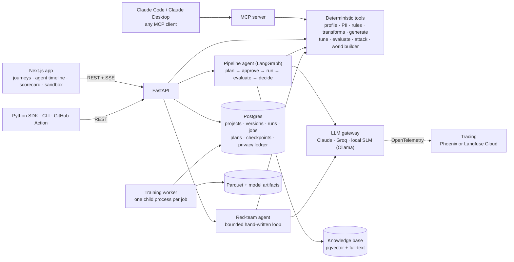
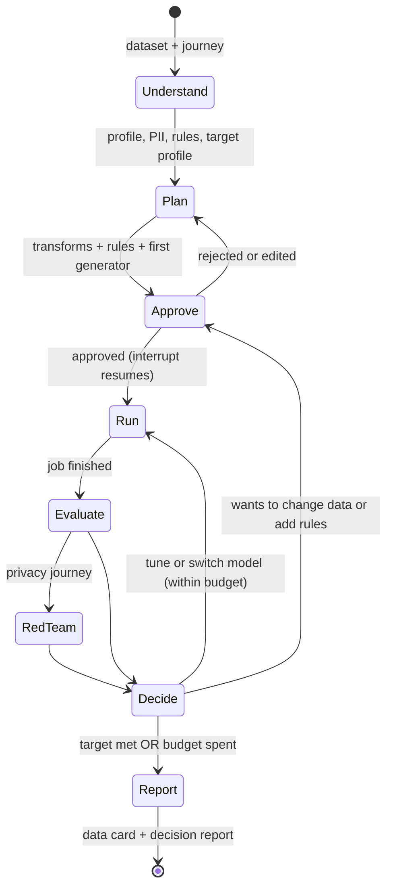
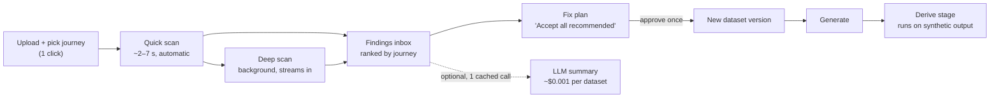

# DataMimicAI: Next-Level Plan (v2.0)

> **Version:** 2.2 · 2026-10-24 · written on branch `feature/next-level-improvements-24oct` (v2.1 adds a pass over the Explore step: problems P6, P7, S8, §3.5 and WS10 "Explore 2.0"; v2.2 adds the feature-suggestion audit: P8, S9, §3.6 and the WS10.3 feature budget; see §17)
> **Replaces:** v1.2 ([datamimicai_imp_plan_oct27.md](datamimicai_imp_plan_oct27.md)). v1.2 stays as a reference for methodology details; §15 maps every v1.2 item to where it lives now.
> **Goals:** (1) a tool people can actually use; (2) a project that holds up in an AI / GenAI Engineer interview in 2026.
> **How to read:** §1 (5 minutes). §3 (what's broken today, with file and line). §6 (the features). Work from §9 (roadmap) and §13 (checklist). §11 is your interview kit: **keep it private** (see the note there).
> **Reference style:** `WS3.2` = workstream 3, item 2 (§8). `F11` = feature 11 (§6). `P1`/`S1` = problems in §3.

---

## 1. The short version

### 1.1 What changed since v1.2 (two days ago)

- **Good:** the Next.js work is committed (95 files), and Agent Mode (Action Planner, approval, Decision Report) now runs in Next.js ([components/ai/](../frontend-next/src/components/ai/)).
- **New problems:** a fresh audit of the code found **7 problems v1.2 missed**. Two of them put **wrong numbers on the screen**:
  1. The Validate page's quality scores are made up in the browser. "Utility" is the average chi-square p-value × 100 + 30 ([useQuality.ts:37](../frontend-next/src/hooks/api/useQuality.ts#L37)). That isn't a utility measure.
  2. AutoML model selection ranks models partly backwards. It averages one higher-is-better metric with three lower-is-better ones and picks the lowest average ([model_selection.py:303-304](../backend/src/core/synth/model_selection.py#L303-L304)).

  The other five: path traversal through `file_id`, 43 `async` endpoints that freeze the server, a downloaded CSV that differs from the one being scored, no seeds or saved models, and a hard-coded Titanic column in the AutoML evaluator (§3).
- **The market moved** (§4):
  - Open-source tabular synthesis is now a commodity. MOSTLY AI open-sourced its engine under Apache-2.0, and NVIDIA bought Gretel.
  - LLMs got very cheap (Claude Haiku 5.5 costs $0.10 / $0.50 per million input / output tokens), which removes the *cost* reason for fine-tuning your own small model. The *privacy* reason remains.
  - Privacy law keeps demand high. In India, the DPDP Rules' core duties become enforceable on 13 May 2027. In the EU, the AI Act's data-governance rules are unchanged, though the high-risk deadline moved to Dec 2027.
- **v2.1, a pass over the Explore step:** users face ~17 "Run" buttons, ~15 parameter choices and 4 different ways to change data. Two of those ways are broken: an approved Action Planner plan never reaches generation (P6), and "Apply for generation" trains the generator on derived columns that come out inconsistent (P7). The analyzers themselves are fast (quick tier 1.7 s on your 25k-row upload), so nothing needs a button. The fix is WS10, **Explore 2.0**: an automatic scan, a findings inbox and one approved fix plan. It works with no LLM at all; the optional summary costs about $0.001 per dataset (§3.5, WS10).
- **v2.2, feature suggestions:** the old suggester proposes 45–61 transforms on an 8–10 column file, which would add 40–73 columns if all were accepted. For a synthetic-data generator, almost none of them help: the synthesizers already scale and encode internally, and every extra column is one more thing the model must keep consistent. The new rule: **"Accept all" adds zero columns before training.** Clean and Protect fixes change columns in place or drop them; model-prep transforms leave the generation path; new features are opt-in ideas that must prove a measured gain, capped at 5 (§3.6, WS10.3). Two bugs found on the way: privacy fixes keep the raw value next to the masked copy (P8), and a still-mounted endpoint runs `exec()` on code sent in the request (S9).

### 1.2 New positioning

> **"DataMimicAI is the privacy-safe data layer for building and testing AI systems: an evaluated agent that turns sensitive data into synthetic data it can *prove* is useful and private, and that builds realistic synthetic worlds for testing AI agents."**

v1.2 had one big idea: an evaluated agent for tabular synthesis. v2.0 keeps it as the core (**Pillar A**) and adds two more:

- **Pillar B, synthetic data *for* AI engineering:** test worlds for data agents, a red-team agent that attacks your own synthetic data, and PII-safe text for LLM work. This is where 2026 demand is, and almost no portfolio project does it.
- **Pillar C, works where engineers work:** a Python SDK, a CLI, an MCP server, an Agent Skill, database connectors and a CI action. This is what turns it into a "real usable project".

### 1.3 The seven moves, in order

| # | Move | Why it matters |
|---|---|---|
| 1 | **Stop showing wrong numbers.** Fix the scoring bugs, the security holes and the leftovers (WS0) | You can't build credibility on a made-up utility score |
| 2 | **Measure everything, and make Explore automatic:** a real scorecard, a benchmark, an LLM eval set (WS1); an automatic scan, a findings inbox and one fix plan in place of ~17 manual "Run" buttons (WS10) | Evals are the #1 interview topic. And users don't want to run EDA by hand: they want to know what's wrong and fix it in one step |
| 3 | **A trustworthy LLM layer:** a provider gateway, structured outputs whose claims cite facts, typed errors (WS2) | Fixes the hallucination guardrail and gives you a support-rate metric |
| 4 | **First wins:** business-rule discovery and enforcement, plus the **Privacy Red-Team agent**, your first real agent (WS4.1, WS5.2) | Two headline numbers early, and a small agent before the big one |
| 5 | **Platform + the pipeline agent:** Postgres, jobs, auth, then a bounded agent with human approval steps (WS6, WS3) | Today's "agent" is a lookup table |
| 6 | **Build from nothing:** NL → dataset, what-if scenarios, drift simulation, and the **Synthetic Sandbox** for AI agents (WS4.2–4.3, WS5.1) | The most memorable demo; strong market pull |
| 7 | **Make it usable and visible:** SDK, CLI, MCP, Agent Skill, connectors, deploy, README with numbers, video (WS7, WS9) | "How would someone actually use this?" |

**Optional:** text de-identification (WS5.3), your own small model (WS8), moonshots (§6.4).

**You don't need all of it.** The full plan is ~99 focused days. §9.2 gives three cuts: 2 weeks, 7 weeks, 4 months.

### 1.4 Start here (first 3 days)

1. **Merge to `main`.** `main` is still at `e0ba7a7`, before the Next.js migration. Merge and tag `v0.1` (WS0.1).
2. **Fix the two wrong numbers** (P1, P2), the Titanic defaults (P3), and the two broken data paths (P6, P7). Each has a unit test (WS0.2).
3. **Fix the two security and reliability bugs:** validate `file_id` (S1) and switch the 43 CPU-heavy `async def` routes to `def` (S2). Each is a short mechanical change with a big effect (WS0.3–0.4).
4. **Add `backend/tests/`** with the v1.2 validator probe cases plus tests for steps 2–3, and a GitHub Actions workflow (WS0.7).

### 1.5 What "done" looks like

- A public repo with green CI and a README that leads with **four tables**: the generator benchmark, the LLM eval, agent vs baselines, and the red-team / sandbox results.
- A live demo link and a 2-minute video.
- Every claim in the README matches the code (§3.4).
- You can answer the §11.2 questions with your own numbers.

---

## 2. What exists today (audit on 2026-10-24)

### 2.1 Inventory

| Area | What's there | Size / evidence |
|---|---|---|
| **Backend API** | FastAPI with 9 routers and **80 routes**. `eda_feature_api.py` alone has 2,405 lines and 49 routes | ~23k lines of Python in `backend/src` |
| **EDA** | Profiling with distribution fitting; correlation, mutual information, functional dependencies; outliers (IQR, Isolation Forest, LOF, Cook's distance, time-series); drift; remediation with history; Presidio PII scan (fast and deep); quasi-identifiers and k-anonymity; time-series detection, ACF/PACF, decomposition | `backend/src/core/eda/` (12 modules) |
| **Feature engineering** | Utility and privacy suggesters, conflict resolver, privacy-technique (PET) mapping, saved transform configs, rollback, **export as code** | [eda_feature_api.py:908](../backend/src/api/eda_feature_api.py#L908), [:1593](../backend/src/api/eda_feature_api.py#L1593), [:1691](../backend/src/api/eda_feature_api.py#L1691) |
| **Generation** | SDV: CTGAN, TVAE, GaussianCopula, PAR. SynthCity: DDPM, CTGAN, TVAE, PrivBayes, DP-GAN, PATE-GAN, ARF. AutoML comparison. Version history with restore | `backend/src/core/synth/` |
| **AI assistance** | Explain pipeline: signals → diagnostics → prompt → Groq LLaMA 3.3 70B → validator. A rule-based interpreter and planner. An approval gate stored in a JSON file. A deterministic execution engine with 9 allowed transformations. Before/after validation; decision report | `backend/src/core/ai_assistance/`, `execution/`, `validation/` |
| **Validation** | `/metrics` (KS, chi-square, DCRBaselineProtection, NewRowSynthesis); `/visualize` (Plotly HTML) | [main.py:585-688](../backend/src/api/main.py#L585-L688) |
| **Frontend (new)** | Next.js 14, TypeScript, TanStack Query, Zustand, shadcn/ui. Wizard, onboarding tour, presets, version timeline, AI Assistance tab | ~10k lines in `frontend-next/src` |
| **Frontend (legacy)** | Streamlit | ~7.6k lines in `frontend/` |
| **Infra** | Dockerfile (CPU torch 2.2.2, Python 3.11); compose runs backend + **Streamlit only**; `render.yaml` deploys Streamlit | No CI (`.github/workflows/` is empty) |
| **Tests** | **None.** `backend/tests/` holds only `__pycache__`. The one test file is a script with a hard-coded absolute Windows path | [test_diagnostics_api_logic.py:8](../backend/test_diagnostics_api_logic.py#L8) |

### 2.2 What's genuinely strong (keep it, talk about it)

- **"AI proposes → human approves → deterministic engine executes."** This is your best design story, and the plan builds on it everywhere.
- **Broad deterministic analytics.** These become the agent's tools; you don't need new EDA.
- **Transformation code export.** Few tools give users the code behind a cleaning step.
- **Real engineering war stories** (§11.3): the SynthCity memory crash, event-loop blocking, empty ACF charts, and now the audit findings in §3.
- **A well-built Next.js app:** typed API client, query caching, persisted workspace, keyboard shortcuts, navigation guard.

---

## 3. Problems found in the code (verified 2026-10-24)

### 3.1 Wrong numbers shown to users (fix first)

| # | Problem | Evidence | What goes wrong | Fix (WS0.2) |
|---|---|---|---|---|
| **P1** | **Quality scores are made up in the browser.** Fidelity = 1 − the mean KS statistic over numeric columns only. Utility = the mean chi-square **p-value** × 100 + 30. The "Train longer / Train less / Generate more rows" recommendations are driven by these numbers | [useQuality.ts:31](../frontend-next/src/hooks/api/useQuality.ts#L31), [:37](../frontend-next/src/hooks/api/useQuality.ts#L37); [QualityActions.tsx:20-50](../frontend-next/src/components/validation/QualityActions.tsx#L20-L50) | A p-value isn't a similarity score, and the +30 floor means a completely wrong category mix still scores at least 30. Categorical columns never affect "fidelity". Nothing measures whether a model trained on the data works (real utility) | Now: rename it "Distribution similarity (KS / chi²)", drop "utility", and show the raw per-column numbers. Then: the backend scorecard (WS1.1) replaces the browser math |
| **P2** | **AutoML ranks models with metrics pointing in opposite directions.** `KolmogorovSmirnovTest` is higher-is-better (SynthCity marks it `maximize`), while JensenShannon, Wasserstein and MMD are lower-is-better. `select_best_model` averages all four and picks the **lowest** average. Wasserstein is also unscaled, so it dominates the average | [model_selection.py:303-304](../backend/src/core/synth/model_selection.py#L303-L304), [config.py `metric_cols`](../backend/src/core/synth/config.py); SynthCity `eval_statistical.py` lines 131 / 218 / 305 / 373 | A model with a *better* KS score looks *worse*. The "best model" can be the wrong one | Rank each metric in its own direction, then average the ranks. Add a unit test with two fake models where the right answer is obvious. Later, rank by the scorecard |
| **P3** | **The AutoML evaluator hard-codes the Titanic column.** `GenericDataLoader(..., target_column="Survived")`, plus `"Survived"` defaults in 5 more places | [synthcity_generator.py:300-301](../backend/src/core/synth/synthcity_generator.py#L300-L301), [:27](../backend/src/core/synth/synthcity_generator.py#L27), [:48](../backend/src/core/synth/synthcity_generator.py#L48); [main.py:285](../backend/src/api/main.py#L285), [:411](../backend/src/api/main.py#L411); [model_selection.py:94](../backend/src/core/synth/model_selection.py#L94) | On any other dataset the metric step can fail silently, so metrics come back as NaN and model selection reports "no valid metrics" | The target column is chosen by the user or inferred, otherwise `None`. Pass it all the way through |
| **P4** | **The downloaded file differs from the stored file.** `generate_and_download` saves the synthetic data, then fills every NaN with `0` before streaming it to the user | [feedback_generate_api.py:81-88](../backend/src/api/feedback_generate_api.py#L81-L88) | The user downloads a different dataset from the one Validate scores: zeros appear in text columns and missing values disappear | Stream exactly the stored file. If cleaning is wanted, do it before saving and say so in the UI |
| **P5** | **Nothing is reproducible.** No seed anywhere in generation. Every generation trains a model and throws it away | [generator.py:87-92](../backend/src/core/synth/generator.py#L87-L92); `grep seed` finds nothing in `core/synth` | You can't re-run a result, and "give me 10k more rows" retrains from scratch | Thread a `seed` through every generator and store it with the run. Save the trained model as an artifact (WS6.2) |
| **P6** *(v2.1)* | **Approved plans change nothing.** The Action Planner's Execute step runs the approved plan in memory and stores a before/after validation report, but never saves the transformed data. Generation still trains on the untouched file | [execution_api.py](../backend/src/api/execution_api.py) has no file write anywhere | The user approves a plan, sees "SUCCESS" and a decision report, and the synthetic data isn't affected at all | Now: relabel it "Preview plan impact". Then: an approved plan creates a new dataset version, and generation uses it (WS10.3) |
| **P7** *(v2.1)* | **Model-prep transforms run before training.** "Apply for generation" adds derived columns (`income_log`, `income_scaled`, bins, one-hot dummies) before the generator trains, and nothing inverts them afterwards | [feedback_engine.py:206-242](../backend/src/core/feedback_engine.py#L206-L242), [feedback_generate_api.py:54-55](../backend/src/api/feedback_generate_api.py#L54-L55) | The generator learns `income` and `income_log` as two separate columns, so synthetic rows can have `income_log ≠ log(income)`. One-hot groups can come out with zero or several 1s | Now: stop applying derive-type transforms before training. Then: a "Derive" stage runs on the synthetic output (WS10.3) |
| **P8** *(v2.2)* | **Privacy fixes keep the raw value.** `mask`, `hash` and `generalize` add a new column (`name_masked`, `email_hashed`, `country_generalized`) and leave the original column in the data. Only `redact` and `suppress` change or remove it | [feedback_engine.py:250-271](../backend/src/core/feedback_engine.py#L250-L271) | The user accepts "mask `name`", but the generator still trains on the real names, next to a masked copy. Checked on your uploads: "accept all" on `ff2a1ddd….csv` keeps `billing_address` and adds `billing_address_masked`. A privacy fix that doesn't protect is worse than none, because the user believes it worked | Now: Protect transforms replace the column in place (or drop it). Test: after any Protect step, no original value of that column appears in the output |

> **Correction to v1.2:** v1.2 called `select_best_model` "a real model-selection step". It is real: it trains several models and compares them. But its ranking is wrong (P2) until fixed.

### 3.2 Security and reliability

| # | Problem | Evidence | Fix |
|---|---|---|---|
| **S1** | **Path traversal.** `file_id` goes straight into file paths in almost every endpoint; only `/restore-version` checks it. Several endpoints **write** to `{file_id}.csv` | Check: [feedback_generate_api.py:113](../backend/src/api/feedback_generate_api.py#L113). Writes: [eda_feature_api.py:225](../backend/src/api/eda_feature_api.py#L225), [:239](../backend/src/api/eda_feature_api.py#L239), [:252](../backend/src/api/eda_feature_api.py#L252), [:309](../backend/src/api/eda_feature_api.py#L309), [:324](../backend/src/api/eda_feature_api.py#L324) | One `resolve_dataset(file_id)` helper: require a UUID, resolve the path, and check it stays inside `UPLOAD_DIR`. Use it everywhere. Later this becomes a database lookup plus an ownership check (WS6.3) |
| **S2** | **The event loop is blocked.** 43 routes in `eda_feature_api.py` are `async def` with **zero** `await`. FastAPI runs those on the event loop, so one deep PII scan or MI matrix freezes every other request, including `/health` | `grep -c "async def"` = 43, `grep -c "await "` = 0 | Change them to plain `def` (FastAPI then runs them in a thread pool). Heavy ones move to the job queue later (WS6.2). Same bug class as war story #4, which was fixed for `/generate` but not for EDA |
| **S3** | **No limits or auth.** No upload size or type limit. No auth at all: a `file_id` is the only thing protecting a dataset | [main.py:176-217](../backend/src/api/main.py#L176-L217) | Size, extension and row/column caps now (WS0.3); auth in WS6.3 |
| **S4** | **The database module is half-wired.** It creates an engine at import time with `ssl: require` and a placeholder URL. Postgres isn't actually used (`create_tables` is commented out) | [database.py](../backend/src/core/database.py), [main.py:117-120](../backend/src/api/main.py#L117-L120) | Remove it in WS0 and replace it properly in WS6.1 |
| **S5** | **CSV injection.** Exported cells that start with `=`, `+`, `-` or `@` can run as formulas when opened in Excel | All CSV exports | Escape on export (WS0.3) |
| **S6** | **LLM guardrail holes (from v1.2, still open):** provider errors come back as strings and can be shown as the explanation; the number check skips numbers below 20 and decimals below 100; the scope check is one keyword | [llama_inference.py:125-172](../backend/src/core/ai_assistance/explainability/llm_explainability_engine/llama_inference.py#L125-L172), [output_validator.py:178-186](../backend/src/core/ai_assistance/explainability/llm_explainability_engine/output_validator.py#L178-L186) | Typed errors in WS0.5; the full redesign in WS2 |
| **S7** | **No version history for cleaning.** EDA cleaning overwrites the working CSV in place; only one "originals" backup exists | [eda_feature_api.py:225](../backend/src/api/eda_feature_api.py#L225), [data_processing.py:30-46](../backend/src/core/data_processing.py#L30-L46) | Immutable dataset versions (WS6.1); simple versioned files in WS10.3 until then |
| **S8** *(v2.1)* | **The upload folder depends on where you start the server.** `diagnostics_api.py` and `execution_api.py` default to the relative path `"uploads"`; the other routers resolve `backend/uploads` as an absolute path. Started from the project root, these two look in a different folder (which explains the stray 35 MB `uploads/` folder at the root) | [diagnostics_api.py:105](../backend/src/api/diagnostics_api.py#L105), [execution_api.py:37](../backend/src/api/execution_api.py#L37) | One shared settings module for paths, used by every router (WS0.6) |
| **S9** *(v2.2)* | **Remote code execution.** `POST /eda/apply-features` takes `code_blocks` from the request body and runs each one with `exec()`. The "safe" globals dict doesn't set `__builtins__`, so Python adds the full builtins (including `__import__`), and `pd` alone can already read and write any file. Nothing in the Next.js app calls it; the only caller is a Streamlit backup file | [eda_feature_api.py:1674-1686](../backend/src/api/eda_feature_api.py#L1674-L1686), [feature_suggester.py:228](../backend/src/core/feature_engineering/feature_suggester.py#L228); caller: `frontend/helpers/eda_feature_eng/expander_feature_suggestions_backup.py:169` | Delete the endpoint and `FeatureSuggester.apply` now (WS0.3). Transforms are only ever named operations from the WS10.3 registry, never code strings. Code export stays one-way (registry → Python text) |

### 3.3 Leftovers still open from v1.2

- [ ] `/load-demo` raises `HTTPException("Data processing failed: ", 500, ...)` with its arguments in the wrong order ([main.py:274](../backend/src/api/main.py#L274)).
- [ ] `DATA_CACHE` is written and never read ([main.py:174](../backend/src/api/main.py#L174), [:185](../backend/src/api/main.py#L185)).
- [ ] `backend/runtime.txt` says `python-3.9.13`, and the README badge says "Python 3.9+". Docker and Render use 3.11.
- [ ] `.gitignore` line 12 (`*docs`) hides the whole `docs/` folder from GitHub.
- [ ] Runtime metadata files are still tracked (`backend/workspace/metadata/*`, `workspace/metadata/*`).
- [ ] **The README is out of date:** it says Agent Mode is Streamlit-only ([README.md:87](../README.md#L87), [:210](../README.md#L210), [:300](../README.md#L300), [:314](../README.md#L314)), but Next.js has it now.
- [ ] `main` is at `e0ba7a7`, and none of the Next.js work is merged.
- [ ] `backend/uploads/` holds 116 MB of test files.
- **Opportunity, not a bug:** `HMASynthesizer` (multi-table) is already wired in [generator.py:54](../backend/src/core/synth/generator.py#L54) but no endpoint uses it. The Sandbox (F11) will.

### 3.4 Say this today (until each upgrade ships)

| Instead of | Say | Until |
|---|---|---|
| "Quality score: fidelity / privacy / utility" | "Distribution similarity (KS / chi²) plus two row-copy checks" | WS1.1 |
| "AutoML picks the best model" | "Compares 7 SynthCity models on 4 statistical distances" | P2 is fixed |
| "AI agents interpret and plan" | "A rule-based interpreter and planner, gated by human approval" | WS3 |
| "RAG knowledge base" | "Rule grounding from a YAML knowledge base" | WS9 |
| "LLM explanations validated against facts" | "LLM explanations with a numeric fact check that I found had holes; I'm replacing it with cited claims" | WS2 |

### 3.5 The Explore step today, and why people dislike it *(v2.1)*

The page header says *"Run each analysis independently"* ([explore/page.tsx:86](../frontend-next/src/app/explore/page.tsx#L86)). That's the problem: the user does the work of an analyst before they learn anything.

| What the user faces | Count | Evidence |
|---|---|---|
| Places to look | 7 analysis tabs, plus a separate "AI Assistance" mode with 3 more panels | [explore/page.tsx:17-25](../frontend-next/src/app/explore/page.tsx#L17-L25), [:100-137](../frontend-next/src/app/explore/page.tsx#L100-L137) |
| "Run" buttons to see every result | ≈ 17: profile, fit distributions, correlation, mutual information, dependencies, outlier detection, Cook's distance, privacy scan, suggest QIs, k-anonymity, analyse features, preview impact, time-series detection, ACF/PACF, decompose, time-series outliers, AI diagnostics, and 2 more in the Action Planner | `frontend-next/src/components/eda/*`, `components/ai/*` |
| Choices to make before the results mean anything | ≈ 15: outlier methods, correlation method, top-K, fast vs deep PII, quasi-identifiers, k, Cook's target and features, date column, value column, LLM focus, tone and columns | same files |
| Ways to change the data | **4, each behaving differently.** Profiling fixes and outlier remediation **overwrite the working file at once.** Feature suggestions are **deferred** to generation time, and break derived columns (P7). The Action Planner's Execute **changes nothing** (P6). "Reset to original" undoes everything at once | [ProfilingCard.tsx:49-61](../frontend-next/src/components/eda/ProfilingCard.tsx#L49-L61), [OutlierCard.tsx:76-96](../frontend-next/src/components/eda/OutlierCard.tsx#L76-L96), [TransformActions.tsx:81-94](../frontend-next/src/components/eda/TransformActions.tsx#L81-L94) |
| Transform vocabularies in the backend | 3 overlapping ones: the EDA cleaning endpoints, `feedback_engine.py` (15 actions) and the execution engine (10) | [feedback_engine.py:182-278](../backend/src/core/feedback_engine.py#L182-L278), [deterministic_execution_engine.py:34](../backend/src/core/execution/deterministic_execution_engine.py#L34) |
| Result caching | Keyed by `file_id`, not by data version, so a cached result can go stale after an in-place fix | `workspace/metadata/{file_id}_*.json` |

**The good news: the analyzers are fast.** I timed the existing code on this machine on 2026-10-24 (read-only script in the session scratchpad; no project files changed):

| Tier | Analyzers | 25,784 × 8 (your upload) | 50,000 × 30 (mixed test table) |
|---|---|---|---|
| Quick | profile, signals + diagnostics, fast PII, z-score/IQR/MAD outliers, correlation, QI suggestion + k-anonymity | **1.7 s** | **6.9 s** |
| Deep | Isolation Forest + LOF, mutual information, functional dependencies, distribution fitting | 7.9 s | 47.9 s |

So nothing needs a "Run" button. The quick tier can run on upload, and the deep tier in the background. WS10 is the redesign.

**Was this covered in v2.0?** Only partly:

| Need | Covered in v2.0? |
|---|---|
| EDA modules reused as agent tools | Yes (WS3.1) |
| Analysis runs without clicks | Only through the LLM agent in Phase 4 (around day 50), and every run would need an LLM |
| One way to change data, with versions | Partly: immutable versions arrive in WS6.1 (Phase 4); the 4 separate change paths weren't addressed |
| P6 (plans don't persist), P7 (derived columns before training) | No: new in v2.1 |
| Smart defaults in place of the ~15 choices | No |
| A redesign of the Explore screen | No: §14 only said "no new EDA widgets" |
| A per-dataset LLM cost ceiling for EDA | Partly: WS2 has routing and caching, but no per-dataset budget |

### 3.6 Feature suggestions: too many, and mostly not needed *(v2.2)*

There are two suggesters, and neither asks *"does this column help the synthetic data?"*

| Suggester | Where it's used | What it proposes |
|---|---|---|
| `FeatureSuggester` (old) | Streamlit; `/eda/feature-suggestions` is still mounted | Up to **10 transforms per numeric column** (log, sqrt, inverse, z-score, min-max, square, cube, quartile bins, rank, outlier flag), plus correlated-pair products, one-hot / label / frequency encoding and text length / word count. No relevance check at all ([feature_suggester.py:80-133](../backend/src/core/feature_engineering/feature_suggester.py#L80-L133)) |
| `UtilitySuggester` + `PrivacySuggester` | Next.js "Features" tab (`/eda/context-aware-suggestions`) | One scaler or transform per numeric column, plus one privacy fix per risky column. Better, but every numeric column qualifies, IDs and PII included ([utility_suggester.py:54-60](../backend/src/core/feature_engineering/utility_suggester.py#L54-L60)) |

**Measured on 6 of your uploads** (read-only script in the session scratchpad; each file loaded into memory and "accept all" applied to a copy):

| File | Columns (numeric) | Old suggester: suggestions → columns added if all accepted | Next.js tab: suggestions → columns added by "accept all" | Examples of what gets added |
|---|---|---|---|---|
| `fcd8fdec` | 10 (4) | 51 → **+63** | 2 + 4 → +6 | `name_masked` (raw `name` kept), `country_generalized` |
| `8635ff96` | 10 (5) | 53 → **+73** | 3 + 4 → +6 | `capacity_mw_log_minmax` (a transform of an earlier transform) |
| `ff2a1ddd` | 9 (3) | 45 → **+40** | 3 + 2 → +4 | **`credit_card_number_log`**, `billing_address_masked` (raw kept) |
| `8635ff96` (older copy) | 9 (4) | 51 → **+72** | 2 + 4 → +6 | `capacity_mw_scaled` |
| `f0de7d3e` | 8 (4) | 61 → **+62** | 4 + 0 → +4 | `Open_log`, `Close_log`, `Volume_log`, `MarketCap_log` |
| `5d6b3511` | 2 (1) | 13 → +13 | 1 + 0 → +1 | `sales_minmax` |

The old suggester turns a 10-column file into one with up to **83 columns**. One-hot encoding a single 12-value category already adds 11.

**Why most of these don't belong in a synthetic-data product:**

1. **The synthesizers already do model prep.** SDV preprocesses every column (RDT), CTGAN uses mode-specific normalization for numbers and one-hot for categories, and SynthCity has its own encoders. Scaling, log, one-hot or label encoding done by the user beforehand adds nothing for the generator.
2. **Every added column costs something.** The generator must learn one more column and its exact link to the original (`x_log = log1p(x)`), and it gets that link only approximately right (P7). Training time and memory grow with the column count.
3. **Many are no-ops for the downstream model too.** Monotonic transforms (log, sqrt, rank, min-max, z-score, quartile bins) don't change tree models such as XGBoost or LightGBM at all, and the user can apply them in one line later.
4. **Some are wrong.** `credit_card_number_log` treats an identifier as a measurement; `capacity_mw_log_minmax` stacks transforms; a masked copy next to the raw value isn't privacy (P8).

**What's still useful:** fixes that change *what the data says*, before training: fill or flag missing values, drop constant, duplicate and ID columns, fix types, group rare categories, cap impossible values, and the privacy fixes, applied in place. A few *new* features can help someone who wants ML-ready synthetic data (a ratio, date parts, a domain flag), but only when tested and opt-in. WS10.3 turns this into a **feature budget**.

**Was this covered in v2.1?** Partly. P7 moved derive-type transforms after generation, but "Accept all recommended" would still have accepted every suggestion, and v2.1 missed P8 and S9.

---

## 4. The market in late 2026, and what it means for you

### 4.1 Signals

| Signal | What it means for DataMimicAI |
|---|---|
| **Open-source tabular synthesis is a commodity.** SDV, SynthCity, and since 2025 MOSTLY AI's SDK (Apache-2.0, built on its TabularARGN model) are all free | Another wrapper around a generator isn't a product. Use these as **engines**, and add MOSTLY AI's engine to your benchmark as a strong open baseline. Compete on **proof** (scorecards, attacks, rule compliance), **workflow** and **agent-native use** |
| **Consolidation.** NVIDIA bought Gretel (March 2025) | Synthetic data is becoming part of the AI-training and evaluation stack, not a standalone niche. Pillar B follows this |
| **Synthetic data for testing AI.** Simulation and persona-based datasets are becoming a common way to build eval sets for LLM agents, because human-labelled multi-turn eval sets keep getting more expensive (vendor-reported; treat with care) | Build synthetic **worlds with ground-truth answers** for testing data agents (F11). You control the data, so you know every correct answer |
| **Privacy law: India.** The DPDP Rules were notified on 13 Nov 2025. Consent-manager registration starts in Nov 2026, and most core obligations become enforceable on 13 May 2027 | Indian companies need test and analytics data that isn't personal data, and they need it before May 2027. A strong, specific pitch for interviews in India. Add Indian identifiers (Aadhaar, PAN, UPI IDs, Indian phone formats) to the PII scanners (F13) |
| **Privacy law: EU.** The AI Act's high-risk obligations were pushed back to 2 Dec 2027 (Annex III) and 2 Aug 2028 (Annex I) by the 2026 "digital omnibus" deal. The data-governance rules (Art. 10) and the general-purpose-AI duties are unchanged | Data documentation (data cards, lineage, bias checks) stays in demand. *Not legal advice; confirm against the Official Journal text* |
| **LLM prices fell sharply.** Claude Haiku 5.5: $0.10 / $0.50 per million tokens; Sonnet 5.5: $2 / $10; Opus 5.5: $4 / $20 | Cost alone no longer justifies fine-tuning a small model for most tasks. Fine-tune for **privacy** (fully offline), **latency**, or **learning from your own feedback data** (WS8). Route each task to the cheapest model that passes your eval |
| **Agent tooling has standardized.** MCP is the default way to give agents tools; Agent Skills package instructions plus scripts for Claude and similar agents | Shipping DataMimicAI as an MCP server and a Skill costs ~3 days and makes a strong demo (WS7) |

### 4.2 What this means: build and don't build

- **Build:** proof that data is useful and private; LLM features that GANs can't do (rules, specs, scenarios); data for testing AI; agent-native interfaces.
- **Don't build:** more EDA widgets, more generators (benchmark entries excepted), a marketplace, image/audio/video synthesis, real-time streaming, multi-tenant billing.

### 4.3 Your older vision docs (`docs/future_scope/`): what happens to each idea

| Idea from the vision docs | Decision | Where |
|---|---|---|
| Natural language → data | **Do** (LLM writes a spec; code samples it) | WS4.2 |
| Domain templates (finance, health, retail) | **Do, as Sandbox "worlds"** | WS5.1 |
| Bias / fairness audit, "trust score" | **Do**, as the fairness part of the scorecard and the data card | WS1.1, F7 |
| Causality-aware generation, "what-if" | **Light version**: conditional scenarios plus rules | WS4.3 |
| Digital twin / agent simulation | **Reframed** as test worlds for AI agents | WS5.1 |
| Real-time / streaming generation | **Park.** The drift simulator covers the testing need | WS4.3 |
| Multimodal (images, audio) | **Park** | — |
| Marketplace | **Park** | — |

---

## 5. Product: north star, pillars, journeys

### 5.1 North star

> **Give DataMimicAI a dataset (or a description) and a goal. An agent profiles it, finds privacy and quality risks, proposes fixes and business rules for you to approve, trains and tunes generators until a target scorecard is met, attacks the result to check privacy, and hands back the data with a data card that proves fidelity, utility and privacy. The same engine builds whole synthetic worlds, with known correct answers, for testing AI agents.**

The rule that never changes: **the LLM never touches data directly.** It only calls allowlisted, schema-checked tools. Anything that changes data or uses serious compute goes through human approval and then a deterministic engine.

### 5.2 Three pillars

| Pillar | What | Who it's for | Key features |
|---|---|---|---|
| **A. Trustworthy synthesis** (core) | Sensitive table → evaluated synthetic table | Data and ML teams sharing data or augmenting rare cases | F1–F10 |
| **B. Synthetic data for AI engineering** (differentiator) | Worlds and eval suites for agents; privacy red-teaming; PII-safe text | AI engineers building agents, RAG and fine-tunes | F11–F14 |
| **C. Works where engineers work** (adoption) | SDK, CLI, MCP, Skill, connectors, CI | Everyone, from their own tools | F15–F20 |

### 5.3 Six user journeys

The user picks the journey. The journey sets the target profile, and the LLM may suggest adjustments but never invents the target. That keeps the agent's goal explicit and testable.

| # | Journey | The user says | Optimize for | Target profile (example) |
|---|---|---|---|---|
| 1 | **Safe sharing** | "Share `customers.csv` with a vendor." | Privacy first, then fidelity | DCR share ≈ 50%; attack risk ≈ baseline; red team finds no planted record; fidelity ≥ 0.80 |
| 2 | **ML augmentation** | "More fraud examples for my model." | Minority-class performance on *real* test data | Must beat random oversampling **and** SMOTE on PR-AUC and minority recall |
| 3 | **Test data from nothing** | "10k orders with 3% refunds and Nov–Dec peaks." | Spec and rule compliance | 0% rule violations; spec targets hit within tolerance |
| 4 | **Agent sandbox** *(new)* | "A realistic fake retail company with 8 tables and 200 questions with correct answers, to test my text-to-SQL agent." | Integrity, realism, verified answers | 100% foreign-key integrity; 0% rule violations; ≥ 95% of gold answers correct on a human spot-check |
| 5 | **What-if / stress test** *(new)* | "Next year's data with 20% more churn among 18–25-year-olds", or "add gradual drift to `income` to test my monitor." | Hit the condition; keep everything else | Condition met within tolerance; other columns' shapes barely move; drift ground truth recorded |
| 6 | **Text de-identification** *(new, optional)* | "Make these 5,000 support tickets safe for fine-tuning." | PII recall, consistency, keeping the text useful | PII recall ≥ 0.98 on a labelled set; downstream classifier accuracy drop ≤ 2 points |

**Scope of v1:** single tables for Pillar A. Multi-table only inside the Sandbox, where you control the schema. Long sequences (PAR) stay in the manual workflow.

---

## 6. Feature catalog

**Effort** is in focused days (~6 hours of real work each). **Priority:** P0 = must, P1 = differentiator, P2 = adoption, M = moonshot (do at most one).

### 6.1 Summary matrix

| ID | Feature | User value | Interview value | Effort | Priority | Workstream |
|---|---|---|---|---|---|---|
| F1 | Server-side scorecard: fidelity, utility, privacy, fairness, rules, with a holdout set | ★★★ | ★★★ | 4 | P0 | WS1.1 |
| F2 | Benchmark harness (datasets × generators × seeds) | ★★ | ★★★ | 2 | P0 | WS1.2 |
| F3 | LLM / agent eval set with injected issues, dev/test split, confidence intervals | ★ | ★★★ | 3 | P0 | WS1.3 |
| F4 | Structured explanations whose claims cite fact IDs, checked claim by claim | ★★ | ★★★ | 4 | P0 | WS2.2–2.3 |
| F5 | LLM gateway: Claude / Groq / local; typed errors; refusals; cost; tracing | ★ | ★★★ | 2 | P0 | WS2.1, 2.6 |
| F6 | Bounded pipeline agent with approval interrupts, budgets, baselines, and an "Ask DataMimic" chat | ★★★ | ★★★ | 14 | P0 | WS3 |
| F7 | Data card + decision report export | ★★★ | ★★ | 1 | P0 | WS3.6 |
| F8 | ⭐ Business-rule discovery and enforcement, **exported as data contracts** | ★★★ | ★★★ | 5 | P1 | WS4.1 |
| F9 | NL → dataset spec → seeded sampler → conformance check | ★★★ | ★★★ | 3 | P1 | WS4.2 |
| F10 | What-if scenarios (conditional generation) + drift simulator | ★★★ | ★★ | 3 | P1 | WS4.3 |
| F11 | ⭐ **Synthetic Sandbox**: multi-table worlds + question suites with verified answers + agent leaderboard | ★★★ | ★★★ | 11 | P1 | WS5.1 |
| F12 | ⭐ **Privacy Red-Team agent**: plans attacks, finds planted records, writes a cited report | ★★★ | ★★★ | 7 | P1 | WS5.2 |
| F13 | Text de-identification with consistent fake replacements, Indian IDs, leakage eval | ★★★ | ★★ | 6 | P1 (optional) | WS5.3 |
| F14 | Privacy budget ledger for the DP models | ★★ | ★★★ | 2 | P1 | WS6.9 |
| F15 | Python SDK + CLI (`datamimic`) | ★★★ | ★★ | 3 | P2 | WS7.1 |
| F16 | MCP server + Agent Skill | ★★ | ★★★ | 3 | P2 | WS7.2–7.3 |
| F17 | Database connectors: read from Postgres/MySQL/SQLite/DuckDB; write back to "seed my staging DB" | ★★★ | ★ | 2 | P2 | WS7.4 |
| F18 | GitHub Action: generate test fixtures in CI and run the exported data contracts | ★★ | ★★ | 1 | P2 | WS7.5 |
| F19 | Projects, immutable versions, lineage, jobs, auth | ★★★ | ★★★ | 8 | P0 (for F6) | WS6 |
| F20 | Real hybrid retrieval powering a cited compliance pack | ★★ | ★★★ | 5 | P2 | WS9 |
| F21 | **Explore 2.0** *(v2.1)*: automatic scan, findings inbox, one fix plan, optional cached LLM summary | ★★★ | ★★★ | 9 | P0 | WS10 |
| M1 | Learn from approvals: approve/reject/edit decisions become preference data (few-shot now, DPO later) | ★★ | ★★★ | 4 | M | WS8.3 |
| M2 | DP synthetic data through foundation-model APIs ("Private Evolution") | ★ | ★★★ | 8–10 | M | §6.4 |
| M3 | Model stress-tester: generate the rows that break the user's model, by subgroup | ★★★ | ★★ | 5–7 | M | §6.4 |
| M4 | Own small model as a tabular generator (GReaT-style) | ★ | ★★ | 4–6 | M | WS8 Track B |

### 6.2 The core features (F1–F10)

F1–F7 are specified in the workstreams (§8). F8–F10 in brief:

**F8 Business-rule discovery and enforcement.** v1.2's flagship, plus one new step.

The problem: GANs and diffusion models routinely produce rows that break business logic (`end_date < start_date`, `total ≠ price × qty`, a 7-year-old with a mortgage). Real users reject synthetic data for exactly this.

The flow:

1. **Propose: deterministic first, then one LLM call.** Rules use a small DSL: inequality, range, fixed combinations, formula, format/regex, conditional, uniqueness.
   - Mine candidates for free first: functional dependencies (already in `dependencies.py`), pairwise inequalities that hold on every row, ranges, formats and date ordering. The WS10 scan already computes most of these.
   - Then **one** LLM call per dataset version (aggregates only, cached) adds the semantic rules a miner can't find (formulas, conditionals), names the rules, and flags nonsense candidates. This keeps the cost to about one cheap call per dataset.
2. **Verify (deterministic)** against the real data:
   - **support ≥ 99.5%:** a rule;
   - **95–99.5%:** shown as a data-quality finding with the violating rows;
   - **below 95%:** dropped.
3. **Filter trivial rules.** Keep only rules a GaussianCopula baseline actually violates; a rule nothing breaks adds nothing.
4. **Confirm (human):** the user ticks the rules to enforce.
5. **Enforce:** SDV constraints where possible, otherwise reject sampling, then repair.
6. **Measure:** violation rate before vs after, and the fidelity cost of enforcing.
7. **New: export the verified rules as data contracts:** Pandera schemas, Great Expectations suites, dbt tests and SQL `CHECK` constraints. Users then guard their *real* pipelines with rules your LLM found and your verifier confirmed. It costs ~1 day once the DSL exists, and it's useful on day one.

Headline metric: *"CTGAN broke ≥ 1 rule in X% of rows; with enforcement, 0%, at a fidelity cost of Y."*

**F9 NL → dataset ("LLM as compiler, not generator").** The LLM writes a **typed spec**, never rows: columns, types, distributions, correlations, category frequencies, rules and time patterns. Make the spec a superset of SDV's metadata JSON. A seeded, deterministic sampler (Faker, numpy and a Gaussian copula for correlations) turns the spec into data. A conformance check confirms the targets were hit ("refund rate 3.0% ± 0.3%"), and on a miss the agent repairs the spec and resamples. *Why:* having an LLM write 10k rows is slow, expensive and statistically poor; a spec is cheap, reproducible and checkable.

**F10 What-if scenarios and drift simulator.**

- **Scenarios:**
  - The LLM turns *"20% more churn among 18–25-year-olds"* into a structured condition spec.
  - A deterministic engine applies it: SDV conditional sampling (`sample_from_conditions`) or reject sampling.
  - A report shows target vs achieved, and how much every other column moved, so side effects are visible.
- **Drift simulator:** from a base dataset, produce N "future" batches with controlled, labelled drift:
  - covariate shift (means, variances, category mix);
  - label shift (class priors);
  - concept drift (change the relationship between the inputs and the label);
  - missingness drift;
  - schema drift (a new category, a renamed column).
- Each batch carries its ground-truth drift labels, so ML teams can test their monitoring. Demo: run your own drift detectors ([drift.py](../backend/src/core/eda/drift.py)) on the batches and report how quickly they catch each type.

### 6.3 Pillar B: the "beyond the usual" features (F11–F14)

#### F11 ⭐ Synthetic Sandbox ("DataMimic Worlds")

**The problem.** Teams building text-to-SQL agents, BI copilots, analytics agents or RAG over tables can't test on production data. Public benchmarks (Spider, BIRD) don't look like their business and may already be in the model's training data. They need a realistic company database plus questions with **known correct answers**, plus traps.

**How it works:**

1. **World spec (LLM as compiler).** *"A D2C fashion retailer in India, 2 years of data, 50k customers."* The LLM writes a typed multi-table spec:
   - tables, primary and foreign keys, cardinalities (orders per customer);
   - distributions and seasonality (festival-season peaks);
   - business rules (WS4.1 DSL);
   - **data-quality defects to inject on purpose:** nulls, duplicates, late-arriving rows, mixed time zones, inconsistent category spellings.
2. **Deterministic generation.**
   - Parent tables first, then children by foreign key, using the cardinality distributions.
   - Rules enforced with the WS4.1 engine; everything seeded.
   - Alternative mode: fit `HMASynthesizer` (already wired in [generator.py:54](../backend/src/core/synth/generator.py#L54)) on a *real* database to make a private twin of a real schema.
3. **Planted facts.** You generated the data, so you can plant findings: *"Store 17's sales fell 40% in March because of a stockout."* Analytical agents are scored on whether they find them. This tests analysis, not just SQL.
4. **Question suite with verified answers.**
   - The LLM proposes questions from template families: aggregations, joins, time windows, rankings, "trick" questions (ambiguity, nulls, defects), and **unanswerable** questions where the right answer is "can't tell".
   - Each question gets a gold SQL query, and **the gold answer comes from running that SQL** (DuckDB). An LLM never writes an answer.
   - Verification:
     - the SQL runs, and its result is stable and non-empty;
     - a second model checks that the question and the SQL agree;
     - a reworded version of the question must give the same answer.
   - Failures are discarded, and the rest are labelled by difficulty.
5. **Harness and leaderboard.** Run any agent against the world: your own, a baseline prompt, or Claude Code connected through MCP (WS7.2). Report execution accuracy, planted-fact recall, cost and latency.
6. **Export:** a DuckDB/SQLite file, a Postgres dump, `tasks.jsonl`, and a world card (README).

**Metrics:**

- 100% foreign-key integrity and 0% rule violations.
- The share of proposed questions that survive verification.
- Gold-answer accuracy on a 50-question human spot-check (target ≥ 95%).
- The spread of baseline agent scores: a good benchmark is neither trivial nor impossible.

**Why it's strong for interviews:** you design an evaluation where **ground truth exists by construction**, and you deal with text-to-SQL, data contamination (fresh worlds can't have been memorized) and agent benchmarking.

**Why it sells:** every company building a data agent needs exactly this.

**Builds on:** WS4.1 rules, the WS4.2 sampler, SDV HMA, DuckDB (one small new dependency).

#### F12 ⭐ Privacy Red-Team agent (your first real agent)

**The problem.** "Is this synthetic data safe to share?" A DCR number is abstract. A report that says *"Using zip code + age + gender, I could single out 3 of 1,000 people; here's the evidence"* is what a privacy officer, or an interviewer, understands.

**The tools** (all deterministic and read-only):

- Anonymeter attacks: singling out, linkability, attribute inference.
- A distance-based membership-inference test.
- Quasi-identifier linkage against an "attacker's knowledge" table. Simulate it from the real holdout set; never use outside data about real people.
- A rare-category scan, an exact and near-duplicate scan, and the DCR share.

**The agent** (a bounded loop you write yourself, ~150 lines, no framework):

- It reads the PII scan and k-anonymity results.
- It chooses quasi-identifiers, attacks and parameters.
- It runs the attacks, reads the results and decides whether to probe further.
- It stops at an iteration or cost cap.
- It writes a **cited** report (WS2.2: every number comes from a tool result) with mitigations: a DP model, coarser quasi-identifiers, dropping rare categories.

The agent's Decide step (WS3) can act on those mitigations.

**Ground truth: canaries.**

- Plant known unique records into the training data, at varying rarity.
- A generator that memorizes reproduces them, and the red team should find them.
- Metrics:
  - **canary recall;**
  - **false-alarm rate** on clean runs;
  - agreement with DP ε: a lower ε should mean less risk.
- Compare the agent against a baseline that runs every attack with default settings. If the agent doesn't beat it, say so: its value is then the explanation and the mitigation advice.

**Scope and ethics:** it attacks only synthetic data generated from the user's own dataset, using a simulated attacker knowledge table. It doesn't target outside data or real individuals. Say this in the UI and the README.

**Why this is the first agent:** a small, read-only tool set; no approval step needed; runs in seconds; measurable with canaries. It teaches you the agent loop before the big LangGraph agent (WS3).

#### F13 Text de-identification (optional; promote it if you target LLM-data roles)

**The problem.** Companies want to fine-tune LLMs or build RAG on tickets, notes and emails without leaking PII. Presidio is already in your stack.

**How it works:**

1. **Detect.** Presidio plus custom recognizers for **Indian identifiers** (Aadhaar with its checksum, PAN, UPI IDs, Indian phone and PIN formats), plus an LLM pass for context-dependent PII (names in unusual formats, addresses written as prose).
2. **Replace consistently.** The same real entity always gets the same fake entity across the whole corpus, with formats preserved and locale-aware Faker (`en_IN`).
3. **Optional rewrite.** An LLM rewrites to remove indirect identifiers ("the only cardiologist in Bikaner").

**Evaluation:**

- **Ground truth by construction:** generate synthetic documents with planted PII and known positions.
- Measure entity precision and recall per type.
- A **leakage re-scan** of the output.
- A **utility check:** train a ticket classifier on original vs de-identified text and compare accuracy.

#### F14 Privacy budget ledger

Every DP run (DP-GAN, PATE-GAN, PrivBayes) records ε and δ against its source dataset version. The ledger sums the budget across runs on the same data (basic composition; optionally a tighter accountant), warns or blocks when the user's budget would be exceeded, and shows the result on the data card.

**Why:** regenerating ten times from the same data spends ten times the budget, and most tools ignore this. It's a sharp interview question you'll be able to answer.

### 6.4 Moonshots (pick at most one, and only after Phase 4)

| ID | Idea | How | Honest caveat |
|---|---|---|---|
| **M1** | **Learn from approvals** | Every approve / reject / edit of a plan or rule is logged with its context as a preference pair. Now: retrieve similar past decisions as few-shot examples. Later: DPO-fine-tune your small model's rule proposer (WS8.3) | A solo project produces few preferences. Bootstrap with a simulated reviewer (an LLM judge with a written rubric, checked against ~30 of your own labels), and say so |
| **M2** | **DP synthetic data via foundation-model APIs** ("Private Evolution": Lin et al., ICLR 2024; Aug-PE for text, Xie et al., ICML 2024) | Generate candidates through an LLM API; a DP histogram of nearest neighbours to the private data selects and evolves them. No model training on private data | Research-grade; the tabular version is experimental. Report ε against fidelity honestly. Best for research-leaning roles |
| **M3** | **Model stress-tester** | The user uploads a scikit-learn or ONNX model (or an endpoint URL). Generate conditional synthetic rows near its decision boundary and in under-represented subgroups, then report failure slices: *"recall drops to 0.41 for age > 70 and income < 20k"* | Needs model upload and sandboxed execution. Builds on the fairness checks in F1 |
| **M4** | **An SLM as a tabular generator** (GReaT / REaLTabFormer style) | Write rows as text, fine-tune, sample, parse back; add it to the benchmark | Language models memorize: it must pass the privacy scorecard and the red team (F12) |

---

## 7. Target architecture



**Two agents on purpose.** The red-team agent is a small loop you write by hand: read-only tools, no approval step. The pipeline agent uses LangGraph because it needs durable approval steps that survive restarts. In interviews you can explain when each approach makes sense.

---

## 8. Workstreams

Each workstream lists **tasks**, **done when** (a measurable exit) and the **interview payoff**.

### WS0: Fix, harden, honesty · ~5 days · Phase 0

| # | Task | Detail |
|---|---|---|
| 0.1 | **Merge and tag** | Merge `feature/next-level-improvements-24oct` → `main` (`main` is at `e0ba7a7`). Tag `v0.1`. From now on: one branch per workstream, and a tag per phase |
| 0.2 | **Stop wrong numbers** | P1: relabel the scores and remove the browser "utility". P2: rank each metric in its own direction, plus a unit test. P3: remove every `"Survived"` default. P4: stream exactly the stored file. P5: a `seed` parameter end to end, stored with each run. P6: relabel the Action Planner's Execute as "Preview plan impact" until WS10.3. P7: stop applying derive-type transforms (log, scaling, one-hot, bins) before training. P8: `mask` / `hash` / `generalize` replace the column in place, plus a test that no raw value survives |
| 0.3 | **Security basics** | S1: a `resolve_dataset()` helper (UUID + path containment) on **every** endpoint. S3: upload limits (size, `.csv`/`.parquet` only, row/column caps). S5: CSV-injection escaping. S4: delete the import-time database engine. S9: delete `/eda/apply-features` and `FeatureSuggester.apply` (no `exec()` anywhere; add a grep check to CI) |
| 0.4 | **Unblock the event loop** | S2: `async def` → `def` for the 43 routes. Test: `/health` answers in under 200 ms while a deep PII scan runs |
| 0.5 | **Typed LLM errors** | Replace `"Error: ..."` strings with `LLMUnavailableError` and friends. The API returns 503, and an error never reaches the validator or the user. Log *why* a validation failed (the report is already computed in `llm_api.py:320`) |
| 0.6 | **Leftovers** | Everything in §3.3: `/load-demo` exception, `DATA_CACHE`, Python 3.11 in `runtime.txt` and the README, `git rm --cached` the runtime metadata, clean `backend/uploads/`. S8: one shared settings module for paths |
| 0.7 | **Tests + CI skeleton** | `backend/tests/` with pytest: the 5 validator probe cases from v1.2 §3.2, a path-traversal test, the scoring-direction test, the download-equals-stored test, the event-loop test. GitHub Actions on every PR: `ruff`, `pytest`, `npm run type-check`, `next build`. Delete or convert `test_diagnostics_api_logic.py` (it has a hard-coded absolute path) |
| 0.8 | **Honesty pass** | README and docs use the §3.4 wording. Note that Next.js now has Agent Mode |
| 0.9 | **Public vs private docs** | Fix `.gitignore` `*docs` so architecture docs go public. Move interview prep (`docs/interview/`, §11 of this plan) to an ignored `notes/` folder |

**Done when:** CI is green; no score on screen comes from made-up math; the traversal test is rejected; `/health` stays responsive under load.

**Interview payoff:** *"I audited my own app and found my quality score was invented and my model ranking was partly inverted. Here's how I found them, fixed them, and made sure they can't come back."* Honest self-audit stories are worth more than features.

### WS1: Evaluation backbone · ~9 days · Phase 1

**WS1.1 Scorecard** (`backend/src/core/evaluation/`, API `GET /api/evaluation/{run_id}`). It replaces the browser math (P1) and the AutoML metric average (P2).

- **Holdout first:** hold back 20–30% of real rows *before* training. Use an explicit target column (P3).
- **Fidelity:** SDMetrics `QualityReport` (column shapes + column-pair trends). Keep the per-column KS / chi-square numbers for drill-down.
- **Utility, matched to the journey (§5.3):**
  - **Sharing:** TSTR vs TRTR. Train a model on synthetic data and on real data, test both on the real holdout, and report the gap. Add the rank correlation of feature importances. Use scikit-learn `HistGradientBoosting*`, which needs no new dependency.
  - **Augmentation:** the uplift from adding synthetic minority rows, measured on **PR-AUC** and minority recall, against random oversampling and **SMOTE** (`imbalanced-learn`). If SMOTE wins, say so.
  - Optional second evaluator: a tabular foundation model such as TabPFN for small tables (fast, no tuning; check its license).
- **Privacy:**
  - **DCR share:** with equal-sized training and holdout samples, the share of synthetic rows closer to a training row than to a holdout row. ≈ 50% means no memorization.
  - NNDR, `NewRowSynthesis`, and Anonymeter's three attacks with the holdout as the control set.
  - ε for the DP models (F14).
  - **State the limit:** attacks can *show* risk but can't *prove* privacy; only DP gives a formal bound.
- **Fairness drift:** for a sensitive attribute, subgroup proportions and positive-outcome rates, real vs synthetic.
- **Rules:** violation rate (after WS4.1).
- **Output:** one JSON scorecard with sub-scores and pass/fail against the journey's target profile. The Validate page renders it, and the agent reads it.

**WS1.2 Benchmark harness** (`backend/benchmarks/run_benchmark.py`):

- **Datasets:** UCI Adult (classification, with sensitive attributes), a credit-card-fraud subsample (imbalanced), California Housing (regression).
- **Generators:** GaussianCopula (baseline), CTGAN, TVAE, TabDDPM, one DP model, and **MOSTLY AI's open-source engine** (a strong, current baseline).
- **Rigor:** 3 seeds each; mean ± std; training time and peak memory. Record the seed and git commit with every result.
- **Modes:** `--quick` (CPU, for CI) and `--full` (your RTX 4050; see v1.2 §3.4 on keeping SynthCity's `torch<2.3` in its own environment).
- **Output:** a Markdown table in `docs/benchmarks/`, summarized in the README. The timings also feed the cost estimator (WS3.5).

**WS1.3 LLM and agent eval set** (`backend/evals/`):

- **Issue-injection generator:** take clean base datasets and inject known problems: skew, outliers, MCAR/MNAR missingness, duplicates, constant columns, mixed date formats, PII columns, a target-leakage column, high-cardinality IDs, broken business rules. You get labels for free. Aim for 40–60 cases, plus ~10 real messy public datasets labelled by hand.
- **Split into dev and test.** Tune prompts on dev only; report test.
- **Metrics:**
  - detection precision and recall per issue type;
  - claim support rate (WS2.3);
  - plan coverage and harm;
  - agent task success;
  - tool-call validity;
  - cost, latency and tokens.
- **Statistics:** paired comparisons on the same cases, with bootstrap confidence intervals. Differences under ~10 points on 20–60 cases may be noise.
- **LLM-as-judge** only for subjective qualities. Use a written rubric, label ~30 outputs yourself, and report how often the judge agrees with you. Judge with a different model from the one being judged.
- **Keep evals cheap:**
  - record and replay LLM responses in CI;
  - cache generator runs by (dataset version, model, params, seed);
  - run live evals through the **Message Batches API** (50% cheaper).

**Done when:** `python -m benchmarks.run_benchmark --quick` prints a table; `python -m evals.run --split test` writes a report with confidence intervals; the README shows both.

**Interview payoff:** "How do you evaluate an LLM feature?", "How do you know the data is useful and private?", "How did you avoid overfitting your eval?" — all answered with your own numbers.

### WS2: Trustworthy LLM layer · ~6 days · Phase 2

**WS2.1 Gateway** (`backend/src/core/llm/`):

- An `LLMClient` protocol with three adapters:
  - `AnthropicClient`, using the official `anthropic` SDK (1.x needs Python ≥ 3.10);
  - `GroqClient`;
  - `LocalClient` (Ollama), for strict-privacy mode and your SLM (WS8).
- **Route each task to the cheapest model that passes its eval.** For example: explanations on Haiku 5.5 if it holds quality, rule proposal on Sonnet 5.5, the agent's Decide step on Opus 5.5. Measure; don't guess.
- Typed errors, timeouts, a fallback provider, and per-call accounting (model, tokens, cache hits, latency, $). All model IDs in one config file, checked at startup with the Models API.

**Claude specifics** (checked against the current API reference, October 2026; re-check before coding):

| Topic | What to do |
|---|---|
| Effort and thinking on Opus 5.5 | Thinking can't be turned off. Set `output_config.effort` explicitly; the default is `medium`. Use `low` for cheap calls |
| Forcing a tool | `tool_choice` `any` / `tool` returns a 400 on Opus 5.5 and Sonnet 5.5. Use `tool_choice: auto` + `strict: true` on tools, or structured outputs (`output_config.format`, or `client.messages.parse()` with a Pydantic model) |
| Refusals | Check `stop_reason == "refusal"` before reading content. Enable the server-side `fallbacks` option and log the `stop_details` category |
| Cost | Prompt caching (stable tools and system prompt first; confirm `cache_read_input_tokens` > 0); Message Batches for offline evals |
| Agent budgets | Task budgets (beta) give the model a soft token ceiling it can see. Keep your own hard caps too |
| Tracing | The SDK can emit OpenTelemetry spans; send them to Phoenix |

**WS2.2 Structured outputs that cite facts.** The prompt gets a **facts table keyed by `fact_id`**, not prose. The output is a schema:

```json
{
  "summary": "string",
  "sections": [{ "title": "Distribution issues",
    "claims": [{ "text": "Income is heavily right-skewed (skewness 3.4).", "fact_ids": ["col.income.skew"] }] }],
  "suggested_next_steps": [{ "action": "log_transform", "columns": ["income"], "fact_ids": ["col.income.skew"] }]
}
```

On Groq and local models: JSON mode + Pydantic validation + one repair retry that feeds back the validation error. On Ollama: schema-constrained decoding.

**WS2.3 Validator rewrite**, claim by claim:

- every cited `fact_id` must exist;
- **every** number must match a cited value, with no skip rules;
- derived numbers are allowed only through declared operations (percent, ratio, rounding);
- unsupported claims are **dropped and shown as dropped**, instead of discarding the whole answer;
- the metric is the **claim support rate**;
- in the UI, hovering a claim shows its source facts.

**WS2.4 Privacy of LLM inputs** (essential for a privacy product):

- **Aggregates only, never raw rows.** PII columns are named by name and type only.
- **Aggregates can leak too:**
  - suppress categories with fewer than 5 rows;
  - send rounded quantiles instead of exact min/max for sensitive numeric columns.
- **Treat column names and cell values as untrusted input.** A column called `ignore_previous_instructions` is a real prompt-injection attack, so put data in delimited blocks marked as data. Only allowlisted tools can run, and data changes need approval.
- **Strict mode** uses the local model only, or the deterministic fallback.

**WS2.5 Prompts as versioned files** (`backend/src/core/llm/prompts/*.md`); the version is logged on every call.

**WS2.6 Tracing:** Arize Phoenix (one local process, OpenTelemetry) or Langfuse Cloud's free tier. Skip self-hosted Langfuse v3: it's too heavy for a 16 GB laptop with ~2 GB free.

**Done when:** claim support ≥ 95% on the WS1.3 test split; invented statistics are caught; no provider error reaches a user; cost per call is visible.

**Interview payoff:** *"I attacked my own guardrail with crafted inputs, found it let invented statistics through, and replaced it with structured outputs whose claims cite facts, validated claim by claim. Support went from X% to Y%."*

### WS3: The pipeline agent · ~14 days · Phase 4 (needs WS6.1–6.3)

> **Builds on WS10.** The automatic scan is the agent's *Understand* step, the findings are its context (never raw rows), and the fix plan is its *Plan → Approve* step. The LLM agent replaces the rule-based ranking and plan behind the same screens and data model, so WS3.6 extends the WS10 UI instead of building a new one.

**WS3.1 Tools.** Wrap existing functions as typed tools (Pydantic input schemas, `strict: true`):

- They return compact JSON summaries, never DataFrames.
- They report failures as error tool results, so the agent can recover.
- They're idempotent and cached.

| Tool | Wraps | Changes data? | Needs approval? |
|---|---|---|---|
| `profile_dataset`, `scan_pii`, `assess_k_anonymity` | `core/eda/*` | No | No |
| `propose_rules` / `verify_rules` / `export_contracts` | WS4.1 | No | No |
| `propose_transform_plan` | LLM planner (rule planner as fallback) | No | No |
| `apply_transform_plan` | `core/execution/` | **Yes** (new version) | **Yes** |
| `train_generator(model, params, seed)` | `core/synth/*` as a job | No (new artifact) | **Yes** if the estimate is > N min |
| `tune_generator(model, space, budget)` | Optuna over train + evaluate | No | **Yes** |
| `evaluate(run_id)` | WS1.1 | No | No |
| `red_team(run_id)` | WS5.2 | No | No |
| `generate_scenario(spec)` | WS4.3 | No (new artifact) | **Yes** |
| `search_knowledge(query)` | WS9 | No | No |
| `compare_runs(run_ids)` | run history | No | No |

**WS3.2 The graph** (LangGraph, Postgres checkpointer):



- **Human approval = LangGraph `interrupt()`.** Paused runs are checkpointed in Postgres, so approval can come hours later and survives restarts. This replaces `shared_state.submitted_plans` and `workspace/approvals.json`.
- **Decide** sees the scorecard vs the target, plus the run history. It picks from a **bounded action set** (accept, tune, switch model, propose rule, propose transform, stop) and gives a reason that cites scorecard fields. Numeric search goes to Optuna; the LLM never guesses learning rates.
- **Hard caps** on iterations, compute minutes and $. When a cap is hit, the agent stops and reports the best run so far.
- **Why a graph and not a free-roaming agent?** The overall workflow is known; only the decisions inside it need judgment. **Why not multi-agent?** One agent plus deterministic tools covers the job, and extra agents add cost and failure modes with no measured benefit. (The red-team agent is a *tool* here, not a peer.)

**WS3.3 Baselines.** Measure the agent against four baselines on the same tasks:

1. the rule-based planner (also the fallback when no LLM is available);
2. `select_best_model`, after the P2 fix;
3. "always CTGAN, 300 epochs";
4. **Optuna alone with the same compute budget.**

If the agent can't beat compute-matched Optuna on the scorecard, its value is in what Optuna can't do: goals, rules, explanations, and knowing when to ask. Report that honestly.

**WS3.4 Run memory:** store a fingerprint of each dataset (schema + profile summary) with its runs, and warm-start the generator choice from similar past datasets. Metric: first-try success rate with memory vs without.

**WS3.5 Cost estimator:** predict training minutes from rows × columns × epochs × model, fitted on the WS1.2 timings. The UI shows "≈ 6 min" before you approve.

**WS3.6 UI:**

- The journey picker (already built in WS10.4).
- An agent timeline streamed over SSE (`@microsoft/fetch-event-source` is already a dependency, unused).
- Approve / reject / edit at each approval step, and a live scorecard.
- **"Ask DataMimic"**: a chat panel over the same tools. Read-only tools need no approval; answers cite tool results.
- **Data card export** (F7), in the shape of *Datasheets for Datasets* / Google's *Data Cards*: generator, params, seed, rules enforced, scorecard, red-team summary, ε and privacy caveats.

**Done when:** on ~20 eval tasks (dataset + journey) you can report the success rate within budget with confidence intervals, the paired comparison against the 4 baselines, and the median cost and time per run.

### WS4: LLM-native differentiators · ~11 days · Phases 3 and 5

- **WS4.1 Rule discovery, enforcement and data contracts** (F8) · 5 d · Phase 3.
- **WS4.2 NL → dataset spec** (F9) · 3 d · Phase 5. The spec format is shared with the Sandbox (WS5.1), so design it once for multiple tables.
- **WS4.3 What-if scenarios + drift simulator** (F10) · 3 d · Phase 5.

**Done when:**

- violation rate before → after, and its fidelity cost, are in the README;
- spec-conformance rate ≥ 95% on 20 written prompts;
- scenario target hit rate is reported;
- your own drift detectors' detection delay is reported per drift type.

### WS5: Synthetic data for AI engineering · Phases 3, 5 and 7

| # | Feature | Effort | Phase | Done when |
|---|---|---|---|---|
| 5.2 | **Privacy Red-Team agent** (F12): build it first | ~7 d | 3 | Canary recall and false-alarm rate across ≥ 3 generators, including one DP model; agent vs run-all-attacks baseline; cited report in the UI |
| 5.1 | **Synthetic Sandbox** (F11) | ~11 d | 5 | 3 worlds (retail, lending, clinic) × ~150 verified questions; human spot-check ≥ 95%; a leaderboard with 3 agents (a baseline prompt, Sonnet 5.5, Claude Code via MCP) |
| 5.3 | **Text de-identification** (F13): optional | ~6 d | 7 | PII recall/precision per entity type on a planted test set; leakage re-scan; downstream accuracy drop |

### WS6: Platform engineering · ~14 days · Phases 4 and 6

| # | Task | Detail |
|---|---|---|
| 6.1 | **Persistence** | Postgres + Alembic. Tables: `users`, `projects`, `datasets`, `dataset_versions`, `jobs`, `generator_runs`, `evaluations`, `plans`, `approvals`, `rules`, `privacy_ledger`, `worlds`, `tasks`, `kb_chunks`, plus LangGraph checkpoint tables. Files are Parquet under `storage/<version_id>/`. **Every edit creates a new immutable version** (fixes S7). Lineage: synthetic file → source version → plan → run → scorecard. A run is (version, generator, params, seed, git commit), so any result can be re-run |
| 6.2 | **Background jobs** | A `jobs` table and a worker that claims jobs with `SELECT … FOR UPDATE SKIP LOCKED` (a queue without Redis). **One child process per training job**, so torch and SynthCity memory is released when it ends. SSE progress, cancel, timeouts. **Save the trained model** so "sample 10k more rows" doesn't retrain (fixes P5) |
| 6.3 | **Auth and isolation** | JWT or per-user API keys (PyJWT is already in requirements); ownership checks on every dataset endpoint; rate limits; a retention job |
| 6.4 | **Code health** | Split `eda_feature_api.py` into routers (profiling, correlation, outliers, privacy, timeseries, features); `ruff` for the backend; `mypy` on `core/`; remove legacy endpoints |
| 6.5 | **Tests** | Unit (engine, evaluators, rule verifier, validator, attacks); API (FastAPI `TestClient`); **agent tests with a fake LLM** replaying recorded responses; **Playwright** E2E in `frontend-next/e2e/` (playwright-core with the installed Edge already works on your machine). Target ≥ 70% coverage on `core/` |
| 6.6 | **CI** | Every PR: ruff, pytest, type-check + build, docker build, `benchmarks --quick`. Weekly or manual: live LLM eval on the test split through Batches; fail if a key metric regresses |
| 6.7 | **Packaging and deploy** | One `docker-compose.yml`: api, worker, postgres + pgvector, next.js, phoenix, optional ollama. A lock file (uv) and Python 3.11 everywhere. Split requirements into `core` and `heavy` (torch/SynthCity). **Live demo:** Next.js on Vercel; backend on Hugging Face Spaces (CPU) or a small VM; demo limits (small uploads, CPU-friendly models, capped epochs); bring-your-own API key or a hard monthly cap |
| 6.8 | **Retire Streamlit** | Delete `frontend/` (or archive it on a branch); update the README, compose and `render.yaml` |
| 6.9 | **Privacy budget ledger** | F14: a table plus a check in `train_generator` for DP models |

**Done when** these are automated tests:

- a second user can't read the first user's dataset;
- a 10-minute training job doesn't slow `/health`;
- restarting the server mid-approval resumes the agent run;
- a fresh clone installs from the lock file and passes CI.

### WS7: Adoption and integrations · ~8 days · Phase 6

| # | Task | Detail |
|---|---|---|
| 7.1 | **Python SDK + CLI** (F15) | `pip install datamimic`. Example: `datamimic synth customers.csv --journey share --out synthetic.parquet`, plus `datamimic evaluate`, `datamimic redteam`, `datamimic world create "D2C retailer"`. A thin typed client over the REST API |
| 7.2 | **MCP server** (F16) | Tools: `profile_dataset`, `scan_pii`, `propose_rules`, `generate_synthetic`, `evaluate`, `red_team`, `get_data_card`, `create_world`, `run_world_tasks`. Same tool code as the agent: one implementation, two front doors. Accept dataset IDs or uploads, **never server file paths**. Per-user keys |
| 7.3 | **Agent Skill** (F16) | A `SKILL.md` bundle that teaches Claude Code (and compatible agents) to use the CLI and MCP tools for jobs like *"make a privacy-safe copy of `data/customers.csv` for a vendor and show me the scorecard."* |
| 7.4 | **Connectors** (F17) | Read a table or schema from Postgres / MySQL / SQLite / DuckDB through SQLAlchemy; write synthetic data back into a target database ("seed my staging DB"); Parquet in and out |
| 7.5 | **GitHub Action** (F18) | Generate test fixtures from a committed spec in CI, and run the exported data contracts (WS4.1) against them |

**Interview payoff:** you understand where tool ecosystems are going (MCP, Skills), for very little code. The demo *"one sentence in Claude Code → scorecard"* lands well.

### WS8: Your own small model · optional · ~8–10 days · Phase 7

**Reframed from v1.2:** at Haiku 5.5 prices, **cost is no longer the main reason.** The reasons now are:

1. a **fully offline** strict-privacy mode, for hospitals and banks that can't send even aggregates to an outside API;
2. latency;
3. **learning from your own feedback** (M1).

Set the bar as *"within X points of Haiku 5.5 on the test split, fully offline, on a 6 GB laptop GPU."*

**8.1 Task SLM** (rule proposal + cited explanations):

1. **Base model:** a current open 1–4B instruct model. Check its license (Apache-2.0 or MIT are simplest).
2. **Training data from your own pipeline, never from real sensitive data:**
   - injected rules (correct by construction), plus teacher proposals your verifier confirmed;
   - explanations kept only if they pass your claim-by-claim validator (*verifier-filtered distillation*).
3. **Teacher:** check the teacher model's license **and the API provider's terms** before training on its outputs; several providers restrict this. An open-weights teacher whose license allows it is the safe choice.
4. **Split by base dataset, not by example,** so the test set only holds datasets the model never saw.
5. **Training:** QLoRA with TRL + PEFT (or Unsloth) in a separate CUDA environment; sequences up to ~2K tokens; batch size 1–2 with gradient accumulation and checkpointing. Track runs in MLflow. Plot a learning curve (quality against training-set size).
6. **Eval:** base SLM vs fine-tuned SLM vs Haiku 5.5 vs Sonnet 5.5 vs Groq. Measure schema-valid rate, rule F1, claim support, latency and GPU memory, plus a forgetting check on a few general prompts.
7. **Serving:**
   - merge the LoRA adapter;
   - quantize to GGUF (Q4_K_M) and measure the quality lost;
   - serve with Ollama, using JSON-schema-constrained decoding.
8. **Routing:** SLM first → on a validation failure, retry once with the error → then fall back to Claude. **In strict mode, the fallback is the deterministic path, never an outside API.** Metric: **SLM coverage**, the share of calls served locally.

**8.2 Track B (optional):** an SLM as a tabular generator (M4).

**8.3 Learn from approvals (M1):**

- Turn logged approve / reject / edit decisions into preference pairs.
- Use them as few-shot examples first.
- If there are enough, run a small DPO step on the rule proposer and report before/after rule acceptance on the test split.

### WS9: Real retrieval with a real job · ~5 days · Phase 6

**Now (1 hour, in WS0.8):** rename the YAML module from "RAG" to **"rule grounding"**.

**Then build real retrieval where it earns its place:** the **compliance and methodology notes on the data card**, and the agent's `search_knowledge` tool.

- **Corpus** (store source URLs and a fetch script, not copies):
  - GDPR Recital 26 and Art. 89;
  - HIPAA Safe Harbor (the 18 identifiers) and Expert Determination guidance;
  - NIST SP 800-188;
  - the **DPDP Act and Rules**;
  - EU AI Act Art. 10;
  - SDV / SynthCity docs, and the key papers (§11.7);
  - your own past data cards and red-team reports.
- **Pipeline:**
  1. Chunk by heading (~300–500 tokens, with the section path as metadata).
  2. Embed locally with `sentence-transformers` and store in pgvector.
  3. Search keywords with Postgres full-text.
  4. Fuse the two result lists with reciprocal rank fusion.
  5. Rerank the top 20 with a cross-encoder.
  6. Return the top 5 with source IDs. Answers must cite them.
- **Retrieval eval:** 50–80 hand-written question → relevant-chunk pairs with a dev/test split. Report **recall@5 and MRR** for BM25 vs dense vs hybrid vs hybrid + rerank.
- **Disclaimer on every compliance note:** *informational, not legal advice.*

**Interview payoff:** chunking, hybrid search, reranking and retrieval metrics, with your own numbers. It also shows judgment: you didn't use vectors where a lookup was enough (the rule grounding stays a lookup).

### WS10: Explore 2.0 (automatic scan, findings inbox, one fix plan) · ~9 days · Phases 1–2 *(v2.1)*

**Why:** see §3.5. Users don't want to run EDA; they want to know what's wrong with their data and fix it in one step. v2.0 would only have automated this through the LLM agent in Phase 4, with an LLM call on every run. Do it **deterministically now**; the agent plugs into the same screens later.

**Design rule:** *scan automatically, show findings rather than tools, fix through one approved plan, and keep the LLM optional.*



**WS10.1 Automatic scan** (`backend/src/core/scan/`) · ~2 d

- **Runs on upload, with no click.** It has two tiers, built from the existing analyzers; the timings are in §3.5.
  - **Quick:** blocks the first screen; 1.7–6.9 s today.
  - **Deep:** runs in the background, and its findings appear as they finish.
- **Sampling makes both tiers faster:**
  - profile statistics on ≤ 20k rows;
  - Isolation Forest / LOF on ≤ 10k rows, distribution fitting on ≤ 5k;
  - exact counts (missing values, duplicates) still on all rows.
  - Targets: quick tier under ~3 s, deep tier under ~15 s on 50k × 30. Measure after.
- **Deep PII (Presidio):** text-like columns only, 100 rows each, in the deep tier.
- **API:**
  - `POST /api/scan/{version_id}` (idempotent);
  - `GET /api/scan/{version_id}`;
  - SSE `/api/scan/{version_id}/events`.
  - Until WS6.2, the deep tier runs in a background thread with the existing `LOKY_MAX_CPU_COUNT` cap; after WS6.2 it's a job.
- **Cache key:** the dataset's content hash + the scan-config version. This fixes stale results keyed by `file_id`.
- **Smart defaults replace today's ~15 choices.** Every one stays adjustable in "Expert tools" (WS10.4):

| Today the user chooses | Default |
|---|---|
| Outlier methods (5 checkboxes) | IQR + MAD in the quick tier, Isolation Forest in the deep tier. A row is flagged only when ≥ 2 methods agree (fewer false alarms) |
| Correlation method, top-K | Pearson/Spearman for number–number, Cramér's V for category–category, correlation ratio for number–category. Show the pairs above 0.6, up to 10 |
| Fast vs deep PII | Fast always; deep on text columns in the background |
| Quasi-identifiers and k | Auto-suggested QIs (existing endpoint), k = 5 |
| Date and value columns for time series | Auto-detected (existing); ACF and decomposition for the top 3 series in the deep tier |
| Cook's distance target and features | Run only when a target is known, on all numeric features |
| Target column | Inferred from name hints (`target`, `label`, `churn`, `is_*`) and a low-cardinality last column, then confirmed with one click. This also closes P3 |

**WS10.2 Findings** · ~1.5 d

- **Extend `diagnostics_builder.py`** rather than writing new code. It already turns signals into 7 issue types with severities. Add:
  - **profiling:** constant columns, duplicate columns, duplicate rows, mostly-missing columns, mixed types, dates stored as text;
  - **privacy:** direct identifiers (email, phone, Aadhaar…), k < 5 on the suggested QIs, rare categories;
  - **relationships:** high correlation, functional dependencies, **possible target leakage** (|correlation with the target| > 0.95, or a column that determines the target);
  - **structure:** ID-like columns, a detected time series.
- **One finding** has these fields:
  - `id`, `category` (privacy / quality / distribution / relationship / structure), `severity` (blocker / warning / info), `columns`;
  - `evidence`: metric, value, threshold. These become the `fact_id`s for WS2;
  - `why`: text from the existing YAML rule-grounding knowledge base (`rag_knowledge/*.yaml`);
  - `recommended_fix` (a plan step), `alternatives`, and which details view to open.
- **Merge duplicates.** The same skew found by profiling, the signals and distribution fitting is one finding, not three.
- **Rank by** severity × journey weight × share of rows affected:
  - **sharing:** privacy findings first;
  - **augmentation:** target and imbalance findings first;
  - **test data:** formats and relationships first.
  - The journey is picked at upload (moved forward from WS3.6).
- **Blockers** are the few things that must be decided before generating. For example: direct identifiers in a sharing journey, a constant or missing target in an augmentation journey.
- **Text is templated** from the evidence, with no LLM: *"`income` is heavily right-skewed (skewness 3.4; threshold 2.0)."*

**WS10.3 One fix plan, one transform engine** · ~2 d

- **Merge the three transform vocabularies into one registry.** Every transform carries a **stage**:

| Stage | When it runs | Examples | Why |
|---|---|---|---|
| **Clean** | Before training; creates a new dataset version | impute, drop column, drop duplicate rows, fix types and date formats, cap / winsorize, group rare categories | Generators copy whatever they're trained on, dirt included |
| **Protect** | Before training; **always in place**, never a copy next to the raw value (P8) | drop or fake direct identifiers; hash, mask, generalize, suppress; coarsen quasi-identifiers | Privacy has to be applied before the model sees the data |
| **Derive** | **Off by default.** After generation, on the synthetic output; also exported as code | an "ML-ready export" option (log / power, scalers, one-hot) and a few *tested* feature ideas (see the feature budget below) | Train in the original space and derive afterwards, so `income_log == log1p(income)` holds exactly. Fixes P7 |

- **The feature budget** (fixes the column explosion in §3.6). Every suggestion passes these gates in order, and only Clean and Protect steps can be "recommended":

| Gate | Rule | What it removes (examples from §3.6) |
|---|---|---|
| 1. Purpose | **Before training, the plan adds zero columns.** Clean and Protect change a column in place or drop it. The fix-plan preview shows a column ledger: *"Columns: 10 → 9 (1 ID column dropped, 0 added)"* | `name_masked` next to `name`; every `_scaled`, `_log`, `_minmax` copy |
| 2. Role | Skip IDs, PII-flagged columns, the target, dates and columns that are already derived (lineage is recorded per version, not guessed from suffixes) | `credit_card_number_log`, `capacity_mw_log_minmax` |
| 3. Not the generator's job | Scaling, log / sqrt / power, one-hot, label and frequency encoding are never suggested for generation. They live only in the opt-in "ML-ready export" | most of the 45–61 old suggestions |
| 4. One per column | At most one representation per column (no `x_sqrt` and `x_log` and `x_rank` side by side) | the 10-per-column catalogue |
| 5. Evidence | A new feature (ratio, product, date parts, text length) is shown only if a quick model gains from it: 3-fold `HistGradientBoosting` on ≤ 5k sampled rows, target known, gain ≥ 0.5 pt AUC or ≥ 1% lower RMSE over the same model without it. Runs in the deep tier, a few seconds, no LLM. Monotonic transforms fail this gate on their own, because trees ignore them | "Add `x^3`", "rank encode `x`", "inverse `1/x`" |
| 6. Cap | At most 5 new features, or 20% of the column count, whichever is smaller, ranked by measured gain | long tails of weak ideas |

- **In the inbox,** feature ideas sit in a collapsed **"Optional: feature ideas"** section, unchecked, each with its measured gain: *"`debt / income`: +1.8 pt AUC (3-fold, 5k rows)"*. "Accept all recommended" never selects them.
- **Retire the old 10-per-column catalogue** (`FeatureSuggester`) together with the Streamlit UI. Its ideas list feeds gate 5 as candidates, and the Expert tools tab keeps a manual "add a feature" form.
- **Effort:** gates 1–4 replace existing suggestion code inside the 2 d above. Gate 5 is optional (~0.5 d, reuses the WS1 quick-model code) and isn't in the totals, because the product is complete without it.

- **Each step** has its parameters and a preview: rows affected, before/after statistics, and 5 sample rows. Steps can be toggled and reordered.
- **One approval:**
  - "Accept all recommended" builds the plan in one click;
  - the user reviews it and approves once;
  - the existing approval gate and deterministic execution engine apply it and create a **new version** (`{file_id}__v{n}.parquet` until WS6.1).
  - Generation always trains on the latest approved version. Fixes P6.
  - Undo = go back one version.
- **The plan is a reusable recipe:**
  - export it as Python (existing code export);
  - save and load it (existing configs);
  - **re-apply it to next month's file;**
  - in WS4.1, also export its rules as data contracts.
- **Remove the four old change paths:** in-place profiling fixes, the in-place write from the outlier dialog, "Apply for generation" (`pendingFeedback`), and the Action Planner's separate Execute.

**WS10.4 The new Explore screen** · ~2.5 d

- **The flow:** Upload → pick a journey (1 click) → Explore opens with the quick scan already done.
- **Readiness bar: a checklist, not one invented score** (the lesson of P1). Example: *"2 blockers · 5 warnings · 9 info · Ready to generate: no (fix or accept the 2 blockers)."*
- **Findings inbox.** Each finding shows one sentence, an evidence chip, a toggle for its recommended fix, "Ignore (with a reason)", and "Details".
- **Fix plan panel**, sticky on the right: the ordered steps, the preview, and **"Approve & apply"**.
- **Details drawers reuse today's cards** in read-only form, so little code is thrown away:
  - the profiling table;
  - the correlation heatmap and MI matrix;
  - the outlier table;
  - the k-anonymity table;
  - the time-series plots.
- **"Expert tools" tab** keeps every manual control (method choice, Cook's distance, ACF parameters, custom k) for power users.
- **The "Data Analysis / AI Assistance" switch goes away:**
  - the AI summary sits at the top of the inbox (WS10.5);
  - the Action Planner becomes the fix plan;
  - the Decision Report becomes the version history.
- **Interaction count from upload to generation:**
  - today ≈ 17 run buttons + ≈ 15 choices across 9 tabs and panels;
  - **target: 3 clicks** (journey → approve plan → continue) and 0 required parameters.

**WS10.5 Optional LLM layer, built for low cost** · ~1 d · Phase 2 (needs WS2.1–2.3)

| Tier | What it does | LLM calls per dataset version | Cost per dataset (list prices, Oct 2026) | Default |
|---|---|---|---|---|
| **0: no LLM** | Templated sentences from the evidence (like today's `_facts_summary`), plus "why" text from the YAML knowledge base | 0 | **$0** | Always on; the product fully works without a key |
| **1: summary** | **One** structured call returns: a 5-line summary; a one-sentence explanation for *every* finding, keyed by finding ID with every number cited (WS2.2); and the reasoning behind the priorities. Cached by content hash, so re-opening the dataset and clicking "explain" cost nothing more | 1 | Haiku 5.5 at effort `low`: ≈ **$0.001–0.002** (≈ 5k input + ≈ 1.5k output tokens, thinking included). Sonnet 5.5: ≈ $0.025. Local Ollama (WS8): $0 | On when an API key is set |
| **2: on demand** | "Ask about my data": a chat over the scan report with read-only tools; semantic rule proposals (WS4.1) | user-driven, capped (e.g. 20 per day) | ≈ $0.001–0.003 per question on Haiku 5.5 | Off by default |

At Tier 1, 1,000 datasets cost about **$1–2** on Haiku 5.5.

**The cost tricks:**

- one batched structured call per dataset instead of one call per click;
- cache by content hash;
- prompt caching on the fixed system prompt and schema;
- effort `low`;
- send aggregates only, never raw rows (WS2.4).

**Guardrails:**

- a per-user daily cap;
- on a provider error or a failed validation, fall back silently to Tier 0, with a small note;
- **the workflow never waits on the LLM.**

Groq stays available as an adapter; check its current pricing and limits before relying on it.

**WS10.6 Measure it**

- **On the WS1.3 injected-issue set:**
  - scan detection precision and recall per issue type;
  - **default-plan correctness:** the share of injected issues whose recommended fix is the right one;
  - **harmful-fix rate**, for example dropping a column that predicts the target;
  - **columns added by "Accept all"** before training (target: 0; today 4–6 in the Next.js tab and 40–73 with the old suggester);
  - **feature ideas:** how many are shown per dataset, and the share whose gain holds up on a held-out split.
- **A Playwright script** counts the clicks from upload to generation and times the first render of the findings.
- **Latency:** quick-scan p95 on 50k × 30.
- **Tier 1:** claim support rate, $ per dataset (WS2 accounting) and cache hit rate.

**Done when:**

- findings appear within 10 s of upload, with no click, on a 50k × 30 table;
- one approval applies every fix, and generation trains on the new version;
- derived columns are exact in the synthetic output;
- "Accept all" adds zero columns before training, and no raw value survives a Protect step;
- the four old change paths are gone;
- everything works with no LLM key;
- Tier 1 cost per dataset is logged.

**Interview payoff:**

- **A product story with numbers:** *"Users disliked running 17 analyses by hand. I made the scan automatic, cut upload-to-generate from ~30 interactions to 3, and kept the LLM optional at about $0.001 per dataset."*
- **Two design insights you can defend:**
  - deterministic first, with the LLM as one optional, cached, structured call;
  - "train in the original space, derive features afterwards";
  - "feature engineering before a synthesizer is mostly a bug": the generator already encodes and scales, so every extra column is one more relationship it can get wrong. Show the §3.6 table (51 suggestions → 0 columns added).

---

## 9. Roadmap

### 9.1 Phases

Don't start a phase until the previous phase's exit criteria are met. The numbers are what make the next phase believable.

| Phase | Contents | Effort | Exit criteria |
|---|---|---|---|
| **0. Fix & foundation** | WS0 | ~5 d | CI green; no made-up scores; traversal and event-loop tests pass; `main` merged |
| **1. Measure + Explore 2.0** | WS1; WS10.1–10.4 | ~17 d | Benchmark table + eval report with confidence intervals in `docs/benchmarks/`; findings appear with no clicks; one approved plan feeds generation |
| **2. Trustworthy LLM layer** | WS2; WS10.5 (cached LLM summary) | ~7 d | Claim support ≥ 95% on the test split; cost per call and per dataset visible |
| **3. First wins** | WS4.1 rules + contracts; WS5.2 red-team agent | ~12 d | Violation rate before/after; canary recall table |
| **4. Platform + pipeline agent** | WS6.1–6.3, then WS3 | ~22 d | Paired comparison vs 4 baselines on ~20 tasks, with cost and time per run |
| **5. Build from nothing** | WS4.2 NL → spec, WS4.3 scenarios + drift, WS5.1 Sandbox | ~17 d | Spec conformance; 3 worlds with verified question suites and a leaderboard |
| **6. Adoption & reach** | WS7, WS6.4–6.9, WS9; deploy, README rewrite, 2-minute video | ~19 d | Public demo link; MCP demo recorded; retrieval table; README with the four tables |
| **7. Optional** | WS5.3 text de-id, WS8 own model, one moonshot | open | Each new feature shows up in an eval or benchmark table |

**Total for Phases 0–6: ~99 focused days.** That's about **5 months full-time**, or **about a year part-time** at ~2 focused days a week. That's a lot, so pick a cut.

### 9.2 Three cuts

| Cut | When to use it | What's in it | Days |
|---|---|---|---|
| **2-week sprint** | Interviews very soon | WS0 essentials (P1–P3, S1, S2, tests, CI, README honesty) · scorecard on 2 datasets × 3 generators (holdout, TSTR, DCR share) · structured cited explanations + new validator + typed errors on 15–20 injected cases · README with those numbers + video. With one more day: auto-run the quick scan and show its findings at the top of Explore (WS10.1 + a simple list) | ~11 |
| **7-week "interview-ready"** | Most likely your best choice | Phases 0–3: real scorecard, benchmark, eval set, **Explore 2.0 lite** (quick scan, findings inbox, one fix plan: WS10.1–10.4 without the deep tier and expert tools), cited LLM layer, **rules + contracts**, **red-team agent**. Present the pipeline agent and the Sandbox as designs with eval plans (honest, and still impressive) | ~38 |
| **4-month "real product"** | You want users | Phases 0–5 (full WS10), then WS7.1–7.2 (SDK, CLI, MCP) and a deployed demo | ~83 |

**Where the interview value is:** Phases 0–3 (~38 days with Explore 2.0 lite) give you evals, a product that does the analysis for the user, a fixed guardrail, a real agent with a measurable job, two headline numbers, and a self-audit story. The Sandbox (Phase 5) is the biggest "wow". If your target roles are LLM-data or fine-tuning heavy, swap WS5.3 or WS8.1 in after Phase 3.

### 9.3 Suggested order inside Phase 0 (day by day)

| Day | Do |
|---|---|
| 1 | Merge and tag; P1 relabel; P2 direction-aware ranking + test; P3 "Survived" removal |
| 2 | S1 `resolve_dataset()` everywhere + test; S2 `async def` → `def` + responsiveness test; P4 download fix; P6 relabel; P7 stop derive transforms before training |
| 3 | WS0.5 typed LLM errors + the 5 probe tests; P5 seeds |
| 4 | Upload limits, CSV escaping, leftovers (§3.3), S8 shared path settings, delete the half-wired database module |
| 5 | GitHub Actions; README honesty pass; `.gitignore` fix; move private notes |

---

## 10. Flagship demo and README shape

### 10.1 Five-minute demo

1. **(30 s) The problem:** a sensitive customer CSV you can't share, and a text-to-SQL agent you can't test on production data.
2. **(60 s)** Upload UCI Adult and pick **Safe sharing**. The agent profiles it, flags PII, and proposes rules with their support numbers. Approve at the approval step; training progress streams in.
3. **(60 s)** The scorecard vs the target. The **red team** runs: *"0 of 20 planted records found; singling-out risk at baseline"*. The agent's Decide step cites the scorecard fields behind its choice.
4. **(60 s)** **Sandbox:** *"a D2C retailer, 8 tables"*. The world is built, 150 verified questions are generated, and three agents appear on the leaderboard.
5. **(60 s)** The same task from **Claude Code through MCP** in one sentence; then the data card, with its compliance notes citing sources.
6. **(30 s)** Limitations (§11.5) and what's next.

Always have the recorded video ready. Live demos fail on cold starts and rate limits.

### 10.2 README outline

Problem → 2-minute video → live demo link → what it does (three pillars) → **the numbers** (benchmark, LLM eval, agent vs baselines, red team / sandbox) → architecture → design decisions (why a bounded graph; why "LLM as compiler"; why rules are verified by data; why two agents) → limitations → quickstart (Docker, SDK, MCP).

---

## 11. Interview kit

> **Keep this section private.** `improvements/` is tracked and already pushed to `origin` (v1.2's interview kit is on GitHub now). Before the repo goes public, move §11 of both plans into an ignored `notes/` folder (WS0.9).

### 11.1 30-second pitch (use it once Phase 3 is done)

> "I built DataMimicAI, a privacy-safe data layer for AI teams. Give it a sensitive table and a goal. It profiles the data, an LLM proposes business rules that are kept only if the real data supports them, and it trains generators until a scorecard for fidelity, ML utility and privacy hits the target. Then a red-team agent attacks the result. It found [X]% of the records I planted, and on our final runs found none. LLM explanations are [Y]% supported by cited facts, and rule violations dropped from [A]% to 0. The same engine builds synthetic company databases with verified answers for testing text-to-SQL agents. The LLM never sees raw rows, and anything that changes data needs human approval."

### 11.2 2026 GenAI interview topics → where your answer lives

| Topic | Likely question | Your evidence | Number to have ready |
|---|---|---|---|
| **Evals** | How do you evaluate an LLM feature? How do you avoid overfitting the eval? | WS1.3 dev/test, paired CIs, judge calibration | Claim support %, judge–human agreement, dev–test gap |
| **Hallucination / grounding** | How do you stop invented numbers? How did you test the guardrail? | §3 S6 → WS2.2–2.3 | Support rate before → after |
| **Structured outputs** | How do you get reliable JSON? What if the model can't comply? | WS2.2 schema, repair retry, constrained decoding | Schema-valid rate per model |
| **Agents** | Walk me through your agent. Why not fully autonomous? Why not multi-agent? | WS3.2, WS5.2 (two agent styles) | Success rate, cost per run |
| **Human-in-the-loop / durability** | What happens if the server restarts mid-approval? | `interrupt()` + Postgres checkpoints | — |
| **Baselines** | Why an LLM at all, instead of hyperparameter search? | WS3.3 compute-matched Optuna | Agent vs Optuna |
| **Eval design with ground truth** | How do you know your benchmark answers are right? | F11 execution-verified gold SQL; F12 canaries; F13 planted PII | Spot-check accuracy, canary recall |
| **Text-to-SQL / data agents** | How would you test a text-to-SQL agent? Contamination? | F11 Sandbox: fresh worlds, unanswerable questions | Leaderboard numbers |
| **RAG** | Chunking, hybrid search, reranking — how do you measure them? | WS9 | recall@5 / MRR table |
| **Privacy** | Do your metrics *prove* privacy? What's DP composition? | WS1.1 caveat; F12 red team; F14 ledger | DCR share, attack risk, ε spent |
| **Security** | Prompt injection? Sending data to an external LLM? | WS2.4 aggregates only, rare-category suppression, untrusted-data handling, local mode; §3 S1 | — |
| **Cost / latency** | How do you control cost? Which model and why? | WS2.1 routing by eval, caching, batches, budgets | $ per run, cache hit rate, per-model quality/cost |
| **Fine-tuning** | When do you fine-tune instead of prompting or RAG? Has the answer changed with cheap models? | WS8: privacy/offline, not cost | SLM vs Haiku quality, latency, coverage |
| **Observability** | How do you debug a bad agent run? | WS2.6 tracing | — |
| **Tooling ecosystem** | MCP? | WS7.2–7.3 | — |
| **System design** | How would this run for 100 users? | WS6.1–6.2: `SKIP LOCKED`, child processes, immutable versions | Jobs/hour on one worker |
| **Product + cost engineering** | Where does the LLM actually add value? How do you keep LLM cost down? | WS10: deterministic scan first; one cached structured call per dataset; Tier 0 works with no key | Clicks before → after; $ per dataset; cache hit rate |
| **Debugging story** | Tell me about a hard bug | §11.3 | — |

### 11.3 Story bank

Tell each one as **situation → what you saw → root cause → fix → what you'd do differently**:

1. **SynthCity crashed the server.** One request started a joblib worker per CPU core (16 × ~277 MB). Fix: capped `LOKY_MAX_CPU_COUNT`, checked memory before importing torch, returned a clear 503. *Lesson: isolate heavy compute in its own process* (→ WS6.2).
2. **My hallucination guardrail had holes** *(tell this once WS2 is done)*. It skipped every number below 20 and every decimal below 100, so invented statistics passed, and provider errors could appear as explanations. Fix: claims that cite facts, every number checked, typed errors. *Lesson: guardrails need adversarial tests too.*
3. **New: my quality score was invented.** The Validate page showed "utility 78", which was a p-value plus 30. Fix: a backend scorecard with TSTR on a holdout. *Lesson: every number on screen needs a definition you can defend.*
4. **New: my AutoML ranked models partly backwards.** I averaged a higher-is-better metric with lower-is-better ones and picked the minimum. Found by reading SynthCity's `direction()`. Fix: direction-aware ranks plus a unit test with an obvious answer. *Lesson: when you aggregate metrics, check each one's direction and scale.*
5. **New: one EDA request froze every user.** 43 `async` endpoints doing CPU work blocked the event loop; I'd fixed this for `/generate` but not for EDA. *Lesson: fix the bug class, not the instance; add a responsiveness test.*
6. **New: path traversal in my own API.** `file_id` went straight into file paths, including write paths. Fix: UUID validation + path containment, then database-backed ownership. *Lesson: an ID is untrusted input.*
7. **New: users didn't want to run EDA, and two of my four fix paths were broken.** Explore had ~17 "Run" buttons. Approved AI plans never reached generation, and "Apply for generation" trained the model on derived columns that came out inconsistent. Fix: an automatic scan (1.7–6.9 s, measured), a ranked findings inbox, one approved fix plan with Clean / Protect / Derive stages, and the LLM as one optional cached call. *Lesson: measure the user's clicks, not just the model's accuracy; and train in the original space, derive afterwards.*
8. **Time-series charts looked empty.** ACF/PACF were computed over several interleaved stock series. Fix: aggregate per timestamp, detect business-day frequency, and apply Box–Jenkins rules.

### 11.4 Numbers to fill in as you go

| Metric | Value | Source |
|---|---|---|
| Best generator per dataset (fidelity / TSTR gap / DCR share), including MOSTLY AI's engine | | WS1.2 |
| Augmentation uplift (PR-AUC) vs random oversampling vs SMOTE | | WS1.1 |
| Claim support rate, before → after WS2 | | WS1.3, WS2.3 |
| Model routing: quality / cost / latency per task and model | | WS2.1 |
| Rule violations before → after, and the fidelity cost | | WS4.1 |
| Red team: canary recall, false-alarm rate; agent vs run-all-attacks | | WS5.2 |
| Agent success vs 4 baselines (with CIs); median $ and minutes per run | | WS3.3 |
| Spec conformance; scenario hit rate; drift detection delay | | WS4.2–4.3 |
| Explore 2.0: clicks upload → generate (before / after), quick-scan p95, detection recall, default-plan correctness, $ per dataset | | WS10.6 |
| Sandbox: questions surviving verification, spot-check accuracy, leaderboard | | WS5.1 |
| Retrieval recall@5: BM25 / dense / hybrid / + rerank | | WS9 |
| SLM vs Haiku 5.5: rule F1, claim support, latency, SLM coverage, quantization drop | | WS8 |

### 11.5 Limitations to volunteer

Saying these before you're asked signals seniority:

- Empirical privacy metrics and red-team attacks can't *prove* privacy. Only the DP models give a formal bound, and they cost fidelity.
- v1 handles single tables; multi-table support exists only inside Sandbox worlds, where the schema is controlled.
- Eval sets are small (20–60 cases), so differences under ~10 points may be noise. That's why I report confidence intervals.
- The LLM sees only aggregates, which limits what it can propose for rare patterns. That's a deliberate privacy trade-off.
- Sandbox worlds are realistic but simpler than a real company. They test agents; they don't replace production evaluation.
- Compliance notes are informational, not legal advice.

### 11.6 Resume bullets (fill in the numbers)

- Built DataMimicAI, an evaluated, human-in-the-loop LLM agent (LangGraph, Claude) that produces privacy-safe synthetic data; reached **[X]%** task success on a held-out 20-task eval vs **[Y]%** for compute-matched Optuna, at **$[Z]** per run.
- Designed a privacy red-team agent (tool-calling loop over membership-inference, singling-out and linkage attacks) that recovered **[C]%** of planted canary records from memorizing generators and none from DP-trained ones.
- Replaced a flawed hallucination guardrail with structured outputs whose claims cite facts, checked claim by claim; raised claim support from **[A]%** to **[B]%**.
- Built LLM-proposed, data-verified business-rule enforcement that cut CTGAN rule violations from **[D]%** to **0%**, and exported the rules as Pandera / Great Expectations data contracts.
- Redesigned data exploration from ~17 manual analyses into an automatic scan with a ranked findings inbox and one approved fix plan, cutting upload-to-generate from ~30 interactions to **3**; kept the LLM optional at **$[E]** per dataset with one cached structured call.
- Created synthetic company databases with execution-verified question suites (**[N]** questions, **[P]%** spot-check accuracy) to benchmark text-to-SQL agents without production data.

### 11.7 Know the landscape

- **Open source:** SDV, SynthCity, MOSTLY AI's SDK (TabularARGN), YData. Know which generators win on which data shapes (your benchmark tells you).
- **Commercial:** MOSTLY AI, Gretel (now part of NVIDIA), Tonic (Structural for databases, Textual for text), and the synthetic-data features in big platforms. *"Why would anyone use yours?"* → agent-driven, rule-aware, evaluated, red-teamed, self-hostable, the LLM never sees raw rows, and it builds test worlds for AI agents.
- **Papers:** CTGAN/TVAE (2019); TabDDPM (2023); PATE-GAN; DP-SGD; GReaT (LLMs for tabular data); Anonymeter (attack-based privacy evaluation); *Datasheets for Datasets*; Private Evolution (ICLR 2024) and Aug-PE (ICML 2024); text-to-SQL benchmarks Spider and BIRD.

---

## 12. Risks and mitigations

| Risk | Mitigation |
|---|---|
| **Scope creep.** This plan lists 20+ features; this is the main risk | Phase exit criteria. Pick a cut (§9.2). No new feature until the current phase's numbers exist |
| **LLM cost.** Rough list-price estimates (October 2026; thinking tokens bill as output): one explanation call ≈ $0.03–0.07 on Opus 5.5 and < $0.002 on Haiku 5.5; one agent run (~12 turns, cached) ≈ $0.3–1.5 on Opus 5.5 | Record/replay on every PR; live evals weekly through Batches (50% off); prompt caching; route by eval; hard caps; a monthly cap on the demo key. Measure with tracing |
| **Low free memory** (~2 GB free of 15.6 GB when checked) | Child-process training, memory guards, `--quick` mode, cap Docker's WSL2 memory, one Postgres, no ClickHouse |
| **Dependency drift** (loose pins; local torch vs SynthCity's `torch<2.3`) | A lock file, Python 3.11 everywhere, CI installs from the lock file; GPU work in a separate environment |
| **Overfitting the eval** | Dev/test split; never tune on test; real messy datasets; fresh Sandbox worlds for agent tests |
| **Wrong gold answers in the Sandbox** | Gold answers come only from executing SQL; second-model agreement; reworded-question consistency; a 50-question human spot-check |
| **Red-team misuse or overclaiming** | Attacks only on the user's own synthetic output with a simulated attacker table; no outside data; "shows risk, doesn't prove safety" stated in the UI |
| **Legal claims** | Compliance notes cite sources and say "informational, not legal advice"; confirm regulation dates against official texts |
| **Model and data licenses** | Permissive base models; check teacher-model licenses and API terms before distillation; check TabPFN's and MOSTLY AI's licenses before shipping them |
| **Framework lock-in** (LangGraph) | Nodes call your own `LLMClient` and tools; the red-team agent proves you can write the loop yourself |
| **Prompt injection through data** | Data in delimited blocks; allowlisted, schema-checked tools; approval for any data change |
| **Live demo failures** | Recorded video; demo limits; cold-start warm-up |

---

## 13. Checklist

### Phase 0: Fix & foundation
- [ ] Merge `feature/next-level-improvements-24oct` → `main`; tag `v0.1`
- [ ] P1 relabel scores, remove browser "utility"; P2 direction-aware ranking + test; P3 remove `"Survived"` defaults
- [ ] P4 download = stored file; P5 seeds end to end
- [ ] P6 relabel the plan Execute as a preview; P7 no derive transforms before training; S8 shared path settings
- [ ] P8 Protect transforms in place + "no raw value survives" test; S9 delete `/eda/apply-features` (no `exec()`)
- [ ] S1 `resolve_dataset()` on every endpoint + traversal test
- [ ] S2 43 routes `async def` → `def` + `/health` responsiveness test
- [ ] Upload limits; CSV-injection escaping; remove the import-time database engine
- [ ] Typed LLM errors; log validation reasons; v1.2 probe cases as tests
- [ ] §3.3 leftovers; Python 3.11 in `runtime.txt` and README; untrack runtime metadata; clean uploads
- [ ] GitHub Actions: ruff, pytest, type-check, build
- [ ] README honesty pass (§3.4); Next.js has Agent Mode; rename "RAG" → "rule grounding"
- [ ] Fix `.gitignore` `*docs`; move private interview material to `notes/`

### Phase 1: Measure
- [ ] Holdout split before training; explicit target column
- [ ] Scorecard: SDMetrics fidelity; TSTR and augmentation uplift vs SMOTE; DCR share, NNDR, Anonymeter; fairness drift
- [ ] Validate page renders the backend scorecard (replaces `useQuality.ts` derivation and the AutoML average)
- [ ] Benchmark harness incl. MOSTLY AI's engine; 3 seeds; `--quick` / `--full`; results in `docs/benchmarks/`
- [ ] Eval set: 40–60 injected + ~10 real cases; dev/test; paired CIs; judge calibration
- [ ] Record/replay; cached generator runs; Batches for live evals
- [ ] WS10.1 scan on upload: quick tier (blocking) + deep tier (background, SSE); sampling; content-hash cache; smart defaults; target inference
- [ ] WS10.2 findings: extend `diagnostics_builder.py`; merge duplicates; journey-weighted ranking; blockers; templated text
- [ ] WS10.3 one transform registry with Clean / Protect / Derive stages; preview; one approval → new version; Derive runs on synthetic output; recipe export and re-apply
- [ ] WS10.4 Explore screen: journey picker, readiness checklist, findings inbox, fix-plan panel, details drawers from today's cards, Expert tools tab; remove the 4 old change paths and the AI-mode switch
- [ ] WS10.6 detection recall, default-plan correctness, harmful-fix rate, Playwright click count, scan p95

### Phase 2: Trustworthy LLM layer
- [ ] `core/llm/` gateway: Anthropic / Groq / Ollama; per-task routing by eval; accounting; startup model check
- [ ] Explicit effort; no forced `tool_choice`; refusal handling + fallbacks; prompt caching verified
- [ ] Facts table with `fact_id`s; structured output schema; repair retry
- [ ] Claim-by-claim validator checking every number; UI shows sources and dropped claims
- [ ] Aggregates-only inputs; rare-category suppression; untrusted-data handling; strict local mode
- [ ] Prompt files with versions; Phoenix tracing
- [ ] WS10.5 Tier 1 summary: one cited structured call per dataset version, cached by content hash; daily cap; silent Tier 0 fallback; $ per dataset logged

### Phase 3: First wins
- [ ] Rule DSL; LLM proposal; verification bands; trivial-rule filter; human confirm; enforcement; before/after metric
- [ ] Export rules as Pandera / Great Expectations / dbt / SQL CHECK
- [ ] Red-team tools (Anonymeter, membership inference, linkage, rare/duplicate scans); canary planting
- [ ] Hand-written bounded red-team loop with caps; cited report; UI panel
- [ ] Canary recall + false-alarm table; agent vs run-all-attacks baseline

### Phase 4: Platform + pipeline agent
- [ ] Postgres + Alembic; Parquet; immutable versions; lineage; re-runnable runs
- [ ] Jobs table + worker (`SKIP LOCKED`); child process per job; SSE; saved model artifacts
- [ ] Auth + ownership checks; rate limits; retention
- [ ] Typed tools incl. `tune_generator` (Optuna) and `red_team`; error tool results; caching
- [ ] LangGraph graph; `interrupt()` approvals; Postgres checkpointer; hard caps
- [ ] Baselines: rule planner, fixed `select_best_model`, always-CTGAN, compute-matched Optuna
- [ ] Run memory; cost estimator
- [ ] Journey picker; agent timeline; "Ask DataMimic" chat; data card export
- [ ] Agent eval: paired comparison with CIs; cost and time per run

### Phase 5: Build from nothing
- [ ] Multi-table spec format (superset of SDV metadata); seeded sampler; conformance check
- [ ] Scenario conditions from natural language; side-effect report
- [ ] Drift simulator with ground-truth labels; detection-delay report
- [ ] Sandbox: world builder, planted facts, defects; question generation with execution-verified gold answers; verification filters; DuckDB export
- [ ] 3 worlds; human spot-check; leaderboard with 3 agents

### Phase 6: Adoption & reach
- [ ] Python SDK + CLI
- [ ] MCP server (IDs only, no paths) + Agent Skill + recorded demo
- [ ] Database connectors + write-back; GitHub Action
- [ ] Privacy budget ledger on the data card
- [ ] Split `eda_feature_api.py`; ruff/mypy; Playwright E2E; weekly live eval in CI
- [ ] Retrieval: corpus fetch script, pgvector + full-text, RRF, reranker, citations; recall@5/MRR table
- [ ] One docker-compose; lock file; retire Streamlit
- [ ] Live demo; README rewrite with the four tables; 2-minute video
- [ ] Fill §11.4 and §11.6

### Phase 7: Optional
- [ ] Text de-identification (F13) with Indian identifiers and leakage eval
- [ ] Own SLM (WS8.1) with offline strict mode and SLM coverage
- [ ] One moonshot (M1–M4)

---

## 14. Stop or park

- **Streamlit:** retire it in Phase 6 (WS6.8). Until then, no new work on it.
- **New EDA widgets:** EDA is a commodity; your value is the agent, the evidence and the worlds. WS10 *consolidates* the existing analyses behind an automatic scan; it adds no new ones.
- **New generators:** only as benchmark entries. Consider hiding PATE-GAN and ARF behind "Advanced" unless the benchmark says they win somewhere.
- **Parked from the vision docs:** marketplace, multimodal (image/audio/video), real-time streaming, billing.
- **Overclaiming:** use the §3.4 wording until each upgrade ships.

---

## 15. How v1.2 maps to v2.0

| v1.2 | v2.0 | Change |
|---|---|---|
| §3.2 weaknesses, leftover bugs | §3 (P1–P5, S1–S7, §3.3) | +7 new findings; the `select_best_model` verdict corrected |
| WS1 Evaluation | WS1 | MOSTLY AI engine added as a baseline; scorecard explicitly replaces the browser math; Batches for evals |
| WS2 LLM layer | WS2 | Routing by eval with Haiku 5.5 / Sonnet 5.5 / Opus 5.5; refusal handling; task budgets |
| WS3 Agent | WS3 (Phase 4) | Red-team node added; "Ask DataMimic" chat; red-team agent built first as a stepping stone |
| WS4.1 Rules | WS4.1 (Phase 3) | + export as data contracts; moved earlier |
| WS4.2 NL → dataset | WS4.2 (Phase 5) | Spec designed for multiple tables, shared with the Sandbox |
| WS4.3 LLM text columns | Parked (Phase 7 idea) | Replaced by F13 text de-identification, which has stronger market pull |
| — | WS4.3 scenarios + drift simulator | New |
| — | WS5 Pillar B (Sandbox, red team, text de-id) | New |
| WS5 Retrieval | WS9 | Retrieval now has a real job: cited compliance notes |
| WS6 Production | WS6 | + immutable versions, saved model artifacts, privacy ledger |
| WS7 MCP | WS7 | + SDK/CLI, Agent Skill, connectors, GitHub Action |
| WS8 SLM | WS8 (optional) | Reframed: privacy, offline and feedback learning, not cost; + DPO from approvals |
| §8 Interview kit | §11 | Topic map for 2026; 4 new stories; new resume bullets |
| — | WS10 Explore 2.0 (v2.1) | New: automatic scan, findings inbox, one fix plan with Clean / Protect / Derive stages, optional single cached LLM call |
| Total ~65 days (Phases 0–6) | ~99 days (Phases 0–6) | Bigger, so §9.2 gives 2-week / 7-week / 4-month cuts |

---

## 16. Sources (market and regulation; checked 2026-10-24)

Market and regulation facts in §4 come from the sources below. Re-check them before quoting in an interview. Vendor claims are marked as such in the text.

- Synthetic data market and vendors (vendor-reported trends; Gretel–NVIDIA acquisition): [Future AGI, top synthetic dataset generators](https://futureagi.com/blog/top-5-synthetic-dataset-generators-2025/), [Technavio market analysis](https://www.technavio.com/report/synthetic-data-generation-platforms-market-industry-analysis), [DataNorth platform guide](https://datanorth.ai/blog/synthetic-data-generation-when-how-and-which-platform-to-use)
- MOSTLY AI open-source SDK and TabularARGN: [arXiv 2508.00718](https://arxiv.org/abs/2508.00718v1), [MOSTLY AI SDK page](https://mostly.ai/synthetic-data-sdk), [TabularARGN announcement](https://mostly.ai/blog/introducing-tabularargn-a-flexible-and-efficient-auto-regressive-framework-for-generating-high-fidelity-synthetic-data)
- EU AI Act high-risk delay (digital omnibus): [Sidley Data Matters](https://datamatters.sidley.com/2026/06/22/eu-lawmakers-reach-provisional-agreement-to-delay-key-eu-ai-act-obligations/), [CSA research note](https://labs.cloudsecurityalliance.org/research/csa-research-note-eu-ai-act-high-risk-deadline-omnibus-20260/), [Pasquale Pillitteri summary](https://pasqualepillitteri.it/en/news/5190/digital-omnibus-ai-act-eu-parliament)
- India DPDP Rules timeline: [Taxmann analysis](https://www.taxmann.com/post/blog/analysis-indias-dpdp-act-and-rules/), [Uniqus timelines](https://uniqus.com/digital-personal-data-protection-act-timelines/), [Voice&Data on phased obligations](https://www.voicendata.com/policy/dpdp-act-businesses-should-prepare-now-for-phased-obligations-10742513)
- Claude model IDs, prices and API behavior: Anthropic API reference (via the `claude-api` skill, model table cached 2026-10-06). Prices: Opus 5.5 $4/$20, Sonnet 5.5 $2/$10, Haiku 5.5 $0.10/$0.50 per million input/output tokens.

---

## 17. Revision history

**v2.2 (2026-10-24): feature suggestions.**

- **Measured** both suggesters on 6 uploads: the old one proposes 45–61 transforms on 8–10 column files (+40 to +73 columns if all accepted); the Next.js tab adds 4–6 near-duplicate columns, including `credit_card_number_log` (§3.6).
- **New problems:** P8 (privacy fixes keep the raw value), S9 (`exec()` on request code in `/eda/apply-features`).
- **WS10.3:** a six-gate feature budget. "Accept all" adds zero columns before training; model-prep transforms leave the generation path; new features are opt-in, tested by a quick model and capped at 5. Gate 5 is optional and isn't in the totals.
- **WS0, checklist, WS10.6 and the interview payoff** updated. Totals unchanged (~99 days).

**v2.1 (2026-10-24): a pass over the Explore (EDA) step.**

- **Audit of Explore:**
  - ~17 run buttons, ~15 parameter choices, 4 data-change paths and 3 transform vocabularies;
  - result caches keyed by `file_id`, so they can go stale;
  - existing analyzers timed: quick tier 1.7 s (25,784 × 8) and 6.9 s (50,000 × 30); deep tier 7.9 s and 47.9 s.
- **New problems:** P6 (approved plans never saved), P7 (derive transforms applied before training), S8 (upload folder depends on the working directory).
- **New workstream WS10 "Explore 2.0":** automatic two-tier scan, findings inbox, one fix plan with Clean / Protect / Derive stages, and an optional LLM layer at ~$0.001 per dataset (Tier 0 needs no key).
- **WS3** now builds on WS10's screens. **WS4.1** mines rule candidates deterministically before one LLM call.
- **Roadmap:** ~99 days; cuts are now 2 weeks / 7 weeks / 4 months.
- **Interview kit:** a new topic row, a story, a metric and a resume bullet.

**v2.0 (2026-10-24): fresh code audit, market update, new pillars.**

- **Audit:** 7 new problems with file and line (P1–P5, S1–S7), including invented quality scores, partly inverted AutoML ranking, path traversal and event-loop blocking. Corrected v1.2's verdict on `select_best_model`. Recorded what landed since v1.2 (the Next.js commit, Agent Mode in Next.js) and what's still open.
- **Market:** commoditized open-source synthesis, LLM price drop, DPDP and EU AI Act timelines; the old vision docs mapped to do / reframe / park.
- **Product:** a new positioning with three pillars and six journeys.
- **New features:** Synthetic Sandbox, Privacy Red-Team agent, text de-identification, data-contract export, scenarios and drift simulator, privacy budget ledger, SDK/CLI/Skill/connectors/CI action, four moonshots.
- **Reordered roadmap:** first wins (rules + red team) before the platform-heavy agent; three cuts; a day-by-day Phase 0.
- **Interview kit:** 2026 topic map, four new stories, updated pitch and bullets.

**v1.2 and earlier:** see [datamimicai_imp_plan_oct27.md](datamimicai_imp_plan_oct27.md) §11.
